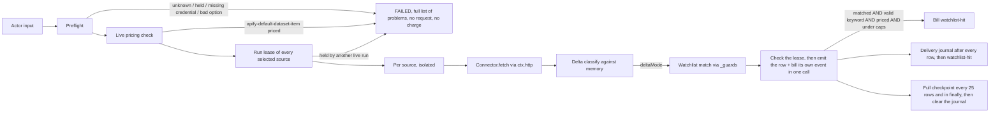

# Apify portfolio refactor strategy, 2026

Consolidation of the single-source Apify Actors in the `stefanoseggio/*` corpus into three flagship Master Engines.

| | |
|---|---|
| Status | Implemented and tested on branch `claude/busy-fermi-yhcyfl` (PR #2). **Not deployed.** Nothing in this document has been run on the Apify platform. |
| Date | 2026-10-21 |
| Code | [`master_engines/`](../master_engines/) (TypeScript, strict, Node 22) |
| Verification | 2,323 TypeScript tests in 53 files (Node 22.22.0 and 24.22.0) and 1,810 Python tests on each of 3.11, 3.12 and 3.13; strict typecheck clean; a platform parity harness (the real SDK and `apify-client` against a mock of the REST API, plus real SDK child processes); fault injection (2,700 scenarios); a static ReDoS audit (`npm run audit:redos`: 219 occurrences, 193 safe, 6 allowlisted); a differential fuzz of 144,000 inputs per implementation; 87 hand-made mutants over three rounds; live checks against public upstreams; a local run of a staged engine; an adversarial review (22 agents), a linear institutional re-audit (section 8.2), four independent reviews of the keyword guard and two of the lease and state code. Report: [`audits/2026-10-21_stress_test_audit.md`](audits/2026-10-21_stress_test_audit.md) |

Everything stated here as fact was checked against code, a live fetch, a test or command run for this document, or a cited primary source. Figures that came from one-off measurements or from an agent's report and have no committed artefact are marked **one-off** or **agent-reported**; claims that could not be checked are marked **UNVERIFIED**; premises from the engagement brief that turned out wrong are listed in section 1.2. Nothing was run on the Apify platform, so everything about platform behaviour is read from the SDK and client source or exercised against a mock of the REST API.

---

## 1. Executive summary

### 1.1 What exists

Three Actors, one shared runtime:

| Engine | Active sources | Held sources |
|---|---|---|
| `global-regtech-compliance-feed` | 6 | 3 |
| `latam-global-tender-intelligence` | 8 | 7 |
| `global-corporate-patent-intelligence` | 5 | 0 |
| **Total** | **19** | **10** |

The shared runtime (`lib/`) owns what must behave identically across sources: preflight, per-source options, delta memory, watchlist guarding, per-source billing events, failure isolation, credential scrubbing. A source is a small connector, ported from a legacy Actor's real parsing code where the corpus had it, or implemented from a live-verified endpoint where the legacy repo was README-only.

### 1.2 Premises in the brief that did not survive verification

| Brief said | Finding |
|---|---|
| "Store policy §2.2.4.2 requires 14 days' notice for price changes" | **Wrong section.** §2.2.4.2 is "Specific Prohibitions". The price-change rule is **§9.4** of the Store Publishing Terms (last updated 2026-09-15): a change that can raise a user's price, including a pricing-model change and a new paid event, takes effect only after 14 days, at most one per month. The payloads cite §9.4. |
| "`PUT /v2/acts/{actorId}`" | The current reference documents `PUT /v2/actors/{actorId}`. `GET` works on both paths; the `PUT` alias was not tested (needs an owner token). |
| "`apify-actor-start` start floor of $0.002-$0.01" | There is no floor. The default is **$0.00005**, Apify recommends keeping it, and the event is charged **once per GB of memory**. $0.002-$0.01 is 40-200x the default. It is allowed in practice (880 of 3,386 sampled public PPE Actors sit in that range) but is a commercial choice. |
| "Mandatory 14-day notice metadata in the payload" | No API field sets a notice period. `startedAt` is the effective date; `notifiedAboutFutureChangeAt` is stamped by the platform. The builder sets `startedAt = now + 14 days` and emits a separate `*.notice.json`. |
| "`Actor.charge()` strictly protected by `perEventPrices` validation" | The SDK has no such validation. An event missing from the pricing is treated as **free** and reported as charged (`chargedCount === count`). The protection is implemented in this codebase. |
| "$0.15 ghost billing per record" | Not corroborated by any legacy document. The legacy SEC actor billed `result` at $0.05 (`sec-enforcement-litigation-delta-feed/README.md:38`), and no legacy README defines a `watchlist-hit` event. The $0.15 figure is used as the `watchlist-hit` price and is labelled `operator-stated`. |
| "23 connectors" / "28 Actors" | The "28 Actors" is the count in the repository's own `README.md` (badge, intro and maintainer line, and an Actor directory listing exactly 28 `apify.com/stefano_seggio/...` slugs); 27 of them are among the 37 cloned repositories, the one not cloned is `page-metadata-extractor`. "23 connectors" is not reproducible: the registry holds **29 connectors (19 active, 10 held)**, absorbing 22 legacy repositories. Legacy repos not assigned to any engine: `uk-hse-enforcement-monitor`, `emerging-market-sovereign-debt-auction-monitor`, `kipris-patent-trademark-status-monitor`, `aozora-bunko-public-domain-text-feed`, `actor-18-b2b-lead-magnet`, `primer-actor` (the first five are in the README's 28, `primer-actor` is not). |
| "`_guards.ts` / `_guards.py`" | Only TypeScript was needed; no Python Actor runs these guards. |
| "`master_engines/`, `scripts/apify_remediation_suite/`, the strategy doc already exist" | None of them exists on the default branch of any of the 37 cloned repositories (searched by file name and by content). The clones are shallow and single-branch, so other branches and unpushed local work were not visible. Everything here was rebuilt from the corpus. |

### 1.3 Decisions

**Resolved** (each is enforced by code and by a named test):

1. **`ar_cordoba` is held.** Its own docs record the same network block that got `ar_pba` held (non-Argentine traffic fails at TCP level; the legacy workaround is a paid residential Argentine proxy, never independently verified). The connector is registered with `createHeldConnector`, so preflight refuses it with that reason; the ported parser stays in the repository as a dormant file that the engine does not import (tested). The `latam` engine therefore has 8 active and 7 held sources.
2. **Florida contact details are opt-in.** `includeContactDetails` defaults to `false`; names, emails and phones of natural persons are emitted only when the caller sets it.
3. **Price-change notice follows Store Publishing Terms §9.4.** The builder sets `startedAt = now + 14 days` and emits a separate `*.notice.json`; no payload claims a field that does not exist in the API.
4. **Pricing payloads and the event catalog carry per-source prices with their evidence.** 18 of the 25 priced events across the three catalogs are quoted from a legacy README (file and line recorded), 4 are `provisional` (derived from the nearest documented sibling) and 3 are `operator-stated` (`watchlist-hit`). The start event is $0.005 per GB, inside the requested $0.002-$0.01 band; `--strict` refuses to emit while any non-legacy price remains.

**Still open**, details in section 10:

5. **Start-event price.** $0.005 x GB per run is charged even for an empty run (regtech: 2 GB = $0.01), 100x Apify's default.
6. **Provisional and operator-stated prices.** Run the generator with `--strict` once they are confirmed.
7. **robots.txt exceptions.** DIFC `/api/`, the ClinicalTrials.gov API and six of seven Diario Oficial CL sections are requested although the host's `robots.txt` disallows them. IDB is held for exactly that reason, so the policy is applied inconsistently.
8. **Whether to retire the legacy Actors** and when (section 11).

---

## 2. Architecture



### 2.1 Contract

`Connector<Options>` (`lib/types.ts`): `id`, `engine`, `legacyActor`, `status` (`active` | `held`), strict zod `optionsSchema`, optional `requiredOptions`, optional `maxSeenIds`, optional `billing`, and `fetch(ctx, options, run) -> SourceRecord[]`.

`SourceRecord` = `{ recordId, fingerprint, payload, watchText?, billingEvent? }`. `recordId` is stable across runs; `fingerprint` changes iff a consumer-visible field changed. Connectors reach the network only through `ctx.http`, and the clock only through `ctx.now()`.

The router stamps every row with `engine`, `source`, `record_id`, `delta_status`, `is_new`, `is_watchlist_match`, `matched_watchlist_keyword`, `scraped_at`. A connector cannot set these (tested).

### 2.2 Delta memory

| Mode | Emits | Legacy equivalent |
|---|---|---|
| `onlyNew` | first sighting | none |
| `onlyChanged` (default) | first sighting + changed | the legacy `onlyNew: true` |
| `all` | everything; unchanged rows tagged `delta_status: "unchanged"` | the legacy `onlyNew: false` |

Memory is one key-value record per source, `state.<namespace>.<source>`, in the named store `<engine>-delta-state`. It keeps `seenIds` (newest first) and `fingerprints`.

- **Sizing.** Memory is never smaller than `maxItemsPerSource`, never shrinks below what it already holds, and is capped at 50,000 ids (a state record at that ceiling is about 9.5 MB through the SDK's pretty-printed JSON, one reviewer's measurement with 53-character ids and 64-character fingerprints, which is above the 9,437,184-byte payload limit that `apify-client` applies to API requests; whether the platform refuses a key-value write of that size is **not verified**, and the UK registry connector's 40,000 ids are about 7.6 MB). A connector that declares `maxSeenIds` (UK registry 40,000; ClinicalTrials, ACRA, UAE 20,000) is authoritative.
- **Namespaces.** `stateNamespace` input, else one per Task (`task-<id>`), else `default`. Two Tasks with different watchlists no longer consume each other's "new" records.
- **A record that exists but cannot be read is not an empty record.** Treating it as empty would restart the source from scratch and deliver **and bill** up to `maxItemsPerSource` rows again, on every run if the bad record keeps being rewritten. A present-but-invalid memory or journal record (truncated JSON, wrong shape, a non-string fingerprint) fails **that source only**, with a message that names the key and the store and says to delete the record to start the source from scratch. An absent record is empty.
- **One live run per namespace and source (run lease).** Delta memory is read when a run starts and written as it progresses, so two overlapping runs of the same `stateNamespace` (a schedule firing while the previous run is still going, a double Start, an API retry) each classify the same records as new and both deliver and bill them: with 100 records at 30 ms per row, two overlapping runs delivered and billed 198 rows. A run now takes the lease of every selected source (`lease.<namespace>.<source>`, same store) after preflight and the live pricing check and before it reads any state or makes any request; it checks the lease around every fetch and before every row it pushes (the check reads the store at most every 60 s, otherwise it only consults what the last read or the timer found), reads it again before every write of the delta memory, renews it at most every 60 s (a timer renews it too, so one long `connector.fetch` cannot let it go stale) and releases it in a `finally`. A lease held by another **live** run refuses the run before it requests a source or delivers and bills a row (`LeaseConflictError`, naming the holder); the platform's own `apify-actor-start` event is charged when the Actor starts, before any of this code runs, so a refused run still pays it. The lease of a killed run does not block anyone: on the platform the holder's run status decides (`READY`, `RUNNING`, `TIMING-OUT`, `ABORTING` are live, the four terminal statuses are dead, anything else, **including a run that cannot be found**, is unknown), and a heartbeat (stale after 15 minutes) decides whenever the status is unknown or the Actor runs elsewhere. A heartbeat stamped more than 5 minutes in the future counts as stale (a holder with a fast clock must not block everyone), and a clock that steps backwards makes the run renew at once. The lease is written only after the record was read twice with the same answer (the status call between the reads can be slow), then the run waits 1.5 s, reads it back, and the run whose id is not in it backs off. Different namespaces overlap freely. **A run that finds its lease taken over, or gone (the only thing that removes a lease is the release of the run that took it), stops before its next push or its next memory write** and leaves the delta memory and the journal of that source to the new holder; before a memory write the lease is always read, before a push it is read when a renewal is due (every 60 s, and at once after a suspension). **Best effort, not a lock:** the key-value store has no compare-and-set. A run suspended for longer than the stale limit can be overtaken; the rows it pushed after the takeover and before it noticed (the row in flight: after a suspension the renewal is overdue, so the first check reads the store) are delivered twice, and its in-flight journal write replaces the new holder's journal, so if that holder is then hard-killed before its next checkpoint up to one checkpoint window of its rows is repeated. Two starts whose second read and write are further apart than the settle delay can both run. Two simultaneous multi-source starts can both back off and neither runs (fail safe).
- **Delivery semantics.** At-least-once. Memory is checkpointed in full every 25 emitted rows and in a `finally`, and a small **delivery journal** (`journal.<namespace>.<source>`, one `{recordId, fingerprint}` per row of the current window: roughly 1 to 3 KB for a full 25-row window, not measured) is rewritten after every row that was pushed and billed. A failure before a push, or in a journal or checkpoint write, repeats nothing; a hard kill (timeout, OOM, migration), which cannot run a `finally`, repeats at most the one row in flight; a charge call that fails AFTER its push leaves that row delivered and unbilled, and the next run delivers it again (section 2.4). Before the journal a hard kill repeated, and re-billed, up to 25 rows (section 8.2, RA-7). Exact guarantees in section 2.4.

### 2.3 Failure semantics

- A source whose `connector.fetch` throws is isolated: its error goes on the run summary, other sources still run, its memory is untouched. A failure to push a row, to write the journal or a delta-memory checkpoint inside the loop, or a lost lease is **not** isolated: it ends the whole run (the journal covers the rows already delivered, and a lost lease leaves the memory to its new holder). The one exception is the last memory write of a source, in the `finally`: if it fails for a storage reason it is logged and added to the source's `warnings`, and the run can still end SUCCEEDED, because the journal still holds the rows; a lost lease found there fails the run.
- Non-fatal problems a connector logs through `ctx.log.warning` (one sub-source down, a throttled stop) are captured on `RunSummary.sources[].warnings`.
- A preflight problem fails the whole run before any request or row charge, listing every problem at once. So does a lease held by another live run (above).
- A record the connector returns without a usable identity (an empty id, a non-string fingerprint) is skipped and counted: it could not be remembered, and writing it would make the persisted memory unreadable. A row that cannot be serialised (a `BigInt`, a cycle) is skipped for the same reason, once per source: every push of it would throw, on every run, and block the sources behind it.
- A present-but-invalid memory or journal record fails that source (section 2.2); its siblings still run.
- **If every selected source fails and nothing was delivered, the run ends `FAILED`** (`allSourcesFailed`, `engine_main.ts`), with one line per source in the status message and the `RUN_SUMMARY` still written. A run in which at least one source answered, even with zero records, stays `SUCCEEDED`: an unchanged re-run is a success, and a source whose fetch fails does not fail its siblings. Proven against the real SDK (`apify_sdk.integration`, "run status through runEngineMain").

### 2.4 Billing and state atomicity

What the installed SDK (`apify` 3.7.2) actually does, read from `charging.js` and confirmed with the real SDK in `test/apify_sdk.integration.test.ts`:

| Property | Behaviour | Consequence here |
|---|---|---|
| Row and charge | `pushData(row, event)` pushes the row first, then calls the platform's charge API. **Ordered, not transactional.** | A crash between the two leaves a row delivered and unbilled (the next run delivers it again and bills it once). A row is never billed without having been pushed. The router never calls `Actor.charge` for a row it pushed (that would double-bill). |
| Free events | An event with no price is free but is reported as charged. | `emit` pushes plain (no event) when the event has no positive price, so there is no per-row SDK warning; the run summary lists it under `pricing.unpricedEvents`. `hasPositivePrice` accepts only an own, finite, positive price. |
| Budget limit | The SDK trims a batch to the remaining budget and, on purpose, pushes and bills **one** extra row at the limit. | That row counts as delivered; `eventChargeLimitReached` stops the router; no `watchlist-hit` is billed after it. |
| Delta memory | Full checkpoint every 25 emitted rows and in a `finally`; **delivery journal** rewritten after every pushed-and-billed row and cleared after each checkpoint; an interrupted run's journal is folded into the memory before the next run classifies anything. | A failure before a push, or in a journal or checkpoint write, repeats nothing. A hard kill (exit 137, no `finally`) repeats **at most the single row in flight**: with the real SDK, kill after a push repeats and re-bills 1 row of 60, kill after the journal write repeats none, and kills at 8 different positions never repeated more than 1 row. Without the journal the same kill repeated and re-billed 15 of 60 rows (75 charges for 60 rows) and could repeat 25. The journal fails closed: if it cannot be read or written the run stops before pushing more billable rows. |
| Isolation | One record per source and namespace. | Separate Tasks cannot consume each other's "new" rows, and a second writer cannot overwrite another source's progress. |
| Overlapping runs | **Run lease** per (namespace, source), taken before any state is read, checked before every row is pushed and again before every memory write (section 2.2). Exercised with two real SDK processes on local storage, where the platform status is not read, so the heartbeat decides and the stale limit is shortened to 1.5 s in the test: the second run refuses before it requests a source or delivers a row, a holder that stopped heartbeating does not block its successor, and different namespaces run side by side. | Without the lease two overlapping runs delivered and billed 198 rows for 100 records. Best effort: no compare-and-set in the store. The status leg is exercised through the real apify-client against a mock of the REST API (`test/platform_parity.integration.test.ts`), the heartbeat timer in unit tests; neither has run on the platform. |
| Corrupt records | A present-but-invalid memory or journal record fails that source (section 2.2). On the platform the records are read as bytes and parsed here, because the client would otherwise retry a truncated body for 2 to 4 minutes per read before throwing. An empty body is unreadable, a JSON `null` body is absent. | The source is not restarted from scratch, so nothing is delivered and billed again. |
| Hit at the budget limit | `WatchlistHitBiller` asks the billing port how many hits the remaining budget affords and does not try when it is none. | The SDK deliberately overcharges by one event at the limit; without the check a hit ($0.15) could take the run up to one hit price past the customer's maximum. The row stays delivered, its hit unbilled, and the run stops. |
| Hit ordering | The `watchlist-hit` charge is made **after** the journal write. | A kill between the two leaks one unbilled hit (at most $0.15) instead of re-billing a whole row. |
| Ghost billing | The router charges a hit only for a row whose text matched a keyword of the sanitised list: `findKeywordMatch` cannot match on an empty list, and `WatchlistHitBiller.chargeHit()` (which takes no match argument: proving the match is the router's job) refuses an unpriced event, a run that is not pay-per-event, the caps and a hit the budget cannot afford. | Empty, blank and one-letter watchlists produce zero hits and zero `watchlist-hit` charges (tested end to end against the SDK). |

**Residual, cannot be removed without a transaction across the dataset, the charge API and the key-value store (the platform offers none):** one row in flight at the instant of a hard kill can be delivered and billed twice, and a row whose charge call fails after its push is delivered unbilled and delivered again. The alternative, writing the journal before the push, trades that for a possible lost row (never delivered, never billed); the implemented choice keeps the compliance feeds lossless. Dollar exposure per hard kill is tabulated in `docs/audits/2026-10-21_pricing_exposure.md` as an upper bound: the dearest row event of the engine, because the hit is charged after the journal write.

Per-row cost of the journal: one small key-value write per delivered row (one entry per row of the window, at most 25: roughly 1 to 3 KB, not measured), independent of the size of the delta memory. Its latency on the platform has not been measured.

Local-mode quirk worth knowing when reading test output: outside the platform the SDK computes how many rows the budget still allows with a price of $1 per event, while the amount it accumulates uses the configured price. The budget scenario therefore prices its event at exactly $1, where both agree.

---

## 3. Master engine inventory

"Basis": **ported** = real parsing code from the legacy actor; **live** = implemented from an endpoint verified live in this work because the legacy repo is README-only; **held** = registered but refused.

### 3.1 `global-regtech-compliance-feed`

| Source | Legacy actor | Basis | Live-verified 2026-10-21 | Limits worth knowing |
|---|---|---|---|---|
| `ofac` | actor-19-maritime-sanctions-monitor | ported | yes, 1,559 vessels when checked (1,568 on 2026-10-21) | Vessels only (`sdnType=Vessel`), as the legacy actor. Needs >= 1 GB RAM (about 660 MB measured). No DELISTED events. |
| `world_bank_debarred` | actor-20-mdb-procurement-monitor | ported | yes | **Table 2 ("Other Sanctions") only**, 4 rows today. The main debarment register is served by an undocumented gateway the doctrine excludes. A miss here does **not** mean "not debarred". |
| `uk_modern_slavery` | uk-modern-slavery-statement-registry-monitor | ported | yes | Own RFC 4180 CSV parser, byte-identical to Python's `csv` on four full live years. Record id now ends with the company number (the legacy id collided on live rows). |
| `sec_enforcement` | sec-enforcement-litigation-delta-feed | live | yes, two RSS feeds, 25 + 25 items | Legacy repo is README-only. Emits only what the feeds carry: no sanctions, statutes, docket or EDGAR linking. A rolling window, not a backfill. |
| `ai_crawler_signals` | ai-crawler-content-signal-permission-monitor | live | yes, 5 real `robots.txt` files | README-only legacy. SSRF-guarded hostnames, https-only, per-hop redirect validation, 8 MiB body cap. Requires `domains`. |
| `fda_ema_recalls` | actor-22-drug-safety-recalls-monitor | ported | yes | Fixes a legacy bug: openFDA answers an empty search with HTTP 404, which the legacy fetcher treated as fatal. |
| `paris_mou_thetis` | actor-19 | held | n/a | Login wall (Keycloak OpenID Connect on every request, including `robots.txt`). |
| `tokyo_mou_apcis` | actor-19 | held | n/a | CAPTCHA input on the public search form. |
| `imo_gisis` | actor-19 | held | n/a | `robots.txt` disallows `/Members/`, `/Secretariat/`, `/WebServices/`; Public module is session-gated. |

### 3.2 `latam-global-tender-intelligence`

| Source | Legacy actor | Basis | Live-verified 2026-10-21 | Limits worth knowing |
|---|---|---|---|---|
| `ar_santafe` | santafe-compras-monitor | ported | yes | Detail page fetched by default; a record whose detail fails is left out and retried. |
| `ar_tucuman` | tucuman-compras-monitor | ported | yes | ISO-8859-1 page; field data is entity-encoded so it works with the text client, and decodes properly through `getRaw`. |
| `ar_entrerios` | entrerios-compras-monitor | ported | yes (with a scratch raw client) | Windows-1252 bytes labelled UTF-8. **Requires `getRaw`** (now in `lib/http.ts`); fails closed without it. Not re-run live through the final `getRaw`. |
| `cl_diario_oficial` | diario-oficial-cl-monitor | ported | access only; every section was on a quiet day | Row parser verified only against HTML the legacy authors describe as reconstructed from a real fetch. |
| `eu_ted` | eu-ted-procurement-delta-monitor | ported | yes | `PAGE_NUMBER` mode only (max 15,000 per query); no BACKFILL. |
| `us_florida` | florida-tenders-monitor | ported | yes | Honest identity works; the legacy Chrome-TLS impersonation was deliberately **not** ported. Contact details opt-in. |
| `world_bank_notices` | actor-20-mdb-procurement-monitor | ported | yes | No contact details or notice text (privacy). |
| `it_lombardia_grants` | regione-lombardia-grants-registry-monitor | live | yes (Socrata `bukx-h2uy`) | README-only legacy. The README's sample dataset id returns 404; the real id is used. Honours `Crawl-delay: 1`. |
| `au_grantconnect` | australia-grantconnect-monitor | **held** | live-verified reason | 403 to an honest User-Agent. The legacy actor passed only with a Chrome UA and TLS fingerprint (impersonation). |
| `adb_procurement` | actor-20 | **held** | n/a | Cloudflare challenge on every path, including its RSS. |
| `idb_procurement` | actor-20 | **held** | n/a | Power BI embed only; the CKAN API is `robots.txt`-disallowed. |
| `ar_cordoba` | cordoba-compras-monitor | **held** | n/a (portal unreachable from the sandbox) | Documented: blocks non-residential, non-Argentine traffic at TCP level (legacy `AGENTS.md` lines 86-88); the legacy workaround is a paid residential Argentine proxy, never verified from a real container. The shared client has no proxy support and the doctrine does not route around a network block. The ported parser is kept as a dormant file, not imported. |
| `ar_salta` | salta-compras-monitor | **held** | n/a | Operator-designated. The legacy repo documents no technical constraint. |
| `ar_mendoza` | mendoza-compras-monitor | **held** | n/a | Operator-designated. The legacy repo documents no technical constraint. |
| `ar_pba` | pba-tenders-monitor | **held** | n/a | Documented: blocks non-residential, non-Argentine traffic outright; 0 successes in two cloud runs. |

### 3.3 `global-corporate-patent-intelligence`

| Source | Legacy actor | Basis | Live-verified 2026-10-21 | Limits worth knowing |
|---|---|---|---|---|
| `uspto_ptab` | actor-21-patent-ip-enforcement-monitor | ported | **no** (BYOK, no key held; route exists and is key-gated) | Field names rest on the legacy record. Honours USPTO's 5 s retry floor. |
| `epo_opposition` | actor-21 | ported | **no** (BYOK) | **Legacy parser defect fixed**: it selected `legal-event, event`, which matches nothing in the documented OPS structure. New parser reads `ops:legal`. Rests on the public OPS guide, not a live reply. Needs a watchlist of at most 100 EP numbers. |
| `clinicaltrials_orange_book` | actor-24-clinical-trials-delta-engine | live | yes | README-only legacy. Orange Book via openFDA (the FDA flat-file ZIP is reachable but not consumed). The Apify platform slug is `clinicaltrials-orange-book-delta`; the corpus uses both names. Honours `Crawl-delay: 1`. |
| `sg_acra` | singapore-acra-registry-monitor | live | yes | README-only legacy. Data.gov.sg datastore; shard-to-dataset map hard-coded from live metadata. Newest registrations first, so changes to old entities are seen only if targeted. |
| `ae_registers` | uae-corporate-registry-monitor | ported | **no live rows** | ADGM answers with a server-side exception and DIFC with HTTP 500, the legacy outage signature. Active but currently returns nothing. Dubai Pulse not ported (wire protocol never verified). |

---

## 4. Held sources and governance

### 4.1 What "held" means

A held connector is registered, so selecting it fails preflight with its documented reason instead of "unknown source". It carries no billing, and its `fetch()` throws before any network call. Tests prove, for `ar_cordoba`, `ar_salta`, `ar_mendoza` and `ar_pba`, that preflight rejects them **even when options (including a proxy URL) are supplied**, and that a run mixing an active and a held source is rejected whole, before any request.

### 4.2 The held Argentine sources

| Held source | Operational constraint |
|---|---|
| `ar_cordoba` | Documented network block on non-residential, non-Argentine traffic (same as `ar_pba`); only a paid residential Argentine proxy was ever claimed to work. Held by decision 1 (section 1.3). |
| `ar_pba` | Documented network block on non-residential, non-Argentine traffic. Only a paid residential Argentine proxy works. |
| `ar_salta` | None documented. Held by portfolio decision. |
| `ar_mendoza` | None documented. Held by portfolio decision; its sibling's docs call it "the most fragile of the five". |

They are never runnable. Reactivating one is a code change that removes `createHeldConnector` (for `ar_cordoba`, also re-importing the dormant `arCordoba.ts`, which a test forbids today), which review will see.

### 4.3 Compliance doctrine (applied to every connector)

No CAPTCHA solving, no fingerprint or User-Agent spoofing, no WAF or login bypass, credentials are bring-your-own and never logged, and only open public sources. Enforced by:

- a static scan test over five tender connectors (`tenders-b.doctrine`: EU TED, Florida, GrantConnect, World Bank notices, Lombardia grants; the Argentine and Chilean connectors are not in it);
- `sec_enforcement` refusing a browser User-Agent and requiring a contact;
- `au_grantconnect`, `paris_mou_thetis`, `tokyo_mou_apcis`, `imo_gisis`, `adb_procurement`, `idb_procurement` registered as held with reasons.

### 4.4 Change control

1. A connector is registered explicitly in `<engine>/index.ts`. Never glob.
2. An active connector with no entry in `pricing/event_catalog.ts` makes the engine fail to load (`applyCatalogBilling`).
3. Generated artifacts (`.actor/*`, `pricing/payloads/*`) are committed and a test fails if they drift from their generators.
4. Any keyword or name-list option is read through `sanitizeKeywordList()`.
5. Credentials are top-level `isSecret` inputs, validated with a static message, and scrubbed from every log, warning and error.
6. A source needing a gate bypass is registered held with a precise reason, not worked around.

---

## 5. Security and vulnerability remediation

### 5.1 Root cause of the "ghost billing" (zero-match inversion)

The legacy SEC actor documents `watchlistNames` as "case-insensitive substrings matched against parsed respondents; a hit sets `is_watchlist_match: true`". A substring test against an **empty needle is vacuously true** in every language: `"anything".includes("") === true`. So any of these inputs turned a no-watchlist run into an everything-matches run:

| Input | Why it matched everything |
|---|---|
| `[""]` | empty needle |
| `[" "]` | blank after trim |
| `""` where an array is expected | split/iteration yields an empty element |
| `"a"` where an array is expected | iterated per character |
| `["a"]` | one letter matches most names |

Every record then carried `is_watchlist_match: true` and was billed as a `watchlist-hit`. **The legacy SEC repository is README-only, so this mechanism is reconstructed from the documented behaviour, not read from the closed source.**

### 5.2 Remediation, in layers (`lib/_guards.ts`, `lib/charging.ts`, `lib/router_core.ts`)

Three layers, so that a defect in one is not the whole story; they share helpers, though, and RA-22, RA-23 and RA-26 were each one defect that passed more than one layer, which is why the guard has been reviewed three times:

1. **`sanitizeKeywordList(input)`** turns any shape into a clean list. A bare string is split on newline, comma, semicolon, never per character. A non-array, non-string value yields an empty list and `malformedContainer: true`. It never throws.
2. **`findKeywordMatch(haystack, list)`** returns `null` immediately on an empty list, and re-checks each needle (a string of at most 400 units with at least 2 code points and 2 letters or digits, no lone surrogate and no NUL; at most 500 needles are read, usable ones found once per list), so even a hand-built list cannot match on `""`, on `".."` or on half of an astral character. It never throws either, whatever list it is given.
3. **The router and `WatchlistHitBiller`**: the router charges a hit only for a row whose text matched a keyword (step 2 on a list from step 1 that holds at least one keyword); `chargeHit()` itself, which takes no match argument, refuses an unpriced event, a run that is not pay-per-event, the per-run caps and a hit the remaining budget cannot afford.

### 5.3 Validation criteria per keyword

Applied in this order, per keyword (`lib/_guards.ts`; the reference model in `test/stress.guards_fuzz.test.ts` is written from this table, not from the code):

| # | Rule |
|---|---|
| 1 | must be a string (numbers, objects, `null` are rejected, never coerced) |
| 2 | at most **4,096 UTF-16 units**, checked before any Unicode work (`String.prototype.normalize` is quadratic on adversarial combining marks: 80,000 units take 2.6 s; the 200 code point cap in rule 7 only applies after normalisation) |
| 3 | well-formed Unicode: a lone surrogate is rejected as `invalid_unicode` (it would match half of an astral character, so a hit could be billed for text that does not contain the keyword) |
| 4 | cleaned to a **fixed point** of: Unicode NFKC, line breaks and tabs to a space, removal of every `Default_Ignorable_Code_Point` and `Bidi_Control` character and the C0/C1 controls (4,239 code points in 19 ranges: zero-width characters, soft hyphen, bidi marks, Arabic letter mark, variation selectors, Hangul fillers, Mongolian selectors, tag characters), whitespace runs collapsed to one space, ends trimmed. One pass is not enough: removal can expose a composable sequence (`e`, ZWSP, combining acute), so the pass repeats until the text stops changing; a text that has not settled after 8 passes counts as empty (never observed: one reviewer's search of 14.9 million strings, **agent-reported**, script not committed, found at most 3 passes, and the argument is that removal and NFKC need at most 3 by construction). Before every pass, a keyword with a run of **more than 16 consecutive combining marks** counts as empty (NFKC reorders marks by combining class, which is quadratic in the length of a run: a 4,090-mark run costs 16 ms, a list of 5,000 of them 82 s; real text never has such a run). A **keyword** that NFKC makes **more than four times its length plus 16 UTF-16 units longer** also counts as empty (U+FDFA becomes 18 characters; a list built from it cost 0.5 s inside every other cap); a haystack is cleaned in pieces instead (below) |
| 5 | length >= **2 code points** after cleaning (one astral-plane letter counts as one; a letter plus an invisible character is one), **and** at least **2 visible code points before NFKC** (a code point that is neither removed nor whitespace). One glyph that NFKC expands (the circled number twenty becomes `20`, the numero sign `No`, a ligature `fi`) is one character typed, not a two-character keyword that would match every year |
| 6 | at least **two letters or digits**: none is `no_letter_or_digit` (`--`, `..`, `()`), exactly one is `single_letter_or_digit` (`c.`, `a |`, `-0`, `(a)`, `1)`: one alphanumeric character padded with punctuation is the one-letter needle of the original bug in disguise, and `c.` matched `Pfizer Inc.`). `BP`, `GE` and `3M` pass Last of the checks before the length bound: at least **2 glyphs** (letters, numbers or symbols; not punctuation, not marks) in the raw text, so one expanding glyph padded with punctuation (the circled twenty plus a full stop, the numero sign plus a full stop) is `too_short`, like the bare glyph |
| 7 | length <= 200 code points |
| 8 | de-duplicated case-insensitively, first spelling wins |
| 9 | at most 500 accepted; the rest are rejected as `over_limit` |
| 10 | at most **5,000 entries inspected**, and the string entries of at most 4,096 units that are inspected add up to at most **200,000 UTF-16 units** (a longer entry is rejected at once and costs nothing); the remainder is not read and is reported as ONE `over_limit` entry. The caps on one entry, on the list and on a haystack do not bound their product, so without the total a list of 5,000 entries of 4,096 units cost about 10 s. A bare string is first cut to 200,000 units, then split on LF, CR, comma and semicolon (ASCII only; their fullwidth look-alikes are not separators); if it was cut, its last piece (which the cut may have truncated: `Pfizer Inc` became `Pfizer In`) is dropped and reported as one more `over_limit` entry |

Matching (`findKeywordMatch`) cleans the haystack with the same function, lower-cases it, and tests a substring. A **keyword** with a run of more than 16 marks (category M, and the halfwidth sound marks U+FF9E and U+FF9F, which NFKC turns into marks of class 8 and then reorders) is rejected; a **haystack** with one is searched with the run cut to its first 16 marks, so one hostile field of a record cannot hide a watchlisted name that sits in another field (before this, anyone who controlled any field of the searched text could make a whole record unsearchable with 17 combining marks). The same holds for characters that NFKC expands more than fourfold (U+FDFA, U+FDFB, U+3316, U+33AF and fifteen more): a haystack that NFKC would grow past 4x plus 16 units is not emptied; those characters are cut out, the pieces between them are cleaned on their own and joined with a NUL that no keyword contains, so nothing matches across a cut-out character (before this, a field of ten U+FDFA hid a name in the next field). A haystack longer than **8,192 units** is searched only up to the last Unicode `White_Space` character inside that window (a window without whitespace is not searched): nothing composes across whitespace, so the searched text is exactly a prefix of what the whole text cleans to. Cutting mid-word could drop a combining accent and create a hit the full text would not give (`z`x8188 + `cafe` + U+0301 matched `cafe`, though the text is `café`). The cut of a mark run is not exact in the same way: a base letter followed by 17 or more marks keeps 16 of them, so `cafe` + 16 marks + U+0301 reads as `cafe` where the full text has `café` (nothing is gained by an attacker, who could write `cafe`). It cannot match on an empty list, and `sanitizeKeywordList`, `findKeywordMatch`, `matchesAnyKeyword` and `describeSanitization` never throw, even for a revoked Proxy or a malformed list argument. A rejected value is described in a bounded, log-safe `preview`: a string is cut at 57 units, with every control, line and paragraph separator, invisible and lone surrogate character shown as U+FFFD; anything else is a constant tag (`[null]`, `[array]`, `[object]`, `[number]`, `[boolean]`, `[undefined]`, `[bigint]`, `[symbol]`, `[function]`) and is never serialised (serialising a deeply nested entry cost 7 ms each, 9 s for a 9 MB JSON input).

### 5.4 The `clinicaltrials` keyword guard

The corpus names the actor both `actor-24-clinical-trials-delta-engine` (repo) and `clinicaltrials-orange-book-delta` (Apify platform slug). Its README documents **no** keyword, sponsor or watch-list input, only free-text `condition` and `orangeBookQuery`, so how the bug manifested there could not be confirmed. The connector therefore guards every list it accepts: the new `sponsors` and `keywords` lists and the single-value `condition` and `orangeBookQuery`. Proven by test: `['', ' ', 'a']` as the keyword list yields **no filter** (so it neither narrows, widens nor bills), and `['  Pfizer  ']` is normalised to `Pfizer`.

### 5.5 Other hardening (sections 8.1 and 8.2)

- Credentials: validated as printable ASCII with a **static** error message (a token pasted with a line break is refused without being echoed); scrubbed centrally (plain, URL-encoded and base64 forms) from logs, warnings and errors, for the string options whose key names a credential (`key`, `token`, `secret`, `passw`, `credential`, `auth` or `pem`) and whose value is at least 6 characters; redirect never forwards credential headers across origins or from https to http.
- SSRF: `ai_crawler_signals` accepts bare public hostnames only, validates every redirect hop, caps bodies at 8 MiB. **Residual, cannot be closed in-process:** DNS rebinding. Deploy behind an egress policy that blocks private ranges.
- Memory: error bodies of non-2xx responses are read through a 1 KiB preview and cancelled (a hostile host could previously exhaust RAM).
- Regex safety: linear scans replace exponential and quadratic patterns; robots rule matching uses an iterative wildcard matcher with no regex. Analysed package-wide by a static gate (section 8.2) whose "safe" verdicts are automaton proofs or, where the automaton times out, a time-budgeted fuzzer's "no attack found" (the default output does not break them down; `scripts/redos_second_opinion.mjs` does).
- Trust anchors: no engine image adds a CA bundle or sets `NODE_EXTRA_CA_CERTS` (the Cordoba chain was removed with the hold; a test fails if one reappears).
- Input bounds: hostile text is capped to field size before any quadratic pattern runs; a per-request `maxBytes` aborts an oversized body (set by the patents connectors and `ai_crawler_signals`, see section 9 for the rest).

---

## 6. Monetization and pay-per-event

### 6.1 Verified platform facts

Cited in [`master_engines/docs-research/apify-ppe-policy-verification.md`](../master_engines/docs-research/apify-ppe-policy-verification.md), each with URL and verbatim quote.

- **Unregistered events are free and look charged.** `calculateMaxEventChargeCountWithinLimit` returns `Infinity`; `charge()` makes no API call and returns `chargedCount === count`. A typo such as `watchlist_hit` silently bills nothing.
- **Double billing is real.** With `apify-default-dataset-item` and a custom event both priced, `pushData(item, 'watchlist-hit')` bills both per row (confirmed in source and by experiment). The pricing therefore never prices it, and the router **refuses to run** if the live pricing does.
- **`apify-actor-start`** covers the first 5 seconds of compute, default $0.00005, charged once up to 1 GB then once per extra GB. The price may be raised or the event deleted.
- **Notice rule** (§9.4): 14 days, one price-increasing change per month, a pending change cannot be cancelled or edited, no waiting period when the Actor has no paying users.
- **`charge()` can overcharge by one** at the budget limit, deliberately, so the platform detects and terminates the Actor. The router therefore never spends that extra event on a `watchlist-hit`.
- **`pushData(row, event)` is ordered, not transactional** (push, then charge). See section 2.4.

### 6.2 Why per-source events

The legacy Actors are priced very differently. One blended `result` price would over-bill OFAC about 100x or under-bill SEC. Each legacy price is kept as its own event, in one catalog (`pricing/event_catalog.ts`) that feeds both the runtime billing and the PUT payloads.

Basis of each price: **legacy** = quoted from a legacy README (file and line in the catalog); **provisional** = derived from the nearest documented sibling; **operator-stated** = from the brief, uncorroborated.

### 6.3 Event catalog

**`global-regtech-compliance-feed`** (start $0.005, 2 GB, so $0.01 per run)

| Event | Price | Source(s) | Basis |
|---|---|---|---|
| `vessel-record` (primary) | $0.0005 | ofac | legacy |
| `debarment-record` | $0.003 | world_bank_debarred | legacy |
| `statement-new` / `statement-updated` | $0.02 / $0.01 | uk_modern_slavery | legacy |
| `enforcement-release` / `enforcement-update` | $0.05 / $0.02 | sec_enforcement | legacy |
| `crawler-signal` / `crawler-signal-change` | $0.015 / $0.006 | ai_crawler_signals | provisional / legacy |
| `recall-record` | $0.001 | fda_ema_recalls | legacy |
| `watchlist-hit` | $0.15 | any | operator-stated |

**`latam-global-tender-intelligence`** (start $0.005, 1 GB)

| Event | Price | Source(s) | Basis |
|---|---|---|---|
| `tender-detail` (primary) | $0.003 | ar_santafe, ar_tucuman, ar_entrerios, cl_diario_oficial, us_florida | legacy |
| `tender-summary` | $0.001 | ar_santafe, us_florida listing-only rows (record override) | legacy |
| `notice-record` | $0.001 | world_bank_notices | legacy |
| `notice-new` / `notice-updated` | $0.02 / $0.01 | eu_ted | legacy |
| `grant-new` / `grant-updated` | $0.02 / $0.008 | it_lombardia_grants | legacy / provisional |
| `watchlist-hit` | $0.15 | any | operator-stated |

**`global-corporate-patent-intelligence`** (start $0.005, 1 GB)

| Event | Price | Source(s) | Basis |
|---|---|---|---|
| `patent-proceeding` (primary) | $0.002 | uspto_ptab, epo_opposition | legacy |
| `clinical-record` | $0.002 | clinicaltrials_orange_book | legacy |
| `uae-entity-new` / `uae-entity-updated` | $0.02 / $0.01 | ae_registers | legacy / provisional |
| `sg-entity-new` / `sg-entity-updated` | $0.03 / $0.01 | sg_acra | legacy / provisional |
| `watchlist-hit` | $0.15 | any | operator-stated |

Where a legacy actor distinguished a status change from a content change and the router cannot, the **lower** price is used to avoid over-billing. An unchanged record re-sent by `deltaMode: all` is billed at the lower "updated" event, not at "new".

### 6.4 The guarded `watchlist-hit` charge

`lib/charge_watchlist_hit.ts` is a drop-in for an Actor's own `main.ts`:

```ts
const chargeHit = createWatchlistHitCharger(Actor);
if (matchedKeyword !== null) {              // from findKeywordMatch() over a sanitizeKeywordList() list
    const outcome = await chargeHit();      // 'charged' | 'skipped_not_ppe' | 'skipped_unpriced' | 'skipped_cap' | 'limit_reached'
    if (outcome === 'limit_reached') break;
}
```

It reaches `Actor.charge({ eventName: 'watchlist-hit', count: 1 })` only when the run is pay-per-event, `getPricingInfo().perEventPrices` has an **own, finite, positive** `watchlist-hit`, the per-run hit cap (default 200) and USD cap (default $50, tracked in integer micro-USD) allow it, and a partial or zero-fulfilled charge counts as `limit_reached`. The router calls it only after proving a keyword match.

### 6.5 PUT payloads

Generated by `scripts/generate_pricing_payloads.ts` into `master_engines/pricing/payloads/<engine>.put.json` (the exact body) and `<engine>.notice.json` (the 14-day metadata). Shape, with field names verified against the API reference:

```jsonc
{ "pricingInfos": [ {
  "pricingModel": "PAY_PER_EVENT",
  "pricingPerEvent": { "actorChargeEvents": {
      "apify-actor-start": { "eventTitle": "...", "eventDescription": "...", "eventPriceUsd": 0.005, "isOneTimeEvent": true },
      "vessel-record":     { "eventTitle": "...", "eventDescription": "...", "eventPriceUsd": 0.0005, "isPrimaryEvent": true }
      /* ... one entry per catalog event ... */ } },
  "minimalMaxTotalChargeUsd": 0.16,
  "apifyMarginPercentage": 0.2,
  "createdAt": "2026-10-21T00:00:00.000Z",
  "startedAt": "2026-11-04T00:00:00.000Z",
  "reasonForChange": "..." } ] }
```

The builder **refuses** to emit: a start price outside $0.002-$0.01, any priced `apify-default-dataset-item`, an event a source bills that is not priced, an orphan priced event, zero or two primary events, a non-positive price, or a missing `watchlist-hit`. `minimalMaxTotalChargeUsd` is computed so the smallest allowed run budget still pays the start events plus the dearest event ($0.16 on all three engines).

**Before sending:** regenerate with `--now=<real submission instant>` (`startedAt` is relative to it); pass `--paying-users=false` only if the Actor has none; use `--strict` once provisional and operator-stated prices are confirmed. The generator never calls the API. **UNVERIFIED:** which fields the server requires or overwrites on a new pricing record, and whether a client-supplied `startedAt` is rejected. The installed `apify-client` 2.25.0 types exclude `pricingInfos`, so the body must be sent raw.

### 6.6 Commercial risk

The start event at $0.005 per GB is **100x** the default, charged even when a run delivers nothing. Apify recommends keeping the default "to keep your Actor competitive". The brief asked for this range and it is implemented as asked; the decision belongs to the operator.

---

## 7. Verification evidence

| Area | Result |
|---|---|
| Tests | **2,323** passing across 53 files on Node 22.22.0, and the same on Node 24.22.0 (the runtime of the Actor image); **1,810** Python tests on each of 3.11.17, 3.12.3 and 3.13.16. Strict typecheck (`noUncheckedIndexedAccess`) clean. Fixture-driven, no network, except the scenarios that run the real Apify SDK (`Actor`, `ChargingManager`, local dataset and key-value store) in child processes (exact per-row billing, `watchlist-hit` once per proven match, poisoned watchlist, a non-pay-per-event run, unpriced event, double-billing refusal, budget limit, hard kill, platform error, unchanged re-run, namespace isolation, run status, run leases) and the platform parity tests, which drive the real `apify-client` over HTTP against an in-process mock of the REST API. |
| Platform parity | `test/platform_parity.integration.test.ts` (40 tests) and `test/mock_apify_platform.test.ts` (13): memory, journal and lease through the platform's client, truncated, empty and `null` bodies, run status under every status and error, charges through the real charge endpoint, a key listing that lags behind a write. It found RA-29 (every run would have died on the platform). It is a mock: no latency model, no platform events, short retry settings; what the platform answers is **not verified**. |
| Fault injection | `test/stress.atomicity_chaos.test.ts`: 1,800 single-fault and 900 multi-fault seeded scenarios plus directed scenarios and negative controls, invariants I1 to I8 (section 2.4). |
| ReDoS | `npm run audit:redos` (recheck 4.5.0 over every regex literal and constant `RegExp(...)`): 219 occurrences, 199 distinct patterns, 193 safe, 6 flagged and allowlisted with a written bound and a named test each; the 7 dynamic `RegExp()` calls take no external input. Exits non-zero on any new unbounded pattern. |
| Differential fuzz | `distribution/tools/differential_fuzz`: 12 seeds, 144,000 inputs per implementation, 0 differences between the TypeScript guard, the Python port on 3.11, 3.12 and 3.13 and the n8n Code nodes (Node 22.22.0); 3 more seeds each on Node 20.20.0 and 21.7.3, also 0. |
| Live upstream checks | Each connector's agent fetched its real endpoint (SEC RSS, OFAC SDN, openFDA, EMA, TED, MFMP, Socrata, data.gov.sg, five real `robots.txt`, ...). Unreachable or key-gated sources are listed in section 3 as not live-verified. |
| Mutation passes | The OFAC / World Bank / UK agent applied 16 deliberate breakages; every one was caught by a test. Three later rounds on the guard, the lease, the adapters and the distribution files: 87 faults, 9 survived on the first attempt, each led to a stronger test, none survive now (audit report section 3.2). |
| End-to-end local run | Staged `global-regtech-compliance-feed` (`stage`, `npm ci`, `tsc`), run with the real Apify SDK against the live SEC feed: 4 rows emitted; poisoned `watchlistNames: ["", "a", " "]` produced 0 accepted keywords and 0 hits; a second run emitted 0 (delta memory); a held source ended the run FAILED with its reason and wrote no row; a missing mandatory field failed preflight; `stateNamespace` produced `state.team-a.sec_enforcement.json`. |
| **Not done** | Nothing was run on the Apify platform. No authenticated USPTO or EPO response was ever seen. A valid openFDA key was never exercised. `ae_registers` returned no live rows. Pay-per-event charging was exercised against the SDK's local charging manager (with prices injected through the environment) and test doubles, never against the platform's real pricing or charge API. |

---

## 8. Remediation matrices

### 8.1 Adversarial review (first pass)

Three independent reviewers (billing, data integrity and transport, security and compliance) wrote reproductions; a separate skeptic then tried to **refute** every high or medium finding with its own reproduction. **22 agents; 33 findings; 19 verified; 0 refuted** (**agent-reported**: the counts of agents and verdicts have no committed artefact; the 33 distinct ids below are what can be checked). Most fixed items carry regression tests named by finding id (`core.review_fixes`: B1 to B8, B10, DI-1 to DI-3, DI-5, DI-6, DI-8; `review_connectors`: SEC-01, 02, 06, 07, 09, 10; `core.apify_store`: B7 / DI-4; `usFlorida`: SEC-08). TR-1 / SEC-03, TR-2 / TR-3, TR-4, SEC-04 and SEC-05 are covered by behaviour tests that do not carry the id in their title (`core.http` bounded error bodies and redirects that never leak credentials; the actor-file tests for `NODE_EXTRA_CA_CERTS`); SEC-05 (the tracked lockfile) has no direct test.

| Id | Severity | Finding | Status |
|---|---|---|---|
| B1 / DI-2 | high | Delta memory capped at 5,000 while `maxItemsPerSource` allows 10,000: the overflow was re-delivered and re-billed as new on every run (17 of 20 connectors) | **Fixed.** Memory sized to the run; never shrinks; 50k ceiling |
| B4 / DI-1 | medium | State saved only after a whole source: an exception or kill re-delivered and re-billed rows already pushed | **Fixed.** Checkpoint every 25 rows and in `finally`; residual of that fix at most 25 rows on a hard kill, superseded by RA-7 (at most the one row in flight) |
| B6 | medium | Guard deleted tabs and line breaks, so `Banco\nCentral` never matched `Banco Central` | **Fixed** |
| B7 / DI-4 | medium | One memory per engine: a second Task consumed the first's "new" records | **Fixed.** `stateNamespace`, default per Task |
| DI-3 | medium | Overlapping runs overwrote each other's memory (whole-document read-modify-write) | **Fixed.** One record per source |
| TR-1 / SEC-03 | medium | Non-2xx bodies read unbounded: a hostile host could exhaust the 2 GB run | **Fixed.** Bounded preview, stream cancelled |
| B2 | low | Extra `watchlist-hit` charge at the budget limit; `minimalMaxTotalChargeUsd` ($0.10) below the hit price ($0.15) | **Fixed** |
| B3 | low | `deltaMode: all` billed unchanged rows at the "new" price | **Fixed** (lower "updated" event, descriptions corrected) |
| B5 | low | No runtime check that billed events are priced or that the default-dataset-item event is absent | **Fixed.** Refuses a double-billing pricing; unpriced events recorded on the summary (warn, not fail, because the new events are not live during the 14-day window) |
| TR-2 / TR-3 | low | Credential headers forwarded across origins and on https to http | **Fixed.** Redirects always in-process |
| SEC-01 / TR-4 | low | A Socrata token could be echoed into the run log and summary; `redactUrl` gaps | **Fixed.** Central scrubbing, static validation messages |
| SEC-04 | low | Dockerfile pointed `NODE_EXTRA_CA_CERTS` at a path absent from the image | **Fixed**, then superseded: the CA bundle was removed with the Cordoba hold and no image sets the variable |
| SEC-05 | low | `package-lock.json` git-ignored: `stage_actor` crashed on a fresh clone | **Fixed.** Tracked; `npm ci` |
| SEC-06 | low | `sec_enforcement` accepted a browser User-Agent | **Fixed** |
| SEC-07 / 09 / 10 | low | Exponential or quadratic regexes (Santa Fe, UK registry, robots rules) | **Fixed** |
| SEC-02 | low | Active connectors request `robots.txt`-disallowed endpoints | **Part fixed** (ClinicalTrials `Crawl-delay`). **Open decision**, section 10 |
| SEC-08 | low | Natural persons' contact data in fixtures and emitted by Florida | **Fixed.** Fixtures anonymised; contact opt-in |
| B8, B10, DI-5, DI-6, DI-8 | low | Float drift in the spend cap, astral-plane length, prototype-named ids, malformed `sourceOptions` swallowed, fingerprint collisions | **Fixed** |
| B9 | low | Florida bills a degraded listing-only row, then bills the same tender again as detail on recovery | **Accepted** (matches the legacy price structure) |
| B11 | low | A per-event `watchlist-hit` limit stops the whole run | **Accepted** (conservative: continuing would deliver hits unbilled) |
| DI-7 | low | One state document for every source grew large | **Resolved by** per-source records |

**Areas the reviewers attacked and found sound** (from their reports): guard bypass attempts (homoglyphs, combining marks, RTL marks, variation selectors, surrogates), the watchlist biller's cap accounting, the delta state machine on duplicate and reordered ids, the router's preflight, the SDK's `pushData` / `charge` semantics versus `sinks.emit`, held-connector fetch isolation, import-to-dependency consistency, and the hand-written CSV and XML parsers on adversarial input.

### 8.2 Institutional re-audit and later review rounds

RA-1 to RA-7 come from a second pass over the whole of `master_engines/`, run sequentially by one reviewer (no sub-agents), after the Cordoba hold was applied; it re-verified decision 2 (Florida contact details are opt-in, already fixed as SEC-08) and added no finding for it. RA-8 to RA-17 come from the distribution review and the stress sprint that followed; RA-18 to RA-28 from independent adversarial reviews of the guard, the journal and the lease, and RA-29 to RA-43 from independent reviews of those fixes (a lease and state review, a guard re-review) and of this document. "Fixed" means a code change plus a regression test.

| Id | Severity | Finding | Status |
|---|---|---|---|
| RA-1 | medium | A static ReDoS analysis flagged 17 patterns (quadratic or worse on repeated markers: HTML comments, PEM blocks, edge dashes, trailing dash, query strings, legal-form suffixes, SEC splitters, Aura bootstrap) | **Fixed.** Rewritten as single-pass scans in `lib/safe_text.ts`, or literal-space patterns on collapsed text, or bounded by enforced input caps. Each replacement has a seeded equivalence test against the pattern it replaces and an adversarial timing test (`review_redos`). 6 bounded patterns remain, allowlisted in `scripts/redos_allowlist.json`, each tied to a test |
| RA-2 | medium | `ar_cordoba` shipped active although its own docs record a network block | **Fixed.** Held with reason; dormant parser not imported; CA bundle and Dockerfile line removed; catalog and payloads regenerated without it |
| RA-3 | medium | Rows whose event had no positive price were still pushed through `pushData(row, event)`: free, reported as charged, one SDK warning per row | **Fixed.** Plain push for unpriced events; `hasPositivePrice` accepts only an own, finite, positive price (a prototype-named event cannot look priced) |
| RA-4 | medium | A run where every source failed ended `SUCCEEDED` with an empty dataset, invisible to schedulers and alerting | **Fixed.** `allSourcesFailed` ends the run `FAILED`; partial failure stays isolated |
| RA-5 | low | `redactUrl` fallback used regular expressions on a string `new URL()` could not parse | **Fixed.** Linear `redactQueryString`, input capped at 4,096 |
| RA-6 | low | Billing and state atomicity had been argued from the SDK source only | **Verified** with the real SDK (section 2.4) |
| RA-7 | high | After a hard kill the next run delivered **and billed** every row since the last 25-row checkpoint a second time (real SDK: 75 charges for 60 distinct rows after a kill at row 40; up to 25 repeated rows per kill, so up to 25 x (dearest event + a hit) per kill). The first version of this document described that exposure as re-delivery only and did not say the rows were re-billed | **Fixed.** Per-row delivery journal, recovered before classification, hit charged after the journal write, fail closed. A kill now repeats at most the row in flight (section 2.4). Regression tests: 3 real-SDK scenarios, a "delivery journal" block in `core.router`, journal tests in `core.state` and `core.apify_store`, and the fault-injection campaigns |
| RA-8 | medium | The keyword guard removed only a hand-typed list of invisible characters. 4,146 `Default_Ignorable_Code_Point` / `Bidi_Control` code points survived: U+061C, Hangul fillers, U+034F, Mongolian selectors, tag characters and more, so a keyword could be one visible letter plus an invisible one (passing the 2-code-point minimum) or made only of invisible letters | **Fixed.** Removal by Unicode property (`\p{Default_Ignorable_Code_Point}`, `\p{Bidi_Control}`); an exhaustive sweep of all 1,114,112 code points compares the guard with a reference model written from the specification by the same author (independent of the guard's code, not of its author) |
| RA-9 | low | Cleaning was not idempotent (NFKC ran before removal, which can expose a composable sequence): a keyword accepted once was dropped or changed when sanitised again, so a client that cleaned a list and sent it saw the Actor reject a keyword it had reported as accepted | **Fixed.** Cleaning repeats to a fixed point (8-pass limit); property P5 checks idempotence over 20,000+ generated inputs |
| RA-10 | low | A keyword with a lone surrogate matched by UTF-16 substring, so a hit could be billed for text that does not contain the keyword | **Fixed.** Rejected as `invalid_unicode` |
| RA-11 | medium | `String.prototype.normalize` runs on the whole keyword and the whole record text before the 200-character cap, and it is quadratic on adversarial combining marks (80,000 units: 2.6 s, 1 MB: minutes). A watchlist entry or a hostile upstream text could burn a run's CPU. A 9 MB bare string also became millions of entries and rejection records. The first fix (caps per entry, list and haystack) still allowed 86 s for 5,000 entries of descending-class marks, found by the distribution review | **Fixed in two steps.** Raw keyword cap 4,096 units, haystack cap 8,192, bare string cap 200,000, 5,000 entries inspected; then a cap of 16 consecutive combining marks (the 86 s list now costs 8 ms) and a 200,000-unit total for the string entries of a list (a list of 5,000 plain 4,096-unit entries: about 10 s before, an agent's measurement on the earlier code; 6 to 11 ms now, measured on 2026-10-21). Two connectors still apply NFD/NFKD to upstream text (`world_bank_debarred` slug, capped at 256; `ar_santafe` `fold`, uncapped) |
| RA-12 | low | `sanitizeKeywordList` documented that it never throws but did (a revoked or hostile Proxy as an element or as the container) | **Fixed.** Wrapped; the watchlist is disabled instead |
| RA-13 | medium | The patents Actor pre-selected `uspto_ptab`, which needs a bring-your-own key, so a run on the default input failed preflight. The Apify Store re-runs a published Actor on its default input to check that it works | **Fixed.** The default is the first active source that needs no mandatory option (`clinicaltrials_orange_book`); a test requires every engine default to pass preflight |
| RA-14 | low | `stateNamespace: ""` (an empty form field, documented "Leave empty") passed `resolveStateNamespace` but failed `EngineInputSchema`, failing the whole run | **Fixed.** An empty string or `null` means "not set" |
| RA-15 | low | `actor.json` carried `categories`, which is not an `actor.json` property; the `sourceOptions` form example named a source (`fda_ema_recalls`) that two of the three engines do not have; the start event was titled `Actor start` where the Console default is `Actor Start` | **Fixed.** Removed; one valid example per engine (a test parses it against the source's own options schema); title mirrored. Payloads regenerated |
| RA-16 | medium | The ReDoS gate accepted an allowlist entry with an empty `enforcedBy` (the empty string is a substring of every text), accepted a code comment as the enforcing test, accepted an empty `bound`, and did not see `new globalThis.RegExp(x)`, an alias of `RegExp`, or a string passed to `.match()` / `.search()` / `.matchAll()` | **Fixed.** Entries are validated; `enforcedBy` must appear in an `it()` / `test()` / `describe()` title read from the AST; indirect constructions are analysed or listed. A pattern that only recheck's time-budgeted fuzzer rates safe is a note, not a failure, so the gate cannot flake |
| RA-17 | medium | Three more guard defects found by the distribution review: the bare-string cut could leave a truncated last piece that was accepted as a different keyword (`Pfizer Inc` became `Pfizer In`); cutting a haystack at a unit count could drop a combining accent past the cut and create a false hit (`cafe` + U+0301); a rejected-value preview cut at 57 units could end in half of a surrogate pair | **Fixed.** The truncated piece is dropped and reported; the haystack is cut only before whitespace; previews are cut on a code point boundary. Each has a regression test, and the Python port and the n8n Code nodes mirror them (corpus parity) |
| RA-18 | high | **Overlapping runs of one namespace delivered and billed the same records twice.** A schedule firing while the previous run was still going, a double Start or an API retry each classified the same records as new (100 records at 30 ms per row: 198 rows delivered and billed). The journal and the checkpoints protect one writer only | **Fixed.** Run lease per (namespace, source), taken before any state is read; liveness from the platform run status, else a heartbeat; a lost lease stops the run (section 2.2). Verified with two real SDK processes. **Best effort**: the store has no compare-and-set (section 9) |
| RA-19 | high | **A memory or journal record that existed but could not be read was treated as empty.** The source restarted from scratch and delivered and billed up to `maxItemsPerSource` rows again, on every run if the unreadable record was rewritten as it was | **Fixed.** Fail closed, per source, with the key and the store in the message and "delete the record" as the remedy; an absent record is still empty (section 2.2) |
| RA-20 | medium | A connector record with an empty id or a non-string fingerprint made the persisted memory unreadable (RA-19's mechanism); a row that could not be serialised (a `BigInt`, a cycle) made every push throw, on every run, and blocked the sources behind it | **Fixed.** Both are skipped, counted and reported once per source (section 2.3) |
| RA-21 | medium | The SDK overcharges by one event at the budget limit on purpose; a `watchlist-hit` ($0.15) charged there could take the run up to one hit price past the customer's maximum | **Fixed.** The biller asks how many hits the remaining budget affords and does not try when it is none |
| RA-22 | high | **Keyword guard: one alphanumeric character padded with punctuation passed.** "At least one letter or digit" plus "at least 2 code points" accepted `c.`, `d.`, `a |`, `-0`, `(a)`, `1)`: the one-letter needle of the original bug in disguise (`c.` matched `Pfizer Inc.`; 3,968 of the 7,812 accepted two-character ASCII keywords held a single alphanumeric character; a pasted `Smith, J.` produced the keyword `J.`) | **Fixed.** At least **two** letters or digits (`single_letter_or_digit`); `BP`, `GE`, `3M` still pass |
| RA-23 | medium | **One glyph that NFKC expands passed as two characters:** the circled number twenty became `20` and matched 27.6 percent of the test corpus (any year); the numero sign became `No`, a ligature `fi`; 1,138 single code points were accepted | **Fixed.** At least 2 visible code points before NFKC |
| RA-24 | medium | CPU inside every cap: U+FDFA (one character, 18 after NFKC) made a list of 48 entries cost 0.5 to 0.6 s; non-string entries cost no budget and were previewed with `JSON.stringify` (a 9 MB JSON input of nested arrays cost 9 s; 5,000 references to one 100,000-element array 4 to 6 s and about 1 GB) | **Fixed.** NFKC expansion cap (4x plus 16 units); previews of non-strings are constant tags and are never serialised |
| RA-25 | medium | `findKeywordMatch`, `matchesAnyKeyword` and `describeSanitization` documented that they never throw but threw for a malformed list argument (`undefined`, `{}`, `needles: [null]`, a revoked Proxy) | **Fixed.** Wrapped: a list that cannot be read matches nothing and bills nothing |
| RA-26 | low | A hand-built list was re-checked for length only (`{needles: ['..']}` matched `Wait..`; `' a'` and `'a '` matched), and the needle loop was unbounded (a sparse array of 10^8 slots took 2.4 s) | **Fixed.** The needle floor of the sanitiser applies again and at most 500 needles are read |
| RA-27 | medium | **One hostile field hid a watchlisted name in another.** A run of 17 combining marks anywhere in the searched text made the whole text empty, so anyone who controlled one field of a record could hide a sanctioned name in the next (`Pfizer Inc x` + 17 marks returned no match; 16 marks returned `Pfizer`) | **Fixed.** A haystack run is cut to 16 marks; a keyword with a run is still rejected. Cutting cannot invent a hit: marks glued to a letter compose with it |
| RA-28 | low | A rejected value was log-safe only in length: control characters, ANSI escapes, bidi controls and lone surrogates were kept verbatim in the preview, which the EPO connector copies into an error message | **Fixed.** Unsafe characters become U+FFFD |
| RA-29 | **critical (availability)** | **Delta memory could not be loaded on the platform.** `ApifyDeltaStore.load()` listed keys with `store.keys()`; on the platform the store's resource client is apify-client's `KeyValueStoreClient`, which has `listKeys` but no `keys`, so every run of every engine died with "Resource client is missing the keys method" after taking and releasing its lease and before any request or charge. Local storage, where every test ran, has `keys()`, and so did the test doubles. Latent since the first adversarial-review commit | **Fixed.** Keys are listed with `forEachKey` and the namespace prefix; the test doubles now behave like the platform client (no `keys()`), and the platform parity tests drive the real client against a mock of the REST API |
| RA-30 | high | **An overtaken run was not stopped and wrote over the run that took its lease.** The renewal ran after the push, treated an absent record as still its own and rewrote it, and the `finally` rewrote the memory and cleared the new holder's journal: in the reproduction 7 of 10 rows were delivered and billed twice, and a later hard kill of the new holder repeated 4 rows instead of 1 | **Fixed.** The lease is checked before every push and read again before every memory write (a second review found that a run blocked in its last push could still write its older view over the new holder's memory: fixed, with regression tests for the last row and for the checkpoint); an absent, foreign or unreadable record is a lost lease; a lost lease leaves the memory and journal to the new holder; a heartbeat timer keeps the lease alive through one long fetch. Residual (section 2.2): the row in flight, and its journal write |
| RA-31 | medium | The platform-status check mapped "run not found" to dead; apify-client answers `undefined` both for a gone run and for a run the token may not see, so a limited token could read every live holder as dead and let a second run take the lease | **Fixed.** Only a terminal status is dead; not found is unknown and the heartbeat decides. **Unverified on the platform** (what the real API answers to a limited token) |
| RA-32 | medium | A record that exists but is truncated JSON threw from the platform client (`InvalidResponseBodyError`) instead of reading as invalid: a truncated state record killed every source of the namespace, a truncated journal killed the run, a truncated lease made every start fail for good | **Fixed.** Each is handled as an unreadable record of its own source (state, journal) or as no lease; other client errors still propagate |
| RA-33 | medium | A row larger than a dataset item may be made every push of it throw: the SDK (crawlee) refuses an item over 9,436,240 bytes (the SDK constant `MAX_PAYLOAD_SIZE_BYTES` is 9,437,184), so the run aborted at that row on every attempt and the sources behind it never ran | **Fixed.** Rows over 9,000,000 bytes are skipped, counted and reported once per source, and not remembered |
| RA-34 | medium | The lease race window was the time between the first read and the write, not "writes within 1.5 s": after a kill every start makes a platform status call in between, and a slow one let two runs both take the lease (120 of 500 rows double-billed in a scaled reproduction) | **Fixed** to the extent the store allows: the record is read again right before the write and only written when unchanged. Remains: a single store request slower than the settle delay |
| RA-35 | low | A lease store error after a pushed row aborted the run between the row and its watchlist-hit: the hit was never billed or counted and the next run saw the row as unchanged | **Fixed.** The check moved in front of the push |
| RA-36 | low | Lease clocks: a clock that stepped back made a live run stop renewing; a heartbeat stamped in the future blocked others for as long as it was ahead (a year-2999 record for good) | **Fixed.** Negative elapsed time renews at once; a heartbeat more than 5 minutes ahead counts as stale |
| RA-37 | low | Lease cleanup was not exception safe: a write error on the second source left the first lease behind; a failing release inside a conflict replaced the explanation with a storage error; one failing removal left the later leases behind | **Fixed** |
| RA-38 | low | A hit skipped by a cap or at the budget limit left no trace in the summary | **Fixed.** `watchlist.hitsCapped` |
| RA-39 | **high (silent miss)** | **RA-27 was only half fixed.** A haystack run of combining marks was cut, but a field of characters that NFKC expands more than fourfold (U+FDFA, U+FDFB, U+3316, U+33AF and fifteen more) still made the whole haystack empty, so one hostile field hid a watchlisted name in another (`Acme Holdings Ltd` + 10 x U+FDFA returned no match). The fields that carry caller-influenced text include FDA recall `recalling_firm` + `product_description`, tender `buyer` + `object` and UK modern slavery `names` and `aliases` | **Fixed.** Those characters are cut out of a haystack, the pieces are cleaned on their own and joined with a NUL no keyword contains |
| RA-40 | low | The glyph rule of RA-23 was bypassed by one punctuation mark (the circled twenty plus a full stop gave the keyword `20.`, the numero sign plus a full stop `No.`) | **Fixed.** At least 2 glyphs (letters, numbers, symbols) in the raw text |
| RA-41 | low | A hand-built list could still match half of an astral character or a needle of any length (500 needles of 100,000 units: 0.4 s); its needles were re-validated on every row; a null keyword entry made the TypeScript guard and the port answer differently | **Fixed** |
| RA-42 | low | A rejected string's preview kept U+2028 and U+2029, which log shippers split on | **Fixed** |
| RA-43 | low | `worldBankNotices.matchesExactList` called `normaliseKeyword` on an unbounded upstream field (5 million U+FDFA: 0.57 s) | **Fixed.** A field longer than any keyword may be cannot equal one |
| RA-44 | medium (CPU) | **The 16-mark cap was bypassed by U+FF9E and U+FF9F** (found by a fourth independent review). They are letters (Lm) until NFKC turns them into the combining marks U+3099 and U+309A, so `\p{M}{17}` did not see them; interleaved with a mark of a higher class they passed the run check and NFKC then reordered them quadratically: 48 watchlist entries of about 4,090 units took 290 ms (about 1 ms expected), and one 8,190-unit haystack field 24 ms per call, about 650 times a plain one. Python was not affected in time but must agree on the verdict | **Fixed in all three implementations** (TypeScript, port, the three n8n templates): both are marks for the run limit. The only non-mark code points whose NFKC form starts with a mark (U+0E33, U+0EB3, U+FF9E, U+FF9F; the first two start with a class-0 mark and are followed by a letter) are pinned by a test that sweeps every code point, so a Unicode update that adds one fails the build. Now 1 ms (TypeScript) and 3 to 4 ms (port) |
| RA-45 | low | `findKeywordMatch` validated a needle and then read it again: a list whose element answered differently the second time (an accessor, a Proxy) could swap in a one-letter needle that was then billed. The port differed from TypeScript on hand-built lists: an unhashable element made the whole list match nothing, a needle written as two separate surrogate halves was refused although it is one character, and every needle of a million-needle list was hashed although at most 500 are read | **Fixed.** The strings that were checked are the strings that are matched (TypeScript); the port reads one snapshot of the first 500 needles, never hashes a non-string and checks the JavaScript view of the string. Reachable only by an in-process object: a JSON watchlist cannot do it |
| RA-46 | low (docs) | The guard's header listed the criteria in an order the code does not use (`'-'.repeat(250)` is `no_letter_or_digit`, not `too_long`) and said a text NFKC expands "counts as empty" (true for keywords only) and "costs 12 ms per 4,096 units" (NFKC of 4,096 U+FDFA takes 0.24 ms); the README said that only the marks are read from Python's own tables (NFKC, lower-casing and the categories are too) and gave stale timings (8,188 ligatures against 500 needles: 4 ms in TypeScript and 39 to 41 ms in the port, not 1 and 10 to 15) | **Fixed** |

---

## 9. Known gaps and limitations

- **No removed / DELISTED events.** The router has no "removed" delta class, so OFAC delistings and other disappearances are not reported. Legacy `event_type` vocabularies (`STATUS_CHANGE` vs `UPDATED`, `TERMINATED`, `ALLOWED` / `DISALLOWED`) are replaced by `delta_status`. Fingerprints let a consumer distinguish status from content changes across runs.
- **No conditional GET.** The UK registry re-downloads each selected year every run (the legacy actor skipped unchanged years with `Content-MD5`).
- **README-only legacy repos.** For SEC, ACRA, AI crawler, ClinicalTrials, Lombardia the connector is built from the README plus live checks. It is not behaviour-equivalent to the closed-source actor (SEC lacks sanctions and docket fields; ACRA's BYOK business-profile tier is not ported).
- **Coverage windows.** ADGM (about 18,700 entities) and DIFC are snapshots capped at 10,000 per run; ACRA reads newest registrations first; unfiltered Orange Book walks are newest-approvals-first.
- **Per-source mismatch.** `ae_registers` is active but currently yields nothing; BYOK sources (`uspto_ptab`, `epo_opposition`, the optional openFDA key) were not exercised with a real key.
- **Body-size caps are per request.** The patents connectors and `ai_crawler_signals` set `maxBytes`; the regtech and tender connectors read fixed, public, open-data hosts without one (error bodies are always a 1 KiB preview). A compromised upstream could still return an oversized success body to those; the 1-2 GB run memory is the backstop.
- **Delivery is at-least-once.** A crash between a push and its charge delivers a row unbilled; a hard kill repeats (and re-bills) at most the one row in flight. Consumers should de-duplicate on `record_id`.
- **Event-loop cost.** Hostile inputs were measured for every flagged regex (section 8.2); a 512 KB `robots.txt` is parsed without per-rule regex compilation. The 6 bounded patterns are linear or polynomial on inputs capped at 41 to 1,000 characters.
- **DNS rebinding** cannot be closed in-process.
- **The run lease is best effort.** The key-value store has no compare-and-set, so the lease is a lease with a settle delay, not a lock: it closes the realistic overlaps (start times seconds apart, or the same instant) but not every interleaving of two runs that write within 1.5 s of each other, and a run suspended longer than the 15-minute stale limit without renewing can be overtaken. The platform status of another run is read with the Actor's own API client; an Actor whose permissions do not let it read other runs, or an API outage, makes the answer `unknown` and the heartbeat decides. Time boxes: the status of another run is allowed 10 s and is then `unknown` (a black-holed status API would otherwise stall the start for as long as the client retries it); the lease and memory reads and writes themselves have no time box of their own, so a platform outage costs the client's retry time (8 retries, 0.5 s doubling, up to a minute apart) per call before the run fails, argued from the client source and not run. Three further limits, found by the second review and left as they are because the store cannot do better: (1) a renewal reads the record, sees its own run id and then writes; if the run stalls between the two while another run takes over, the write replaces the new holder's record, the overtaken run then reads its own id for ever and keeps delivering, and the new holder stops at its next check (`LeaseLostError`); (2) the lease knows runs, not containers: a platform migration reboots the Actor with the same run id, and if the old and the new container ever overlap, two writers share one run id and the lease protects nothing between them (the SDK reboots on a migration event; whether the containers overlap is not verified); (3) two simultaneous multi-source starts can each win one source and back off from the other, so neither runs (fails safe, nothing is delivered). Never exercised on the platform itself: the real-SDK tests run locally, where the status is not read (outside the platform only the heartbeat decides).
- **Watchlist matching does not follow every spelling, and a substring can hit where the customer did not mean it.** *Missed hits* (compliance, never a charge): apostrophe and dash variants do not fold (`Moody’s` against `Moody's`, `Coca‐Cola` against `Coca-Cola`), case folding is `toLowerCase` rather than full case folding (`STRASSE` against `Straße`, dotted capital I, and final sigma: the keyword is lower-cased alone, so a name that ends in capital Σ becomes `ς`, while the haystack is lower-cased in context, so the same Σ followed by a letter or by a case-ignorable character becomes `σ`; `ΕΛΛΑΣ` misses `ΕΛΛΑΣ.ΑΕ`, `ΕΛΛΑΣΑΕ` and `ΕΛΛΑΣ'ΑΕ` and hits `ΕΛΛΑΣ ΑΕ`, in the TypeScript guard and the port alike), a keyword that itself contains one of the 19 characters NFKC expands more than fourfold (`㌖㌖`) cannot match in a haystack that has to be cleaned in pieces around such characters,, accents are not stripped (`Nestlé` against `Nestle`), an invisible character joins what it separates for the keyword too (`Smith`, ZWSP, `Jones` does not match `Smith Jones`), and a text over 8,192 units with no whitespace in its first 8,192 (long CJK or Thai runs) is not searched. *False hits* (a hit that is billed): a substring match has no word boundary (`li` matches `Lilly`), an invisible character fuses words (`Smith`, ZWSP, `Jones` reads `SmithJones` and matches that keyword), the C0 separators U+001C to U+001F are deleted rather than turned into spaces (so they fuse words too), a match can start or end inside a grapheme (`Zhang` matches `Zhang` + combining tilde), and a keyword taken from a comma-split paste can be a bare fragment (`Pfizer, Inc.` becomes `Pfizer` and `Inc.`, and `Inc.` is accepted and then matches every text that contains it; a one-letter fragment such as `J.` in `Smith, J.` is rejected as `single_letter_or_digit`). A bare-string watchlist is split on LF, CR, comma and semicolon only: a tab or `|` does not separate and a fullwidth comma ends up inside a keyword. Put a name that contains a comma on its own line, without the comma. Whether to add folding or word boundaries is a product decision (it changes which spelling a consumer sees in `matched_watchlist_keyword`), not a billing one.
- **Platform behaviour is exercised against a mock, not against the platform.** A review proved that local storage hides a class of defects: the platform's key-value client has no `keys()` (`ApifyDeltaStore.load()` would have died on every platform run), parses record bodies and throws on truncated JSON, and answers `undefined` for a run it cannot find or may not see. These are fixed and covered by tests that drive the real `apify-client` against an in-process mock of the REST API (`test/platform_parity.integration.test.ts`); what the real platform answers (the status of another run under a limited token, listing consistency right after a write, retry timing, whether the containers of a migrated run overlap while sharing a run id) is **not verified**. The mock answers every request at once (no latency, jitter or ordering model, so the settle window of the lease and the stall between a renewal's read and write are not exercised by it), delivers no platform events to the SDK (the `ABORTING` handler, which exits without a `finally`, and the `MIGRATING` handler, which reboots, never run), and uses short retry settings, not the client's production ones, except in the one test that keeps them.
- **A record whose body is the JSON literal `null` reads as absent** (a state record: the source restarts from scratch; a journal: empty; a lease: none), while every other malformed body (`{}`, `[]`, a string, a number, an empty body, trailing garbage) fails closed. The code never writes one (clearing a record deletes it), so only a hand edit or an external writer can produce it; a platform test pins the behaviour on purpose.
- **Local runs silently drop an unparsable record.** Apify's local storage ignores a record file whose JSON cannot be parsed when it opens the store, so a truncated state record in local mode restarts its source from scratch without an error (5 of 5 rows redelivered in the review's reproduction). Local runs are not billed in production; on the platform the same record fails its source (RA-32).
- **The per-run hit caps and the hit counters restart with the process.** After a platform migration of one run (same run id, same input) `maxWatchlistHitsPerRun` counts from zero again (a run with a cap of 2 billed 4 hits across a kill and restart); the platform's `maxTotalChargeUsd` still bounds the total.
- **The guard depends on the runtime's Unicode tables.** The removed set (4,239 code points in 19 ranges), NFKC and `\p{L}` are those of Node 22.22.0 (Unicode 16.0). The Python port reads the removed ranges from `engines.json` (generated on Node) but uses `unicodedata` for the rest (Unicode 14.0 on 3.11, 15.0 on 3.12, 15.1 on 3.13); the n8n Code node uses the Node that runs n8n. The skew affects only characters assigned after the oldest Unicode version (`distribution/README.md`, "What is NOT verified").

---

## 10. Decisions

| # | Decision | Status / recommendation |
|---|---|---|
| 1 | `ar_cordoba` active or held? | **Resolved: held.** Reactivate only if a residential Argentine proxy becomes acceptable and the shared client gains proxy support. |
| 2 | Florida contact details | **Resolved: opt-in, default off.** |
| 3 | Price-change notice | **Resolved: 14 days, §9.4.** Regenerate with the real submission instant before sending. |
| 4 | Start-event price ($0.005 per GB) | **Open.** Confirm, or return to the $0.00005 default. At 2 GB, regtech charges $0.01 for an empty run. |
| 5 | Confirm the provisional and operator-stated prices | **Open.** At minimum `watchlist-hit` ($0.15, uncorroborated), `crawler-signal`, `grant-updated`, `uae-entity-updated`, `sg-entity-updated`. Then run the generator with `--strict`. |
| 6 | robots.txt policy | **Open.** Apply one rule: hold DIFC and the six non-index Diario Oficial sections, decide explicitly on the ClinicalTrials.gov API (a documented public API under `Disallow: /api/`), and reconsider the IDB hold if the policy is not applied to the others. |
| 7 | Whether and when to retire the legacy Actors | **Open.** Only after the engines are deployed and pricing is live (section 11). |

---

## 11. Rollout plan

1. **Resolve the open decisions in section 10**, then freeze `pricing/event_catalog.ts`.
2. **Stage and publish each engine:** `npx tsx scripts/stage_actor.ts <engine> --out=<dir>`, then `npm ci && npm run build && apify push` from that directory. Memory is pinned (`minMemoryMbytes == maxMemoryMbytes`) so the per-GB start cost matches the pricing.
3. **Apply pricing** with `PUT /v2/actors/{id}` using the regenerated body. A brand-new Actor with no paying users takes effect immediately; an existing Actor with paying users takes 14 days and allows one such change per month, so batch the event additions into one submission.
4. **Smoke test** one source per engine on the platform, then check `RUN_SUMMARY`: `pricing.unpricedEvents` must be empty, and `watchlist.hitsUnpriced` zero.
5. **Monitor** `sources[].error`, `sources[].warnings` and `stoppedOnChargeLimit` on every scheduled run.
6. **Retire legacy Actors** only after customers are migrated, and not before the new pricing is in force.

---

## 12. Market traction diagnosis and consolidation

### 12.1 The October 2026 telemetry: what can and cannot be verified

The engagement brief states: 23 of 28 Actors (82.2 percent) had zero traction and zero revenue in October 2026, the portfolio ran a negative net operating margin of -$2.25 per month "before factoring", superficial metadata changes did not help because of a "Zero-Query Trap" (nobody searches for the niche the Actor serves), and the legacy fleet was split by "geo-legal hyper-fragmentation".

| Statement | Status | Evidence |
|---|---|---|
| 23 of 28 Actors had zero traction and zero revenue | **UNVERIFIED** | The figures appear in no file of this repository or of the 37 cloned repositories (searched every non-lockfile for the figures and the terms; no hit). No Apify token was available, so Store and Console analytics could not be read. |
| "82.2 percent" | **Arithmetic does not match** | 23 / 28 = 82.14 percent, which rounds to **82.1**. Either the percentage or the 23-of-28 count differs from what was measured. |
| "28 Actors" | **Found in the repository, but it is not the registry** | The repository's own `README.md` says 28 Actors (badge, intro, maintainer line) and its Actor directory lists exactly 28 `apify.com/stefano_seggio/...` slugs; 27 of them are among the 37 cloned repositories, the one not cloned is `page-metadata-extractor`. The registry here absorbs 22 legacy repositories and 6 more are unassigned (section 1.2). Whether the Store profile still shows 28 could not be checked. |
| Net operating margin of -$2.25 per month "before factoring" | **UNVERIFIED, incomplete** | No revenue, plan fee or compute figure is in the corpus, and "before factoring" does not say which items. The number cannot be reproduced or tested. |
| "Zero-Query Trap" | **Hypothesis, plausible, untested** | Needs Store search impressions and listing views per Actor, which only the account owner can pull. Section 12.3 lists the falsifiable test. |
| "Geo-legal hyper-fragmentation" | **Structurally visible in the corpus** | 7 provincial Argentine portals were 7 separate Actors; 4 of them cannot run (section 4.2). Counts in 12.2. |

Nothing in sections 1 to 11 depends on these figures. They motivate the consolidation; they are not an input to the code, the pricing or the tests.

### 12.2 What the corpus does verify: the consolidation

Measured from the cloned repositories and this package (lines of TypeScript/JavaScript/Python excluding `node_modules`, fixtures and lockfiles; "test" means a path containing `test`):

| Metric | Legacy fleet | Master engines |
|---|---|---|
| Repositories / Actors | 22 repositories absorbed (one of them, `actor-20`, feeds two engines) | 3 Actors in one package |
| Per-repository manifest files (`package.json`, Dockerfile, `actor.json`, input schema, README) | 90 | 11 (one shared `package.json`, one `README.md` and 3 x 3 generated Actor files) |
| Source lines, repositories with at least one active connector | 18,093 across 17 repositories | 15,895 on 2026-10-21 (shared runtime `lib/` 2,969; engines 12,926) |
| Source lines of repositories that are held-only (not carried over) | 5,958 across 5 repositories (`australia-grantconnect`, `cordoba`, `mendoza`, `pba`, `salta`) | 0 (Cordoba's parser is kept as one dormant file inside the 12,924) |
| Test lines | 11,736 in the 17 active repositories (5 of them are README-only stubs with no tests) | 27,842 lines of TypeScript tests (including `test/support/`, excluding fixtures) and 3,825 of Python tests on 2026-10-21 |
| Connectors built from a README-only stub (51 to 68 lines each: SEC, ACRA, AI crawler, ClinicalTrials, Lombardia) | 5 | 5 implemented from live-verified endpoints |

The source count fell 12 percent (18,093 to 15,895 lines) while five sources that were stubs became real connectors and the guards, delta memory, billing guard and credential scrubbing were added once instead of per repository. The comparison is rough: the legacy side includes code for sub-sources that were not ported (the held maritime registries in `actor-19`, ADB and IDB in `actor-20`).

Consolidating Store SEO and reviews is a **design intent, not a measured result**: nothing is deployed, the three Store listing texts (README, categories, screenshots) are not written, and the Actor ids are not reserved.

### 12.3 The Zero-Query Trap: a test, not a claim

The three engine names are descriptive phrases ("regtech compliance feed", "LatAm global tender intelligence", "corporate patent intelligence"). Whether people search for them is unknown. To test it before committing more engineering:

1. For each of the 28 Actors the brief counts, export 90 days of Store search impressions, listing views, run starts and revenue (the account owner can read them through the Console or the API).
2. Compute, for the 5 Actors that had traction, what they share (a named regulator, a named jurisdiction, a named list) against the 23 that did not.
3. Publish one engine, measure 14 days of impressions and run starts, and compare it with the average of the 23.

If the 23 differ from the 5 mainly by a named, searched entity, the lesson is to name listings after what people search for ("OFAC sanctions monitor") and let the engine behind them stay generic. That is a listing decision; it needs no change to the runtime.

### 12.4 Unit economics of a run (formulas, with assumptions marked)

For an engine with start price s ($ per GB), memory G (GB), R delivered rows at event price p, and the marketplace share m (the generated payloads carry `apifyMarginPercentage: 0.2`, so the Actor owner keeps 0.8): net revenue per run = 0.8 x (s x G + R x p). Compute cost = G x t x c, with t the run time in hours and c the plan's price per GB-hour. **c is an assumption that depends on the account's plan and must be replaced with the real rate.** The run time at which a run stops paying for itself is t* = 0.8 x (s x G + R x p) / (G x c).

For an EMPTY regtech run (s = 0.005, G = 2): net revenue is $0.008, so at an assumed c of $0.25 per GB-hour a run that lasts longer than about 58 seconds loses money. Section 6.6 already flags the start price as 100 times the default; this is its cost side. The full table is in `docs/audits/`.

---

## 13. Distribution funnel and three-phase timeline

### 13.1 What exists (`master_engines/distribution/`)

Three ways to call an engine without the Apify Console, each built so that the TypeScript code stays the single source of truth (`engines.json` and `guard_parity.json` are generated from the registries, the event catalog, `EngineInputSchema` and `lib/_guards.ts`, and a test fails when a committed file is stale):

| Channel | What it is | What it refuses before any API call |
|---|---|---|
| Python SDK `regulatory-engines` | A safety-first wrapper around the official `apify-client` (3.3.0): `run`, `prepare` (dry run), typed rows, `estimate_worst_case_usd` | A missing or non-positive spending cap (`max_total_charge_usd` has no default), held and unknown sources, a credential inside `source_options`, a watchlist that cleans down to nothing (warning, or an error with `strict_watchlist=True`) |
| LangChain tools | One `StructuredTool` per engine over the same client | The model cannot raise the cap (it is fixed by the application, and an undefined argument is refused, not ignored); held sources are never offered; the watchlist runs in strict mode |
| n8n templates | One workflow per engine: schedule, run, poll, filter watchlist matches | The Code node applies a JavaScript port of the same guard, refuses held, unknown and credential-needing sources, and carries no credential |

Verification and its limits are in `distribution/README.md`: 1,810 Python tests on 3.11, 3.12 and 3.13 (each); the Python port and the three n8n Code nodes reproduce the TypeScript guard byte for byte on a generated corpus of 498 sanitiser, 325 normaliser and 287 matcher cases; a committed differential fuzz (`distribution/tools/differential_fuzz`) compares the TypeScript guard, the port on all three interpreters and the n8n Code nodes. **Nothing in `distribution/` has been run against the Apify platform, the n8n templates were never imported into n8n, and the Python package is not on PyPI.**

### 13.2 The funnel it is meant to serve (a hypothesis, not a measurement)

Store discovery has to reach an owner who never opens the Console: a compliance analyst who wants a watchlist match in Slack (n8n), a data team that wants rows in a notebook (Python), an agent builder who wants a tool (LangChain). The package is the cheap way to put each of those next to the Actor listing. Whether any of them converts is **unknown**: no listing is published, no impression has been counted, and section 12.3 shows the one test that can say whether the niche is searched at all. Nothing below depends on the answer being yes.

### 13.3 Three phases (a proposal with gates; the dates are relative to the day the first Actor is published)

| Phase | Window | Work | Gate to the next phase |
|---|---|---|---|
| 1. Deploy and verify on the platform | days 0 to 14 | Resolve the open decisions in section 10 (start-event price, the unconfirmed event prices, robots policy); `stage_actor`, `apify push`, apply the pricing payload (a new Actor with no paying users takes effect at once); one smoke run per engine on the platform; read `RUN_SUMMARY` (`pricing.unpricedEvents` empty, `watchlist.hitsUnpriced` zero); run the lease and journal scenarios once against the real platform (a second Start of the same namespace must refuse, and a run killed from the Console must not block the next one) | Every smoke run `SUCCEEDED`; the lease refuses an overlapping run and does not block after an abort; no unexpected charge on the account for the smoke runs |
| 2. Publish the channels and measure | days 15 to 45 | Publish the Python package; import the three n8n templates into a real n8n and fix whatever the import rewrites (the parameter shapes are the uncertain part); write the Store listing texts; start the 14-day measurement of section 12.3 (impressions, listing views, run starts, revenue per Actor) | Impressions and run starts exist for at least one engine, and the n8n templates import cleanly |
| 3. Decide on the legacy fleet | days 46 to 90 | Compare the engines' measured impressions with the legacy average; name listings after what people search for if section 12.3's test says so; migrate paying users of the legacy Actors; retire legacy Actors only after migration and only after the new pricing is in force (section 11, step 6) | A written decision per legacy Actor: keep, redirect or retire |

Each gate is a condition that can fail; if it fails, the phase repeats instead of the next one starting. No revenue, run count or conversion figure is projected here, because there is no measured baseline to project from.

---

## Appendix A. File map

```
master_engines/
  lib/            _guards, router_core, charging, charge_watchlist_hit, state, lease, http, secrets, safe_text,
                  connector_helpers, apify_adapters, engine_main, types
  pricing/        event_catalog, apply_billing, build_put_payloads, payloads/
  scripts/        generate_pricing_payloads, generate_actor_files, stage_actor, actor_files,
                  redos_audit.mjs, redos_allowlist.json, redos_second_opinion.mjs, generate_distribution_data,
                  audit_pricing_exposure, audit_unit_economics
  <engine>/       index, main, connectors/, .actor/
  docs-research/  apify-ppe-policy-verification.md
  distribution/   python/ (regulatory_engines package + tests + parity fixture), n8n/ (three templates), tools/differential_fuzz/, README
  test/           53 test files (+ support/: real-SDK child processes, the chaos platform, the mock of the Apify REST API)
docs/             apify_portfolio_refactor_strategy_2026.md
docs/audits/      stress_test_audit, pricing_exposure, unit_economics (the last two are generated by scripts/audit_*.ts)
```

## Appendix B. Commands

```bash
cd master_engines
npm ci
npm run typecheck && npm test
npm install --no-save recheck && npm run audit:redos   # static ReDoS gate, exits non-zero on a new unbounded pattern
npx tsx scripts/generate_actor_files.ts
npx tsx scripts/generate_pricing_payloads.ts --now=<ISO instant> [--paying-users=false] [--strict]
npx tsx scripts/stage_actor.ts <engine-slug> [--out=<dir>]
```

Live smoke runs from behind an egress proxy need `NODE_USE_ENV_PROXY=1`.
