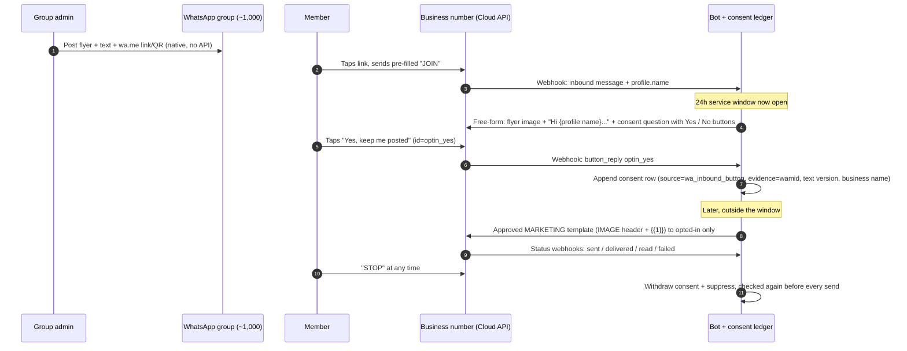
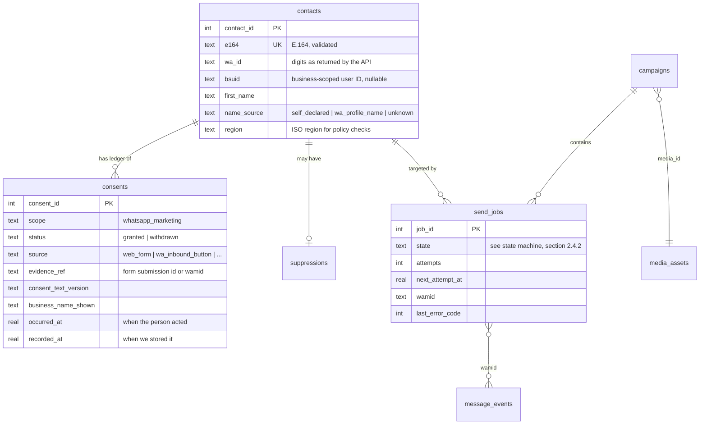
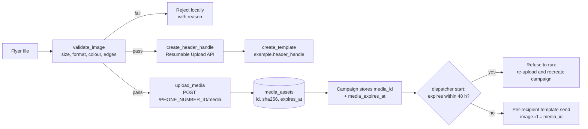
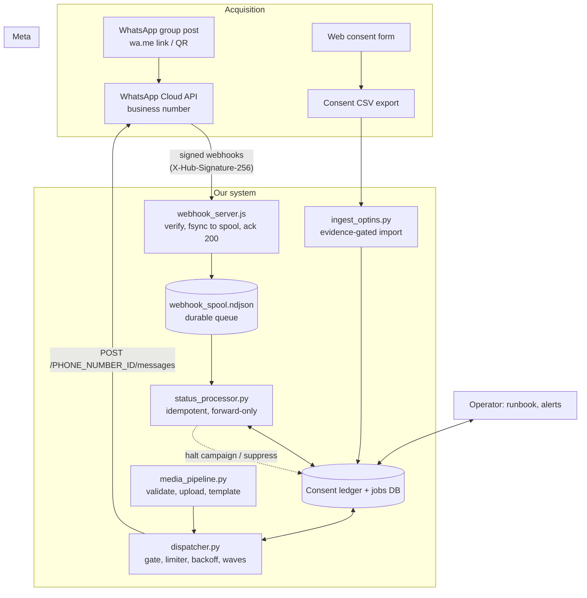
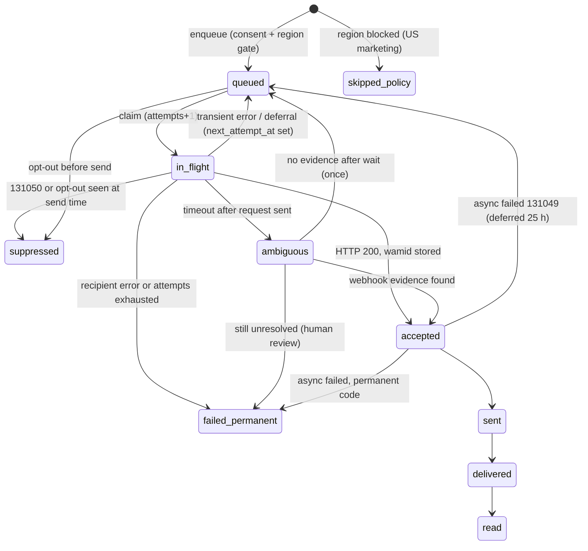

# WhatsApp Event-Promotion Bot — Feasibility, Compliance & Architecture Manifest

| | |
|---|---|
| **Manifest ID** | `WA-EVT-FEAS-2026-11-04` (date as fixed by the mandated filename) |
| **Platform facts verified on** | 2026-11-12, against Meta's developer documentation and the WhatsApp Business Messaging Policy (policy page shows "Last updated: September 23, 2026") |
| **Scope** | Promote one event to roughly 1,000 people who are members of a WhatsApp group, with a personalised greeting and a graphic flyer, using only Meta-sanctioned channels |
| **Status** | Final for review. The reference code was exercised end to end against a mock Graph API (95 automated checks pass). It has **not** yet been run against Meta's live sandbox; Section 8 lists exactly what that run must confirm. |

### How to read the evidence tags

Every platform statement carries a tag so that you can see how much weight it can bear.

| Tag | Meaning |
|---|---|
| **[M]** | Read on Meta's own developer or policy page on 2026-11-12. |
| **[V]** | Reported by a vendor or third-party source, or recalled from earlier Meta documentation, and not re-read on a Meta page this session. Treat as probable, confirm before relying on it. |
| **[E]** | An engineering heuristic chosen by this design. It is **not** a number Meta publishes. |
| **[U]** | Not verified. The design does not depend on it being true, but it must be confirmed in Meta's sandbox. |
| **[T]** | Verified by the automated test harness in Appendix C (against a mock, so it proves our logic, not Meta's behaviour). |

---

## 0. Executive verdict

**The system as literally specified cannot be built within Meta's rules, and the part that cannot be built is not an engineering gap.** Three of the requirements collide with the platform itself. A fourth asks for something that has no legitimate implementation. Everything else is feasible, and a redesigned flow achieves the business goal (a personalised flyer invitation reaching the people who want it) with a materially lower chance of losing the phone number.

| # | Requirement as written | Verdict | Reason | What replaces it |
|---|---|---|---|---|
| R1 | Enumerate ~1,000 members of an existing WhatsApp group through the official API | **Not feasible** | Cloud API has no endpoint that reads the members of a consumer group. The Groups API only manages groups that the business number itself created, which people join by invite link, with at most 8 participants **[M]**. Enumerating existing groups is undocumented, so read it as unsupported. | Members self-identify by tapping a link or QR posted in the group (Section 1.4). |
| R2 | Fetch each member's "display name / saved name" | **Not feasible as stated** | A saved name lives in the group member's own address book. The API never exposes it. The WhatsApp *profile* name arrives only inside a webhook **after that person messages you** (`contacts[].profile.name`), and nothing in the docs read shows a way to obtain it earlier **[M/U]**. | Capture the first name the person gives you (form field) or read the profile name from their first inbound message (Section 2.1). |
| R3 | Send a personalised promotional message to those members without prior opt-in | **Not compliant** | Policy: you may contact people only if they gave you their number **and** you hold opt-in permission confirming they want subsequent messages from you **[M]**. Sharing a group is neither. The API will *technically accept* such sends, which is precisely why the consent gate has to live in our system, not in Meta's. | A consent ledger plus a send-time gate that refuses any recipient without current, evidenced opt-in (Sections 2.1, 3.2). |
| R4 | "Strictly bypass automated spam flags" | **No legitimate implementation** | Meta's enforcement is statistical: user blocks and reports, template quality, per-user frequency caps, and policy review **[M]**. The only durable way to avoid being flagged is to not send content people reject. Evasion tactics (rotating numbers, spinning text to defeat review, splitting volume across accounts) are policy violations that escalate account-level penalties. They are excluded from this design. | Quality-protecting controls: consent gate, pilot waves with automatic halt, opt-out handling, frequency discipline (Sections 1.2, 3.1). |
| R5 | Flyer + customised text invitation | **Feasible** | Inside a 24-hour customer-service window: free-form image with caption. Outside it: an approved *marketing* template with an `IMAGE` header and a `{{1}}` first-name variable **[M]**. | Section 2.2, 2.3. |
| R6 | Rate-limited batch over ~1,000 contacts with backoff | **Feasible** | Throughput is not the constraint: 80 messages/second per number by default **[M]**. The binding limit is *unique recipients per rolling 24 hours at portfolio level*, which starts at **250** for a new portfolio **[M]**. | Tier-aware dispatcher (Section 3.2). |
| R7 | Delivery tracking, error handling, retries | **Feasible** | Status webhooks (`sent`, `delivered`, `read`, `failed`) and documented error codes **[M]**. | Section 3.1. |

### The recommendation in six lines

1. **If you are in the group, the lowest-risk "campaign" needs no API at all:** post the flyer and text in the group. The roughly 1,000 members already receive it. No list is exported, no consent question arises, nothing can be flagged.
2. Add a `wa.me` link and QR code to that post, pre-filled with a keyword. A member who taps it **starts the conversation**, which opens a free 24-hour window and hands you a consenting, identified contact.
3. In that window the bot replies with the flyer image and a greeting using the person's profile name, then asks one explicit question: *"Riverside Community Hall will send you event updates and reminders on WhatsApp. Tap Yes to agree."* The button tap is recorded as evidenced opt-in.
4. Only opted-in people receive later reminders, as approved marketing templates, in pilot waves that halt automatically on bad signals.
5. Expect 4 to 5 days to cover 1,000 people on a brand-new portfolio (250/day at 100% use; 200/day at the dispatcher's default 80% headroom), or 1 day once the portfolio reaches the 2,000 tier. Plan the timeline around that (Section 2.4).
6. Do not run the specified "scrape the group, blast the list" design. The probable outcome is a quality rating collapse, a lowered effective ceiling, template pausing, and possible restriction of the whole business account, with no appeal path that treats "they were in my group" as consent.

---

## 1. BLOCK 1 — Platform compliance, permissions and Meta policy audit

### 1.1 Capability and limitation analysis

#### 1.1.1 What each access path can and cannot do

| Capability | WhatsApp Business **Cloud API** (official) | **Groups API** (official, part of Cloud API) | **Unofficial session automation** (reverse-engineered clients, browser automation, linked-device hijacking) |
|---|---|---|---|
| Read the member list of an *existing consumer* group | No documented endpoint | No. Lists participants only of groups **created via the API**, via `GET /<GROUP_ID>?fields=participants` **[M]** | Technically reachable because a linked device sees what the phone sees. Violates the WhatsApp Terms and is the behaviour that triggers number bans |
| Add people to a group | n/a | **Not possible.** "Since you cannot manually add participants" the business sends an invite link; people join themselves **[M]** | Possible via the client protocol, again against the Terms |
| Maximum group size | n/a | **8 participants**, 10,000 groups per number, 1 Cloud API business per group **[M]** | Consumer limits |
| Obtain a person's *saved* contact name | Never | Never | Can read the linked phone's contact sync. Personal-data exfiltration, against the Terms |
| Obtain a person's *profile* name | Only in inbound webhooks after they message you **[M]** | Same | Readable from the client |
| Send to a number that never opted in | The API accepts the request (it does not check opt-in) but policy forbids it **[M]**; enforcement is statistical and retrospective | Sends only to API-group members, who joined by link | No template review and no tiers; enforcement is account bans on the personal or business number |
| Out-of-window message gating | Approved templates only **[M]** | Text, media, text and media templates **[M]** | None. Nothing prevents spam, which is why detection is aggressive |
| Delivery receipts / webhooks | `sent`, `delivered`, `read`, `failed` with error codes **[M]** | Group lifecycle and participant webhooks plus statuses **[M]** | Best effort, no contractual semantics |
| Support, appeal, SLA | Business Support, appeals, documented error taxonomy | Same | None. A ban on a personal number is typically unrecoverable |
| Security posture | App tokens and system-user tokens, HMAC-signed webhooks | Same | Long-lived session credentials equal full account takeover if leaked |

**Mandate compliance:** the instruction excludes unofficial libraries and browser-driven session automation. This manifest therefore specifies no unofficial path, and the comparison above exists only to document why they are excluded. Beyond ban risk they offer no delivery guarantees, create a personal-data breach surface, and leave a regulated business with no defensible compliance story.

#### 1.1.2 Why the Groups API does not solve the enumeration problem

The Groups API looks like a loophole and is not one. Applying its documented limits to a 1,000-person audience:

- 1,000 people ÷ 8 participants per group = **125 API groups**, each populated only by people who individually tap an invite link. The tap is itself an affirmative act, so you would be rebuilding an opt-in funnel the hard way.
- Eligibility: Meta's page says the API is open to all businesses with an Official Business Account (OBA). Older vendor guides still say a 100K messaging-limit tier is required; these conflict and Meta's page is authoritative **[M]**. The phone number must be on Cloud API, not the WhatsApp Business app, and not part of Multi-solution Conversations **[M]**.
- Billing is per delivered message **per group member**, at the same per-country rates as one-to-one messages, so a message to a full group of 8 is billed 8 times **[M]**.
- Unsupported in groups: calling, disappearing messages, view-once, authentication, commerce messages, interactive messages **[M]**. That removes reply buttons, which the consent flow in Section 1.4 depends on.

**Conclusion:** use ordinary one-to-one messaging for the consent funnel. Groups API is the wrong tool for a 1,000-person audience.

#### 1.1.3 Direct messaging to non-opted-in profiles

Technically the API sends to any registered WhatsApp number. Whether that is *allowed* is a separate question the API does not enforce. Three layers apply:

1. **Policy.** The Business Messaging Policy permits contact only where the person gave you their number *and* you hold opt-in permission confirming they want subsequent messages **[M]**. A group roster satisfies neither condition: the number was shared with fellow members, not given to you for marketing.
2. **Platform mechanics.** Every business-initiated message outside a 24-hour window must be an approved template **[M]**. Marketing templates are additionally subject to an adaptive per-user frequency cap (error `131049`) **[M]** and to opt-out controls that surface as error `131050` **[M]**. Marketing templates are not delivered to US phone numbers at all **[M]**.
3. **Law.** Using group members' numbers for a new purpose (marketing) engages data-protection and electronic-marketing rules (Section 1.5). That is independent of Meta's policy.

---

### 1.2 Compliance strategy: opt-in, template approval, and quality protection

#### 1.2.1 What counts as valid opt-in

Meta's opt-in requirements **[M]**: the person must clearly be told they are opting in to receive communication from the business, and the business's name must be stated. The opt-in "can be general and not specifically for WhatsApp" provided all local laws are complied with. Examples Meta gives include SMS, website, phone IVR and in person or on paper. As best practice (not mandatory), Meta suggests covering message categories and asking separately for each.

| Where the number came from | Counts as marketing opt-in? | Notes |
|---|---|---|
| Web form with an unticked checkbox naming the business and stating WhatsApp event updates | **Yes** | Store the exact text shown, its version, and the submission ID |
| Person taps a "Yes, keep me posted" button after a message that names the business and states what they will receive | **Yes** | Evidence is the inbound message ID. This is the flow in Section 1.4 |
| Person only sent a first message (clicked `wa.me`, typed "JOIN") | **Treat as no** for marketing [E] | It opens the service window, which allows replies, but it does not prove they want later promotions. Ask the explicit question |
| Click-to-WhatsApp ad click | **No** for ongoing marketing | Opens a window (and a free entry-point period) but is not an opt-in to later templates [V] |
| Signed paper or in-person sheet naming the business and WhatsApp | **Yes** | Scan and store the evidence reference |
| CRM contacts with documented marketing consent captured under compatible wording | **Yes, if** the wording named your organisation and the channel type, and local law is met | Import path in Section 2.1 requires the evidence fields |
| Membership of a WhatsApp group | **No** | Not given to you, no statement of intent |
| Purchased, rented or third-party list | **No** | No relationship, no consent |
| Phone address-book export | **No** | Same |
| Event ticketing export | **Only** the rows where the buyer ticked marketing consent | Filter on the consent flag, not on the buyer list |

The importer in Appendix B **refuses** rows whose declared source is `group_membership`, `group_roster`, `scraped`, `purchased_list`, `third_party_list`, `contact_book` or `address_book`, and rows with no evidence reference, no consent-text version, no business name shown, a malformed or ambiguous phone number, a future timestamp, or consent older than 730 days **[T]**.

#### 1.2.2 Opt-out is part of the opt-in

- Meta's policy requires you to respect any request, on or off WhatsApp, to block, discontinue or opt out, including removing the person from your contact list **[M]**.
- Meta also gives users a way to stop marketing messages from a business; when they do, further marketing templates fail with `131050`, and Meta says to subscribe to the `user_preferences` webhook and never retry **[M]**.
- Implementation **[T]**: inbound `STOP`-class keywords and the `optout_stop` button write a `withdrawn` consent row and a suppression. A `131050` error suppresses immediately. The suppression is **re-checked immediately before each HTTP call**, so an opt-out that arrives after enqueue but before send is still honoured.
- Consent order is decided by *when the person acted*, not when we recorded it. A back-filled old `granted` row can never override a newer `withdrawn` row **[T]**. This corrects a flaw found during the verification pass (Section 6.3).

#### 1.2.3 Template approval workflow

Templates are mandatory for any business-initiated message outside the 24-hour window **[M]**. A promotional invitation is `MARKETING`. Do not file it as `UTILITY` to obtain cheaper pricing or a looser cap: miscategorisation is a recognised violation and risks account penalties **[V]**.

| Step | Action | Control |
|---|---|---|
| 1 | Draft body, header, footer and buttons | Run the lint checklist below before submitting |
| 2 | Upload flyer through the Resumable Upload API to obtain a `header_handle` for the template *example* | Only for creation. A different identifier, the media ID, is used at send time (Section 2.3) |
| 3 | `POST /<WABA_ID>/message_templates` with category `MARKETING`, language, components, and examples | Rate: about 100 template creations per hour **[M]** |
| 4 | Status moves through In-Review, then Active (Quality pending / High / Medium / Low) or Rejected **[M]** | Subscribe to `message_template_status_update`. Plan for review taking from minutes up to a day and add a 48-hour buffer [E] |
| 5 | On rejection: read the reason, edit, resubmit. Appeals are decided within about 24 hours **[M]** | Do not resubmit slightly reworded copies in a loop to probe the reviewer |
| 6 | Pilot the first send; Meta may pace a new marketing template, holding messages (`held_for_quality_assessment`) until early feedback is judged, and pausing the template on negative feedback **[M]** | Dispatcher records `api_message_status` and waits for the wave gate |

**Template lint checklist [M unless tagged]:**

- Body is required, at most **1,024** characters. Text header at most **60**; footer at most **60**, text only.
- A variable must not be the first or last thing in the body (Meta error text: *"Variables cannot be at the start or end of the template"*). A "too many variables for its length" check also exists; the numeric ratio is not published **[M/U]**.
- Do not place two variables adjacent to each other **[V]**.
- Supply realistic example values for every variable. They are required at creation **[M]**.
- Positional `{{1}}` is the default. Named parameters (`{{first_name}}`, lowercase letters and underscores, unique) are available with `parameter_format: "named"` at creation **[M]**.
- Buttons: at most 10 total; quick replies max 10 (25 characters each) and must be grouped together; URL max 2; phone max 1. With more than 3 buttons only two show and the rest sit under "See all options"; 4+ buttons, or quick reply plus another type, cannot be viewed on WhatsApp desktop **[M]**.
- Template name: lowercase alphanumeric and underscore, at most 512 characters; the same name may exist in several languages **[M]**.
- Avoid URL shorteners, shouty capitals, and emoji floods, which are common rejection triggers **[V]**. Name the business in the body. State how to opt out in the footer or via a quick-reply button.
- Template capacity: 250 per messaging account for an unverified portfolio, up to 6,000 for a verified one **[M, "messaging account" wording]**.

#### 1.2.4 How quality is measured, what Meta does not publish, and our guardrails

Meta documents the *mechanisms*. It publishes **no numeric block, report, or opt-out threshold** that triggers a penalty. Anyone quoting such a figure is guessing. What is documented **[M]**:

| Mechanism | Documented behaviour |
|---|---|
| Template quality | Scores GREEN / YELLOW / RED / UNKNOWN. RED pauses the template: first pause 3 hours, second pause 6 hours, third pause disables it permanently (`132016`). While paused, sends are rejected with `132015` and not charged. |
| Template pacing | New, unpaused, or non-GREEN marketing templates may have messages held for a quality assessment. Positive feedback releases them; negative feedback pauses the template and drops held messages as `failed` with `132015`. |
| Per-user marketing cap | Adaptive, unpublished, based on recent read rates and inbox volume across businesses. Each delivered marketing template counts. Marketing sent inside an open service window does not count. Hitting it returns `131049`; wait at least 24 hours, and repeated retries inside 24 hours can extend the block. |
| Messaging limit | Portfolio-level count of unique recipients outside service windows per moving 24 hours. Starts at 250 for a new portfolio; scales through 2,000, 10,000, 100,000 and unlimited **[M]** (Section 2.4). |
| Spam restrictions | Error `131048` signals a sending restriction, possibly because earlier messages were blocked or flagged as spam. Check quality status in WhatsApp Manager. |
| Account enforcement | `368` means the WABA is restricted or disabled for a policy violation. Policy says Meta may limit or remove access after significant negative feedback, and may bar repeat offenders from future use of WhatsApp products **[M]**. |
| Tier downgrade | Meta's page states a quality-rating drop no longer lowers the messaging limit, because the old "Flagged" state is gone **[M]**. Quality still gates upgrades and can trigger enforcement. |

**Our own halt and warn thresholds [E] — chosen conservatively and labelled so you never mistake them for Meta numbers:**

| Signal | Source | Warn | Auto-halt (implemented) | Why this value |
|---|---|---|---|---|
| Any `131048` | send response or webhook | — | **Halt immediately** [T] | Meta's own restriction signal; continuing is the opposite of recovery |
| Undeliverable (`131026`) share of a wave | webhook | > 5% | **> 10%** (min 20 sent) | A healthy opted-in list is mostly valid numbers. A high rate suggests stale or foreign-sourced data, i.e. a provenance problem |
| Opt-out share (STOP, button, `131050`) | inbound and webhooks | > 1.5% | **> 3%** (min 20 sent) | Early opt-out spikes mean the content or the consent wording does not match expectations |
| Template status `PAUSED` / `DISABLED` / `REJECTED` | `message_template_status_update` | — | **Halt campaigns using it** | Stop feeding a paused template |
| Account events (`account_update`, `account_review_update`) | webhook | — | **Halt all** pending human review | Possible enforcement |
| Systemic API failures | dispatcher | — | **Halt when ≥30% of the last 20 sends (minimum 10) failed for non-recipient reasons** | Prevents a bug becoming a thousand bad calls |
| Read rate after 24 h | status webhooks | < 25% | — (human review) | Content-relevance indicator, not a Meta metric |

#### 1.2.5 Frequency and etiquette rules [E]

- Maximum **one** flyer on opt-in (free-form, inside the window) and **two** marketing-template reminders per person per event. Everything beyond that invites blocks.
- Send only 09:00–20:00 in the event's local time (`WA_SEND_WINDOW`, `WA_SEND_TZ`).
- Never message the same person from two campaigns on the same day.
- The first wave is a **pilot of 50**, followed by a 20-minute pause during which webhooks are evaluated against the table above.
- Every marketing message carries a visible way to opt out.

---

### 1.3 Rejected-approaches register

| Approach | Why rejected |
|---|---|
| Export group participants and import them as the audience | No opt-in; contradicts the policy; a primary trigger for high block rates and `131048`/`368` outcomes |
| Reverse-engineered WhatsApp libraries or browser session automation to read the group and send | Excluded by mandate; violates the Terms; ban risk; no support path |
| Buy, rent or "enrich" a number list | No consent; legally radioactive |
| Create many API groups and add people | Cannot add people; 8-person cap; 125 groups for 1,000 people |
| File the invitation as `UTILITY` | Miscategorisation is a violation; reviewers re-categorise; account risk |
| Rotate phone numbers, WABAs or portfolios to dodge limits or flags | Evasion of enforcement; escalates to permanent bans |
| Alter message text per recipient solely to evade similarity detection | Evasion. Legitimate personalisation (the first name variable) is fine; randomised obfuscation is not |
| Send marketing templates to `+1` numbers | Not delivered by Meta; produces failures **[M]** |
| Retry `131049` / `131050` aggressively | Meta says wait ≥24 h / never retry. Retrying can extend blocks |
| Treat inbound-first-message as blanket marketing consent | Conservative reading; the explicit button costs one tap and produces defensible evidence |

---

### 1.4 The compliant acquisition funnel (the redesign)

#### 1.4.1 Option comparison

| # | Channel | Reaches | Consent status | Cost | Effort | Risk |
|---|---|---|---|---|---|---|
| 0 | **Post the flyer and text directly in the group** | All ~1,000 members at once | n/a (ordinary group use) | Free | Minutes | Lowest. Needs permission to post |
| 1 | **Group post with `wa.me` link / QR → bot conversation** | Members who engage | Explicit button opt-in captured | Service window free; later templates billed per delivery | Medium | Low |
| 2 | WhatsApp Channel or Community announcement | Followers | Follow is the opt-in; no phone numbers exchanged | Free | Low | Low. Audience builds only from follows |
| 3 | Web form with consent checkbox on the event page | Anyone who signs up | Explicit, auditable | Low | Medium | Low |
| 4 | Click-to-WhatsApp ad | Paid audience | Window only; ask for opt-in in-chat | Ad spend; messages inside the free entry-point window are free for 72 h [V] | Medium | Low-medium |
| 5 | WhatsApp Business **app** broadcast list | Contacts who saved your number | Recipient saved you; capped at 256 per list [V] | Free | Low | Low, but does not scale to 1,000 cold |
| 6 | Cold template blast to scraped group members | — | **None** | — | — | **Unacceptable** |

Options 0 and 1 together are the recommended path. Option 0 delivers the "1,000 people" goal immediately; option 1 builds the consenting list that makes later reminders legitimate and measurable.

#### 1.4.2 Sequence



#### 1.4.3 Consent message wording (version `2026-11-v1`)

> Hi *{profile name}*, thanks for your interest in our Community Open Day (14 December, Riverside Hall). The flyer is attached.
> **Riverside Community Hall** would like to send you event updates and reminders on WhatsApp. Tap **Yes** to agree. You can stop at any time by replying STOP.
> [ Yes, keep me posted ] [ No thanks ]

This satisfies the two things Meta's opt-in rule asks for: it states that the person is opting in to receive communication, and it names the business **[M]**. The version string is stored with every consent row so that you can prove which wording each person saw.

---

### 1.5 Data-protection and electronic-marketing overlay

This is an engineering manifest, not legal advice; have counsel confirm the points below for the jurisdictions your recipients live in. Do not assume a jurisdiction from the audience's language or the organiser's location.

| Regime (illustrative) | Relevance |
|---|---|
| EU GDPR and ePrivacy (national implementations) | Prior consent for electronic marketing is the norm; a phone number is personal data; purpose limitation applies to numbers obtained for group membership; data-subject rights include access and erasure |
| UK GDPR and PECR | Similar consent model for electronic marketing |
| Brazil LGPD, India DPDP Act 2023, others | Consent and purpose-limitation requirements; local rules on marketing messages |
| US federal and state telemarketing and messaging rules | Meta already blocks marketing templates to US numbers, but other US rules may apply to other channels |
| Canada CASL | Express or implied consent with strict conditions |

Design consequences already built into the reference system: data minimisation (E.164, first name, consent evidence, no address-book fields); an append-only consent ledger with the consent text version and business name shown; suppression that survives re-imports; a documented erasure routine that deletes the person's rows and leaves only a **keyed hash tombstone** so a later bulk import cannot resurrect them **[T]**; no phone numbers or payloads in application logs; and Meta's own rule not to use data obtained from the platform about a person for any purpose beyond supporting messaging with them **[M]**.

---

## 2. BLOCK 2 — System architecture and personalisation pipeline

### 2.1 Data ingestion, identity mapping and variable insertion

#### 2.1.1 Principles

1. **Consent first.** A phone number enters the campaign database only together with its consent evidence. There is no code path that adds a bare number.
2. **The ledger is append-only.** Consent changes are new rows, never edits, so the history of what each person agreed to and when is reconstructible.
3. **Latest by event time wins; withdrawal wins ties.** The send gate evaluates the person's most recent action, not our most recent write **[T]**.
4. **Gate twice.** Eligibility is evaluated at enqueue and again immediately before each HTTP call **[T]**.
5. **Minimise.** E.164 number, first name, name provenance, region, consent evidence. Nothing else.

#### 2.1.2 Entity model



The full DDL is `SCHEMA` in `wa_common.py` (Appendix B, §B.1). The reference uses SQLite so that it runs anywhere. Mapping to PostgreSQL for production:

| SQLite construct | PostgreSQL equivalent |
|---|---|
| `INTEGER PRIMARY KEY AUTOINCREMENT` | `BIGINT GENERATED ALWAYS AS IDENTITY` |
| `REAL` epoch seconds | `TIMESTAMPTZ` (convert with `to_timestamp`) |
| `CHECK (e164 GLOB '+[1-9]*')` | `CHECK (e164 ~ '^\+[1-9][0-9]{7,14}$')` |
| `INSERT OR IGNORE` | `INSERT ... ON CONFLICT DO NOTHING` |
| claim by `UPDATE ... WHERE state='queued'` | `SELECT ... FOR UPDATE SKIP LOCKED` inside a transaction, to run several dispatcher workers |
| `JOURNAL_MODE=WAL` | not applicable |

#### 2.1.3 CSV contract for consent import

Header row required, UTF-8 (BOM tolerated).

| Column | Required | Rule |
|---|---|---|
| `phone` | yes | E.164 preferred. National format is accepted only when `--default-region` is supplied, otherwise rejected as ambiguous. With `phonenumbers` installed the number must be a valid number for its region; without it a strict `^\+[1-9]\d{7,14}$` check applies |
| `first_name` | no | What the person typed. Empty is allowed; the greeting then falls back to "there" |
| `consent_status` | yes | `granted` or `withdrawn` |
| `consent_source` | yes | One of `web_form`, `wa_inbound_keyword`, `wa_inbound_button`, `sms_reply`, `ivr`, `in_person_signed`, `paper_signed`, `click_to_whatsapp_flow`, `crm_marketing_consent`. Forbidden: `group_membership`, `group_roster`, `scraped`, `purchased_list`, `third_party_list`, `contact_book`, `address_book`, `unknown` |
| `evidence_ref` | yes | Form submission ID, message ID, signed-sheet reference. Must let an auditor retrieve the original |
| `consent_text_version` | yes | Identifier of the exact wording shown |
| `business_name_shown` | yes | The business name that appeared in the opt-in, because Meta requires the opt-in to name it **[M]** |
| `occurred_at` | yes | ISO-8601. Not in the future; `granted` rows older than 730 days are rejected as stale [E] |

Behaviour **[T]**: rows are validated, sorted chronologically and replayed inside one transaction. Exact duplicates are ignored. A `withdrawn` row creates a suppression; a later genuine `granted` row clears only suppressions that came from our own withdrawal record, never a Meta-side stop. Rejected rows go to `rejects.csv` with a machine-readable reason, so the operator can fix the source data instead of arguing with the importer.

#### 2.1.4 Name resolution

The user request was to fetch "contact display names/saved names". The platform does not offer that, so names come from the following sources in priority order:

| Priority | Source | `name_source` | Notes |
|---|---|---|---|
| 1 | The first name the person typed into your consent form | `self_declared` | Most reliable; the person chose it |
| 2 | `contacts[].profile.name` in the person's first inbound webhook | `wa_profile_name` | Self-chosen WhatsApp profile name; often a nickname, brand, or emoji string **[M]**. Only overwrites when no self-declared name exists **[T]** |
| 3 | Fallback word ("there") | — | "Hi there," is better than a wrong name |

Cleaning rules applied before any name reaches a template variable **[T]**:

- Collapse every whitespace run (including newlines, tabs, non-breaking spaces) to a single space *first*, then remove control, format (zero-width, bidirectional) and symbol/emoji characters. Order matters: stripping controls first glued "Ana\n\tMaria" into "AnaMaria" in the first test run.
- Keep only the first token. The variable is a first name.
- Reject values that look like URLs, e-mail addresses or contain digits (`www.`, `.com`, `@`, `://`, any digit). They are fallback-substituted. This blocks link injection through a profile name and avoids pasting handles like "User12345" into a greeting.
- Title-case all-capital names of two or more letters ("LUCA" → "Luca").
- Truncate to 30 characters.
- Meta rejects template parameters that contain newlines, tabs or more than four consecutive spaces (error `132018`/`132012` family) **[V]**; the cleaner makes that impossible.

#### 2.1.5 WhatsApp usernames and business-scoped user IDs (BSUID)

Meta is introducing usernames and a business-scoped user identifier. Verified facts **[M]**: BSUIDs began appearing in webhooks in early April 2026; usernames are rolling out gradually through 2026 and name reservation opened on 29 June 2026; if a person has adopted a username, `wa_id` and `from` may be **omitted** from webhooks, except where you messaged or received a message or call from that number in the last 30 days or the person is in your contact book; a message can be sent to a BSUID by setting `recipient` and omitting `to` (`to` wins if both are present); authentication templates cannot be sent to a BSUID (error `131062`). The BSUID page lists July 2026 as the date sending to BSUIDs becomes supported; a model-extracted changelog line says the earlier date was May 2026, which was **not confirmed [U]**.

Consequences for this design:

- The `contacts.bsuid` column exists, and consent rows can in principle be keyed to a BSUID.
- **Known limitation of the reference code:** `status_processor.py` ignores inbound senders that arrive without a numeric `from` (BSUID-only). Those people can message you but will not be written to the consent ledger until a username-aware contact model is added. Treat this as a required work item if your audience adopts usernames (Section 8, item 9).
- Because phone numbers may disappear from webhooks, **do not use the phone number as the only join key** between consent evidence and inbound events in a production build.

#### 2.1.6 Dynamic variable insertion

Two body formats exist **[M]**. Pick one per template.

| Format | Template text | Send-time parameter | Pros | Cons |
|---|---|---|---|---|
| Positional (requested) | `Hi {{1}}, ...` | `{"type":"text","text":"Maria"}` | Simple; widely supported | Order-dependent as variables grow |
| Named | `Hi {{first_name}}, ...` | `{"type":"text","parameter_name":"first_name","text":"Maria"}` | Self-documenting; safer with several variables | Requires `parameter_format: "named"` at creation |

The dispatcher's `param_format` column on the campaign selects the shape **[T]**. The Meta documentation uses lowercase `"named"` at creation, and the send payload carries no `parameter_format` field **[M]**.

---

### 2.2 Template specification

#### 2.2.1 Worked template (English, positional)

```json
{
  "name": "event_invite",
  "language": "en",
  "category": "MARKETING",
  "components": [
    { "type": "HEADER", "format": "IMAGE",
      "example": { "header_handle": ["4::aW1hZ2UvcG5nOmV4YW1wbGUtZmx5ZXI"] } },
    { "type": "BODY",
      "text": "Hi {{1}}, you are invited to our Community Open Day on 14 December at Riverside Hall. Tap below to reserve your free place.",
      "example": { "body_text": [["Maria"]] } },
    { "type": "FOOTER", "text": "Reply STOP to opt out" },
    { "type": "BUTTONS", "buttons": [
        { "type": "QUICK_REPLY", "text": "Count me in" },
        { "type": "QUICK_REPLY", "text": "Stop messages" } ] }
  ]
}
```

The `header_handle` string above is an **illustrative value** with the right general form (`4::` followed by an opaque token). Every upload returns a different handle, so the real one is always produced at run time by the Resumable Upload call (`create_header_handle()` in Appendix B, §B.3) and written into the spec by `build_template_spec()`. It is the only field in the spec that cannot be fixed in advance.

Why each design choice:

- The variable sits in the **middle** of the body (`Hi {{1}}, ...`), satisfying the rule that a variable cannot start or end the body **[M]**.
- The body names the event, date and place so the message is self-explanatory when it arrives out of context.
- Two quick-reply buttons keep replies in-channel. `Stop messages` gives an explicit opt-out; the dispatcher's status processor treats the button id `optout_stop` as a withdrawal **[T]**.
- The footer repeats the opt-out instruction in plain words.
- One image header carries the flyer; no URL is needed, so there is nothing for a shortener check to trip over.

#### 2.2.2 Localisation

The pair (template name, language) is unique; the same name can exist in several languages **[M]**. Create one template per audience language and run one campaign per language (`campaigns.template_lang`). Do not machine-translate into a language you cannot review; reviewers and recipients both react badly to broken text.

#### 2.2.3 Variants for later phases

| Phase | Message | Where it is sent | Template needed |
|---|---|---|---|
| On opt-in (T-14 to T-8) | Flyer image + greeting + consent question | Inside the 24-h window | No: free-form message and interactive reply buttons |
| Reminder 1 (T-7) | Marketing template with flyer | Outside the window | Yes: `event_invite` |
| Reminder 2 (T-1) | Short marketing template, no repeated flyer needed | Outside the window | Yes: a second, shorter template (`event_reminder_final`), created and approved the same way |

---

### 2.3 Media pipeline: asynchronous flyer distribution

#### 2.3.1 Two identifiers that must never be confused

| | **Media ID** | **Header handle** |
|---|---|---|
| Obtained by | `POST /<PHONE_NUMBER_ID>/media` (multipart) | Resumable Upload API on the **app** ID: create an upload session, then `POST` the bytes |
| Used for | **Sending**: `{"type":"header","parameters":[{"type":"image","image":{"id":"<MEDIA_ID>"}}]}` | **Template creation only**: `components[].example.header_handle` |
| Lifetime | API-returned media IDs expire **30 days** after upload; media IDs delivered in webhooks expire after 7 days **[M]** | Not used after template approval |
| Pipeline function | `upload_media()` | `create_header_handle()` |

The send payload with an image header by media ID follows the standard Cloud API template shape, but the pages read this session showed the media-ID header only for creation examples. Confirm the exact send shape in the sandbox **[U]**. The test harness asserts the dispatcher emits it and the mock verifies it; that proves internal consistency, not Meta's acceptance.

#### 2.3.2 Flyer specification and pre-flight

| Property | Limit | Source |
|---|---|---|
| Formats | JPEG, PNG (static WebP is also accepted by Meta; this pipeline restricts to JPEG/PNG) | **[M]** |
| Maximum size | 5 MB | **[M]** |
| Colour | 8-bit RGB or RGBA | **[M]** |
| Edge length | Images over 4,096 px on an edge are rejected | **[M]** |
| Design guidance | Put key content in the centre; verify the rendering on iOS and Android in the sandbox, because chat bubbles crop previews | **[E]** |

`validate_image()` checks magic bytes, size, bit depth, colour type (PNG) or precision and component count (JPEG), and edge length before any network call, and the test harness confirms it rejects a palette PNG and a 5,000-px image **[T]**. Failing locally is cheaper than failing at upload and far cheaper than failing at send.

#### 2.3.3 Lifecycle



Operational rules:

- **Upload once, reference many.** One media ID serves every recipient of the campaign. Never re-upload per recipient.
- **Refresh margin.** `media_needs_refresh()` returns true with fewer than 48 hours of life left; the dispatcher refuses to start a campaign that would outlive its media **[T]**.
- **Media errors** `131052` (download) and `131053` (upload) halt the campaign instead of retrying, because every recipient would hit the same defect. The operator re-uploads and starts a new campaign.
- **Integrity.** The SHA-256 of the uploaded file is recorded in `media_assets`, so you can prove which artwork went to whom.

#### 2.3.4 Sequential queue dispatch with exponential backoff

The queue is the `send_jobs` table. A single dispatcher process drains it in order of `next_attempt_at`. Properties:

- **Token-bucket limiter.** `WA_MAX_MPS` (default 5) is far below the 80 mps per-number default **[M]** and nowhere near the real bottleneck, but it keeps request bursts polite and gives the limiter something to adapt. Throughput is *inclusive of inbound and outbound messages*, so inbound reply traffic from opted-in users also consumes it **[M]**.
- **AIMD adaptation.** On `130429` the rate is halved (floor 0.5 mps); it creeps back up 10% per success once 60 seconds pass without throttling **[T]**.
- **Backoff.** Transient errors use "equal jitter" exponential backoff: half the exponential term is fixed, half is random, base 5 s for API errors and capped at 900 s **[T for bounds]**. A `Retry-After` header on HTTP 429 is honoured (the test shows the retry lands at least one second later) **[T]**.
- **Deferral, not retry, for caps.** `131049` waits 25 hours and `131056` one hour, each with a small attempt budget (2 and 3), because the documentation says repeated retries can lengthen the block **[M]**.
- **Wave gating.** Every `WA_WAVE_SIZE` successful sends (default 50) the dispatcher pauses `WA_WAVE_PAUSE_S` seconds (default 1,200) so that webhook feedback can arrive, then evaluates the guardrails in Section 1.2.4 **[T]**.
- **Send window and daily cap.** Outside `WA_SEND_WINDOW` the run exits (or waits with `--wait`). The 24-hour unique-recipient count is compared with `portfolio_limit × headroom` (default 250 × 0.8 = 200) **[T]**.

---

### 2.4 Architecture, state machine and capacity

#### 2.4.1 Component view



Why the webhook receiver does almost nothing: Meta treats any non-200 as a failure and retries with decreasing frequency for up to **7 days**, so duplicates are normal and slow handlers cause retry storms **[M]**. The receiver therefore verifies the HMAC over the *raw* body, appends the event to a durable spool with `fsync`, and only then answers 200. All business logic runs afterwards in the processor, which is idempotent by construction: `UNIQUE(wamid, status)` on events and forward-only job states **[T]**. Replaying the whole spool from offset zero changes nothing **[T]**.

Production substitutions: replace the file spool with SQS, Kafka or Redis Streams; run at least two receiver replicas behind TLS; replace SQLite with PostgreSQL; keep the verify, persist, acknowledge ordering exactly as written.

#### 2.4.2 Job state machine



Two details are easy to get wrong and both were found by testing:

1. **A webhook can beat the database write.** A fast `sent` or `delivered` event may arrive before the dispatcher has stored the `wamid`, and the processor then has no job to update. `sync_job_from_events()` replays stored events whenever a `wamid` is linked to a job (after a 200 and after ambiguity reconciliation). Without it a perfectly delivered message sat at `accepted` forever **[T]**.
2. **A timeout is not a failure.** The Graph API offers no client idempotency key, so retrying a timed-out call can duplicate the message. The dispatcher parks the job as `ambiguous`, waits `WA_RECONCILE_WAIT_S` (default 900 s), looks for any status event for that recipient after the attempt started, and only then either confirms delivery or re-queues **once**. The test covers both branches: delivered-but-timed-out (no duplicate, `posts=1`) and lost (second attempt succeeds, `posts=2`) **[T]**. Residual risk: if the status webhook is delayed beyond the wait, one duplicate invitation is possible. That is accepted as the lesser harm.

#### 2.4.3 Capacity arithmetic for 1,000 people

| Portfolio tier (unique recipients per moving 24 h, outside service windows) | Days to cover 1,000 at 100% | At the 80% headroom the dispatcher enforces |
|---|---|---|
| 250 (new portfolio) | 4 | 5 days (200/day) |
| 2,000 | 1 | 1 day (1,600/day) |
| 10,000 and above | 1 | 1 day |
| Throughput at 5 mps | ~200 seconds | — |

Tier facts **[M]**: limits are set at the **business portfolio** level and shared by all numbers in it; a new portfolio starts at 250. To reach 2,000 you complete one of: business verification; partner verification when onboarded by a solution provider; or 2,000 delivered messages outside service windows to unique numbers within 30 days using high-quality templates. Above 2,000, increases are automatic when messages are high quality across all your numbers and templates **and** you used at least half of the current limit in the last 7 days, with the change applying within about 6 hours. Meta's page says a quality drop no longer lowers the limit.

Conflict flagged in verification: one vendor changelog says the 2K and 10K tiers are being removed in 2026; Meta's own page still lists them as of this check. **Read the live value in WhatsApp Manager before scheduling** and set `WA_PORTFOLIO_LIMIT` accordingly.

Important consequence: users who message *you* first open a service window and are **not** counted against the outbound limit **[M]**. The opt-in funnel therefore consumes almost none of the 250/day, which is another reason it fits a new account.

#### 2.4.4 Timeline (T = event day)

| When | Action | Exit criterion |
|---|---|---|
| T-21 | Decide funnel; counsel review of consent wording; start business verification; display-name approval; create System User token | Verification submitted |
| T-18 | Deploy webhook receiver over TLS; subscribe to `messages`, `message_template_status_update`, `user_preferences`, `account_update`, `account_review_update`, `phone_number_quality_update`; run the sandbox checklist in Section 8 | All Section 8 items ticked |
| T-16 | Upload flyer; create `event_invite` | Template ACTIVE, quality not RED |
| T-14 | Post flyer, text and `wa.me`/QR in the group | Inbound conversations begin |
| T-14 to T-8 | Bot replies in-window with flyer and consent question; opt-ins accrue | Opt-in count tracked daily |
| T-7 | Reminder 1 to opted-in people outside their window: pilot 50, pause 20 min, review, then continue | Wave gate passes |
| T-1 | Reminder 2 (shorter template) to opted-in people who have not RSVP'd | Opt-out rate under 1.5% |
| T+1 | Close campaigns; export report; apply retention schedule | Report archived |

#### 2.4.5 Cost model

Meta bills per **delivered** message, priced by the recipient's country and the template category, since the move to per-message pricing on 1 July 2025 **[M/V]**. In-window free-form replies are covered by the service-window rules; Meta's groups pricing page indicates that from 1 October 2026 non-template messages are free only within a shared 1,000-message free tier, while a vendor guide claims support replies became billable again in 2026. These two statements are consistent with each other but not with the older "service conversations are free" rule, so **model both cases** and read the live rate card **[U]**.

```
projected_cost = Σ over delivered marketing templates of rate(country, "marketing")
               + Σ over in-window free-form messages above the free allowance of rate(country, "service")
               + BSP or hosting fees
```

No rates are quoted here on purpose: they vary by country, change on a schedule Meta publishes, and a stale number in a manifest is worse than none. Load the current card from Meta's pricing page into a country-to-rate table and run the formula over `send_jobs` joined to `contacts.region`.

---

## 3. BLOCK 3 — Risk mitigation, execution runbook and code artifacts

### 3.1 Error-handling protocols

#### 3.1.1 Principles

1. **Classify by Meta's `error.code`, not by HTTP status.** Meta's error page says to build handling on `code` and `details`, and it documents an HTTP status for almost none of the codes **[M]**. The classifier falls back to HTTP status only when no code is present: `429` → throttle, `401/403` → halt, `5xx` → retry.
2. **Every error maps to exactly one action** from a closed set: `retry`, `throttle`, `defer`, `fail`, `suppress`, `halt_campaign`, `halt_all` (table `POLICIES` in `wa_common.py`). Unknown codes get a bounded retry (3 attempts) and count toward the circuit breaker, so a new Meta error cannot cause an infinite loop.
3. **Separate recipient problems from systemic problems.** Undeliverable numbers, opt-outs and per-user caps are expected in any real list and must not trip the circuit breaker. Template, auth, billing and payload errors affect everyone, so they halt after **one** call. The test proves a forced `132001`, `131048` and `190` each stop the run after a single request **[T]**.
4. **A halt does not burn an attempt.** The job returns to `queued` with its attempt counter restored, so resuming does not penalise recipients for an infrastructure fault **[T]**.
5. **Never hammer caps.** `131049` and `131056` are deferred, not retried, with small attempt budgets.

#### 3.1.2 Invalid numbers: prevent, then handle

| Stage | Control | Outcome |
|---|---|---|
| Import | E.164 normalisation; with `phonenumbers`, full validity for the region; without it, strict regex. National-format numbers without a stated region are **rejected as ambiguous**, never guessed **[T]** | `rejects.csv` with reason `invalid_or_ambiguous_phone` |
| Enqueue | Region policy: contacts whose region is in `WA_BLOCKED_MARKETING_REGIONS` (default `US`) become `skipped_policy`. Without the library every `+1` number is treated as US because NANP numbers cannot be told apart **[T]** | Never sent; shown in the report |
| Send | Meta may still answer `131026` (not a WhatsApp number / terms not accepted / old client) **[M]** | `failed_permanent`, no retry, counted for the wave gate |
| Reporting | `131026` rate above 10% of a wave halts the campaign: a high rate means the list did not come from people who use WhatsApp with you | Operator audits list provenance |

Do **not** pre-check numbers with a "contact lookup" or send throwaway probes to discover who is on WhatsApp. Probing sends are themselves unsolicited messages and count against you.

#### 3.1.3 Synchronous send errors

| Code | Meta meaning **[M]** | Class | Action | Attempts | Escalate |
|---|---|---|---|---|---|
| `130429` | Cloud API message throughput reached | systemic, ours | **Throttle**: halve the limiter, backoff from 5 s | 8 | If it recurs after the limiter is at its floor |
| `80007` | WABA reached its rate limit | systemic | **Throttle** with 900 s base | 4 | Review concurrent senders on the WABA |
| `131048` | Sending restricted, possibly because earlier messages were blocked or flagged as spam | enforcement | **Halt campaign** | — | Inspect quality in WhatsApp Manager before resuming |
| `131049` | Not delivered to maintain healthy ecosystem engagement (per-user marketing cap) | recipient | **Defer 25 h**, retry once more at most | 2 | None; excluded from breaker |
| `131050` | Recipient stopped marketing from this business | recipient | **Suppress**, never retry | 1 | None |
| `131056` | Too many messages from this number to the same recipient in a short period | recipient | **Defer 1 h** | 3 | None |
| `131026` | Undeliverable: not on WhatsApp, terms not accepted, or old client | recipient | **Fail permanently** | 1 | Counted by wave gate |
| `131047` | More than 24 h since the recipient last replied | our bug | **Halt campaign** (a non-template message was attempted) | — | Fix the code path |
| `131042` | Payment method / billing eligibility | account | **Halt all** | — | Billing owner |
| `131031` | Account locked | account | **Halt all** | — | Business Support |
| `133010` | Phone number not registered on the platform | account | **Halt all** | — | Re-register the number |
| `368` | WABA restricted or disabled for a policy violation | enforcement | **Halt all** | — | Policy enforcement appeal |
| `190` | Access token expired or invalid | account | **Halt all** | — | Rotate the System User token |
| `132000` | Number of variable values does not match the template | our bug | **Halt campaign** | — | Fix payload builder |
| `132001` | Template does not exist in that language or is not approved | systemic | **Halt campaign** | — | Check name, language, status |
| `132005` | Translated (hydrated) text too long | recipient value | **Fail** that recipient | 1 | Name is truncated to 30 chars, so rare |
| `132007` | Template content violates a WhatsApp policy | enforcement | **Halt campaign** | — | Edit and resubmit |
| `132012` | Variable value not in the format the template specifies | recipient value | **Fail** | 1 | — |
| `132015` | Template paused for low quality | enforcement | **Halt campaign** | — | Edit, wait for review (auto-unpause after 3 h, then 6 h) |
| `132016` | Template paused too many times; permanently disabled | enforcement | **Halt campaign** | — | Create a new template with different content |
| `131052` / `131053` | Media download / upload error | systemic | **Halt campaign** | — | Re-upload flyer, new campaign |
| `130472` | Not delivered: user is in a Meta market experiment | recipient | **Fail** | 1 | None |
| `131057` | Number in maintenance mode during a throughput upgrade (up to ~1 min) | transient | **Retry** with backoff | 6 | None |
| `131016`, `133004`, `131000` | Service temporarily unavailable / unknown error | transient | **Retry** with backoff | 6 / 6 / 4 | Meta status page; support ticket if persistent |
| `100`, `131008`, `131009` | Invalid or missing parameter | payload | **Fail** the recipient; a run of these trips the circuit breaker | 1 | Fix builder if breaker opens |
| any other | Unclassified | unknown | **Retry** 3 times then fail; counts toward breaker | 3 | Add an explicit policy row |

Notes: `131030` ("recipient not in allowed list") appears when sending from Meta's test number to a number not registered in the sandbox **[V]**; it is a sandbox artefact and not part of the production policy table. The `131056` meaning is documented by Meta as the pair rate limit; one vendor page lists it differently, so Meta's text is followed **[M]**.

#### 3.1.4 HTTP 429 and throughput

- Default Cloud API throughput is **80 messages/second per business number**, upgradable automatically to **1,000** when the portfolio is on the unlimited tier, the number sends to 100K or more unique recipients per 24 hours, and its quality score is at least YELLOW. During the upgrade the number can be unavailable for up to one minute and the API returns `131057`. WhatsApp Business app numbers used with Cloud API are fixed at 20 mps **[M]**. At 1,000 contacts this is irrelevant; the dispatcher defaults to 5 mps for politeness.
- `130429` and HTTP `429` both throttle. `Retry-After` is honoured when present **[T]**. After a throttle the rate is halved and recovers slowly, so a burst never becomes a loop.
- The throughput cap includes inbound traffic, so a burst of replies after a send reduces headroom **[M]**.

#### 3.1.5 Asynchronous outcomes: delivery-status webhooks

Subscribe the app to the `messages` field (and the fields in the timeline, Section 2.4.4). A status object carries `id` (the `wamid`), `status` (`sent`, `delivered`, `read`, `played` for voice, or `failed`), `timestamp`, `recipient_id`, an optional `errors[]` array, and a `pricing` object with `pricing_model`, `category` and `type`; the `billable` flag is being deprecated and the pricing object appears on either the `sent` or the `delivered`/`read` event, not both **[M]**.

| Event | Processor behaviour **[T]** |
|---|---|
| `sent`, `delivered`, `read` | Insert into `message_events` (unique on `wamid`+`status`); advance the job state **forward only** (`accepted` < `sent` < `delivered` < `read`) |
| `failed` before delivery | Apply the same policy table as synchronous errors. A `131049` here re-queues the job for 25 hours; `131050` suppresses; a permanent code fails the job |
| `failed` after `delivered`/`read` (out-of-order) | Ignored: a later success state wins |
| Duplicate delivery of the same event | Ignored by the unique constraint; Meta retries can produce duplicates |
| Event for an unknown `wamid` | Stored, not applied. Linked later by `sync_job_from_events()` if the job catches up |

Inbound messages and preference webhooks:

| Event | Behaviour **[T]** unless tagged |
|---|---|
| Inbound text matching a STOP keyword (`stop`, `unsubscribe`, `cancel`, `end`, `quit`, `opt out`, `remove me`, plus a small multilingual set) | Withdraw consent, suppress at once |
| Interactive button `optout_stop` | Same |
| Interactive button `optin_yes` | Append a `granted` row (evidence = inbound message ID, wording version, business name) and clear only a keyword-based suppression. Requires `WA_BUSINESS_NAME` and `WA_CONSENT_TEXT_VERSION` to be set, otherwise the opt-in is deliberately not recorded |
| `contacts[].profile.name` | Stored as `wa_profile_name` unless a self-declared name exists |
| `user_preferences` with category `marketing_messages` and value `stop` / `resume` | Suppress / clear a Meta-side suppression. **Payload shape recalled from earlier Meta documentation, not re-read this session [U]** |
| `message_template_status_update` with `PAUSED`, `DISABLED`, `REJECTED`, `FLAGGED` | Halt every running campaign using that template |
| `account_update`, `account_review_update` | Halt all pending human review |
| `account_alerts`, `phone_number_quality_update` | Recorded and logged for the operator |

#### 3.1.6 Webhook receiver contract

| Requirement | Implementation **[T]** |
|---|---|
| Subscription handshake | `GET` with `hub.mode=subscribe`, constant-time compare of `hub.verify_token`, echo `hub.challenge` as plain text; otherwise 403 |
| Authenticity | Recompute `sha256=` HMAC of the **raw** request body with the app secret and compare in constant time with `X-Hub-Signature-256`; mismatch → 401. The signature scheme is the standard Graph API webhook mechanism; the specific header was **not** on the pages read this session, so confirm it on the first real delivery **[U]** |
| Durability before acknowledgement | Append the event as one NDJSON line, `fsync`, then answer 200. If the disk write fails the receiver answers 500 so that Meta retries |
| Retry semantics | Meta retries non-200 responses with decreasing frequency for up to **7 days**; duplicates are expected; payloads can reach 3 MB; mTLS is supported **[M]** |
| Size cap | 4 MiB. A declared `Content-Length` above the cap gets an immediate 413 with `Connection: close`; chunked bodies are guarded while streaming. Nothing is spooled |
| Non-WhatsApp objects | Acknowledged with 200 and discarded, so unrelated subscriptions cannot cause retries |
| Logging | Never logs payloads or numbers |
| Concurrency | Single event loop plus synchronous append keeps lines unbroken; for scale move to a real queue |

#### 3.1.7 Reconciliation, dead letters, alerts

Daily reconciliation queries are in Appendix B, §B.8 (`ops_queries.sql`), all executed against the test database. The most important is **Q5, the consent audit**, which lists any message accepted for a person whose latest consent *as of the send time* was not `granted`. It must return zero rows. During verification it returned exactly the 120 rows that the wave-gate unit test fabricates for contacts with no consent, and zero rows from the real send flow, which demonstrates that it detects the failure it exists to detect.

| Dead-letter class | Where it lands | Human action |
|---|---|---|
| Poison spool line (unparseable event) | `webhook_spool.ndjson.poison` | Inspect, fix parser, replay |
| `failed_permanent` with `ambiguous_unresolved` | `send_jobs.last_error_title` | Check the recipient's chat manually or accept possible non-delivery |
| Jobs stuck at `accepted` more than 30 minutes | Q1 | Check webhook health |
| Halted campaigns | `campaigns.halt_reason` | Follow the playbook below |

Alert conditions, none of which need a vendor: campaign halted; any `platform_events` row in `account_update`/`account_review_update`/`phone_number_quality_update`; spool checkpoint older than 5 minutes; jobs stuck at `accepted`; `unique_recipients_24h` above 90% of the portfolio limit; any non-empty Q5 result.

---

### 3.2 Execution runbook

#### 3.2.1 Go / no-go checklist

| # | Gate | Evidence | Owner |
|---|---|---|---|
| 1 | Consent wording reviewed by counsel for the recipient jurisdictions | Signed-off text, version `2026-11-v1` | Legal |
| 2 | Business verification submitted or complete; portfolio tier read from WhatsApp Manager and set in `WA_PORTFOLIO_LIMIT` | Screenshot or API value | Account owner |
| 3 | Display name approved; number on Cloud API (not the Business app) | WhatsApp Manager | Account owner |
| 4 | System User token stored in the secret manager; app secret and verify token stored; none in git | Secret-manager audit | Engineering |
| 5 | Webhook receiver on TLS; handshake succeeded; signature verified on a real delivery | Log line, first event | Engineering |
| 6 | Every Section 8 sandbox item ticked | Checklist | Engineering |
| 7 | Template ACTIVE, category MARKETING, quality not RED | WhatsApp Manager | Marketing |
| 8 | Flyer validated; media ID recorded with at least 48 h of life | `media_assets` | Marketing |
| 9 | Consent import ran; `rejects.csv` reviewed; Q5 returns zero rows | Report | Engineering |
| 10 | No `+1` audience expectations (marketing templates are not delivered to US numbers) | Audience breakdown by `region` | Marketing |
| 11 | Send window, timezone, frequency rules configured | Env file | Engineering |
| 12 | Opt-out path tested end to end with a real phone | Test record | Engineering |
| 13 | Incident owner and Business Support route identified | Named person | Operations |

#### 3.2.2 Commands

Environment. Values come from your secret store, never from the repository. `secret-manager get ...` below stands for your platform's own command, for example `aws secretsmanager get-secret-value --query SecretString --output text --secret-id ...`, `gcloud secrets versions access latest --secret=...`, or `vault kv get -field=value ...`:

```bash
export WA_ACCESS_TOKEN="$(secret-manager get wa/system-user-token)"
export WA_PHONE_NUMBER_ID="$(secret-manager get wa/phone-number-id)"
export WA_WABA_ID="$(secret-manager get wa/waba-id)"
export WA_APP_ID="$(secret-manager get wa/app-id)"
export WA_PORTFOLIO_LIMIT=250            # read the live tier from WhatsApp Manager
export WA_SEND_TZ="Europe/London"        # the event's local timezone
export WA_BUSINESS_NAME="Riverside Community Hall"
export WA_CONSENT_TEXT_VERSION="2026-11-v1"
export WA_ERASURE_HMAC_KEY="$(secret-manager get wa/erasure-hmac-key)"
export WA_DB_PATH=/var/lib/wa/campaign.db
```

Services (run under a supervisor such as systemd):

```bash
node webhook_server.js                              # needs WA_APP_SECRET, WA_VERIFY_TOKEN, WA_SPOOL_PATH, PORT
python3 status_processor.py --follow --spool /var/lib/wa/webhook_spool.ndjson
```

One-off preparation:

```bash
python3 media_pipeline.py validate --file flyer.png
MEDIA_ID="$(python3 media_pipeline.py upload-media --file flyer.png)"
HEADER_HANDLE="$(python3 media_pipeline.py header-handle --file flyer.png)"
python3 ingest_optins.py --csv optins.csv --default-region GB --rejects-out rejects.csv
```

The template spec is produced with `build_template_spec()` (Appendix B, §B.3), saved as JSON, then:

```bash
python3 media_pipeline.py create-template --spec event_invite.json
python3 media_pipeline.py template-status --name event_invite
```

Campaign, pilot and full run:

```bash
python3 dispatcher.py create --id evt-reminder-1 --template event_invite --lang en --media-id "$MEDIA_ID"
python3 dispatcher.py enqueue --id evt-reminder-1
python3 dispatcher.py run --id evt-reminder-1 --dry-run 3          # inspect masked payloads, sends nothing
WA_WAVE_SIZE=50 WA_WAVE_PAUSE_S=1200 python3 dispatcher.py run --id evt-reminder-1 --wait
python3 dispatcher.py report --id evt-reminder-1
```

Control:

```bash
python3 dispatcher.py halt   --id evt-reminder-1 --reason "operator pause: wording question"
python3 dispatcher.py resume --id evt-reminder-1 --note "reviewed by on-call; quality GREEN"
```

Without `--wait`, `run` exits with a reason and the next retry time when it hits the send window, the daily cap or a long deferral; schedule it hourly with cron or a timer and it will pick up exactly where it left off.

#### 3.2.3 Pilot procedure

1. Dry-run three payloads; read them aloud. Confirm name, image id, language.
2. Send the first wave of 50. The dispatcher stops and waits 20 minutes.
3. During the pause check, in this order: any `131048`; template status; phone number quality in WhatsApp Manager; the wave-gate outputs (undeliverable share, opt-out share); Q1 for stuck jobs; read rate after a few hours.
4. Continue only if every check is clean. The gate halts by itself above the thresholds in Section 1.2.4; the human check covers what the gate cannot see.
5. Respect the daily cap. At 250/day with 80% headroom the run ends each day at 200 and resumes automatically after the window frees.

#### 3.2.4 Incident playbooks

| Incident | Detection | Immediate action | Recovery | Follow-up |
|---|---|---|---|---|
| Quality YELLOW/RED or template `PAUSED` | `message_template_status_update`, WhatsApp Manager | Campaign auto-halts; do not send other marketing from the number | Wait out the 3 h / 6 h pause; edit the template content if reviews are negative. Third pause disables it permanently | Compare opt-out and read rates; rewrite value proposition |
| `131048` | Send error, wave gate | Auto-halt | Read the restriction in WhatsApp Manager. Do not resume until quality is stable | Audit list provenance and consent wording |
| `368` WABA restricted | Send error, `account_update` | Auto-halt all | Use Meta's enforcement appeal process. Do not move volume to another number | Root-cause review with legal |
| Token expired (`190`) | Send error | Auto-halt all | Rotate the System User token in the secret manager, restart | Add token-expiry alert |
| Webhook outage | Spool checkpoint age, Q1 | Dispatcher keeps running; statuses lag | Restore the receiver; Meta replays for up to 7 days | Check no wave gate ran blind |
| Duplicate invitations reported | Complaints, Q-queries on `ambiguous_count` | Halt | Review jobs with `ambiguous_count` ≥ 1 and the reconcile wait setting | Increase `WA_RECONCILE_WAIT_S` |
| Wrong content or wrong flyer sent | Operator | `halt` immediately. A delivered message cannot be recalled | Send a correction only to recipients inside an open window, otherwise via an approved template, and only if the error is material | Add a second human approval to dry-run |
| Erasure or opt-out request received out of band | Support inbox | Run `erase_contact()` for erasure, or ingest a `withdrawn` row for opt-out | Confirm via Q5 that no further send occurred | Add the channel to the intake form |
| Complaints spike | Wave gate, support | Halt | Review wording, frequency, source | Reduce reminder count |
| `130472` clusters | Error histogram | None; it is Meta-side | Informational | — |

---

### 3.3 Code artifacts

The production-oriented reference implementation is reproduced in full in Appendix B. It is the same code that the test harness in Appendix C exercised, extracted verbatim, so the document and the verification cannot drift apart (Appendix D includes the extractor and the check).

| File | Role | Lines |
|---|---|---|
| `wa_common.py` | Config, schema, phone/name normalisation, consent gate, erasure, error policy, rate limiter | see §B.1 |
| `ingest_optins.py` | Evidence-gated consent import | §B.2 |
| `media_pipeline.py` | Flyer validation, Media API upload, Resumable Upload handle, template creation and status | §B.3 |
| `dispatcher.py` | Enqueue, gate, rate-limited send loop, waves, ambiguity reconciliation, CLI | §B.4 |
| `status_processor.py` | Idempotent webhook-event processor | §B.5 |
| `webhook_server.js` | Zero-dependency Node.js webhook receiver | §B.6 |
| `ops_queries.sql` | Reconciliation, audit and retention queries | §B.8 |

Dependencies: Python 3.11+ with `requests`; optional but recommended `phonenumbers`; Node.js 18+ with no packages.

---

## 4. Security and data lifecycle

| Area | Control |
|---|---|
| Credentials | A System User access token with only the messaging and management permissions the app needs, kept in a secret manager, rotated on a schedule and on any suspected exposure. App secret and verify token likewise. Nothing in git, env files committed to the repo, or logs |
| Transport | TLS on the receiver; consider mutual TLS, which Meta supports **[M]** |
| Webhook trust | Signature verified over the raw body before parsing; constant-time comparisons; size cap; non-200 only for genuine failures |
| Data at rest | Encrypt the database volume and backups; spool file mode `0600`; restrict access to the operator role |
| Logs | Application logs contain job IDs and codes, not numbers, names or payloads |
| Minimisation | E.164, first name, name provenance, region, consent evidence. No address-book data |
| Retention [E] | `message_events.raw_json` (contains numbers) stripped after 30 days (Q6). Delivery history kept for the period needed to answer complaints. Consent evidence kept as long as the relationship plus the limitation period counsel advises |
| Erasure | `erase_contact()` deletes the person's contact, jobs, consents, suppressions and events in one transaction and keeps only a keyed hash tombstone so a later import is refused **[T]** |
| Meta's data rule | Data obtained from the platform about a person must not be used beyond what is reasonably necessary to support messaging with that person **[M]** |

---

## 5. Risk register

| ID | Risk | Likelihood | Impact | Mitigation | Residual |
|---|---|---|---|---|---|
| RK1 | Operator reverts to scraping or blasting the group | Medium | Severe (quality collapse, restriction) | Importer refuses forbidden sources; gate re-checks consent per send; Q5 audit; this manifest's verdict | Low |
| RK2 | Consent evidence is fabricated or sloppy upstream | Low-medium | Severe | The gate enforces presence of evidence, not truth: sample-audit 5% of records each week against the source system [E] | Medium |
| RK3 | New portfolio capped at 250/day | Certain | Schedule | Plan 5 days; start verification at T-21; in-window replies are not counted | Low |
| RK4 | Template rejected or paused | Medium | Schedule, quality | Lint checklist; pilot waves; second template ready | Low |
| RK5 | Marketing templates silently fail for US numbers | Certain if +1 present | Reach | Region skip; communicate to the organiser | Low |
| RK6 | Per-user marketing cap (`131049`) hits many recipients | Medium | Reach | Deferral not retry; fewer reminders; in-window messages do not count | Medium |
| RK7 | Duplicate send after timeout | Low | Annoyance | Ambiguity parking, reconcile wait, one re-queue | Low |
| RK8 | Webhook receiver down | Medium | Blind pilot gate | Durable spool, Meta 7-day retry, stuck-job alert | Low |
| RK9 | Opt-out ignored in the race between enqueue and send | Low | Policy breach | Send-time re-check **[T]** | Very low |
| RK10 | Profile name is embarrassing or hostile | Medium | Brand | Name cleaner; prefer self-declared names; fallback "there" | Low |
| RK11 | Usernames hide phone numbers; joins by number break | Rising | Data model | `bsuid` column; Section 8 item 9; do not rely on number alone | Medium until built |
| RK12 | Platform rules change after this check (tiers, pricing, templates) | High over time | Wrong plan | Every fact is tagged and sourced; re-verify at T-21 and at go/no-go | Medium |
| RK13 | Token or app secret leak | Low | Account takeover | Secret manager; rotation; least privilege; signature checks | Low |
| RK14 | Personal-data complaint or regulatory inquiry | Low | Legal | Minimisation, evidence, erasure, counsel review | Low |

---

## 6. Adversarial verification pass

The brief required an internal adversarial pass over platform restrictions, rate limits, privacy and delivery mechanics. It was run in four layers: (1) five independent documentation-reading passes against Meta's own pages, (2) triangulation against third-party sources to expose conflicts, (3) execution of the reference code against a mock platform with fault injection, and (4) a red-team review of the design. Layers 3 and 4 found defects. They are recorded below because a verification section that reports no defects should not be believed.

### 6.1 Claim ledger

| Claim | Value used | Tag | Evidence |
|---|---|---|---|
| Limits are set per business portfolio and shared by its numbers | yes | **[M]** | Messaging-limits page, live since 7 Oct 2025 |
| New portfolio starting limit | 250 unique recipients per moving 24 h | **[M]** | Same |
| Tier ladder | 250 → 2,000 → 10,000 → 100,000 → unlimited | **[M]** | Same; conflicts with a vendor changelog (§6.2) |
| Paths to 2,000 | business verification; partner verification; or 2,000 delivered to unique numbers in 30 days with high-quality templates | **[M]** | Same |
| Automatic scaling above 2,000 | high quality **and** ≥50% of limit used in last 7 days; applied within ~6 h | **[M]** | Same |
| Quality drop lowers the limit | no longer true; "Flagged" removed | **[M]** | Upcoming-changes page |
| Limit counts only messages outside service windows | yes | **[M]** | Definition on the page |
| Limit applies to which categories | not stated on the pages read | **[U]** | Read it as all business-initiated templates |
| Cloud API default throughput | 80 mps per number; up to 1,000 automatically | **[M]** | Throughput page |
| Business app numbers on Cloud API | 20 mps fixed | **[M]** | Same |
| Groups API eligibility | all businesses with an Official Business Account | **[M]** | Groups overview page |
| Group size and count | 8 participants; 10,000 groups per number; 1 business per group | **[M]** | Groups quick facts |
| Adding participants | not possible; invite link only | **[M]** | Groups reference |
| Enumerating existing consumer groups | undocumented, treated as unsupported | **[M/U]** | No page mentions it |
| Opt-in rule | number given to you **and** opt-in permission confirming subsequent messages | **[M]** | Business Messaging Policy, updated 23 Sep 2026 |
| Opt-in content | state the person is opting in; name the business; may be channel-agnostic | **[M]** | Get-opt-in page |
| Opt-out duty | respect any request on or off WhatsApp | **[M]** | Policy |
| Enforcement | limits or removal after significant negative feedback | **[M]** | Policy section on enforcement |
| Per-user marketing cap | adaptive, unpublished; `131049`; wait ≥ 24 h | **[M]** | Per-user-limits page |
| US marketing templates | not delivered to US phone numbers | **[M]** | Same page. Effective date and error code not in the fetched text **[U]** |
| Template pausing | 3 h, 6 h, then disabled | **[M]** | Template-pausing page |
| Template pacing | may hold new marketing templates; `held_for_quality_assessment` | **[M]** | Template-pacing page |
| Body / header / footer limits | 1,024 / 60 / 60 characters | **[M]** | Components page |
| Variables | positional or named; cannot start or end the body; examples required | **[M]** | Components and overview pages |
| Templates per account | 250 unverified, up to 6,000 verified; creation ≈100/hour | **[M]** | Overview page ("Messaging account" wording) |
| Image media | JPEG, PNG (and static WebP); 5 MB; 8-bit RGB/RGBA; edges ≤ 4,096 px | **[M]** | Media page |
| Media ID life | 30 days for API-returned IDs; 7 days for IDs in webhooks | **[M]** | Media page |
| Webhook retry | decreasing frequency up to 7 days; duplicates possible; ≤ 3 MB | **[M]** | Webhooks overview |
| Status values and pricing object | `sent`, `delivered`, `read`, `played`, `failed`; `pricing_model`, `category`, `type` | **[M]** | Status reference |
| BSUID and usernames | in webhooks since Apr 2026; usernames gradual in 2026; phone may be omitted | **[M]** | BSUID page |
| Profile name before first inbound message | not available | **[M/U]** | Not found in any page |
| Error code meanings | as in §3.1.3 | **[M]** | Error-codes page; HTTP statuses not documented per code |
| Graph API version in current examples | `v27.0` (older examples `v23.0`) | **[M]** | Examples across pages. Pin explicitly |
| `X-Hub-Signature-256` HMAC | standard Graph webhook scheme | **[U]** | Not on the pages read |
| Resumable Upload endpoints | `/<APP_ID>/uploads` then `POST` bytes with `file_offset: 0` returns `h` | **[V/U]** | Recalled; the pages only show the resulting `header_handle` shape |
| Image-header send payload | `parameters:[{type:image,image:{id}}]` | **[U]** | Standard shape, not shown on the pages read |
| `user_preferences` payload shape | as handled in code | **[U]** | Recalled |

**Gaps in the reading passes (stated so nobody assumes coverage that does not exist):** the template *guidelines* and *template-components* URLs returned only site navigation, so template limits were taken from the `components`, `overview`, `template-quality`, `template-pausing`, `template-pacing` and `per-user-limits` pages instead. Not read at all: the Resumable Upload guide, the Graph API webhook "getting started" page (where the signature header is defined), the template-send reference (where the image-header send shape would be shown), the user-preferences webhook reference, and roughly 100,000 characters in the middle of the BSUID page. Meta's pages show no "last updated" date except the Business Messaging Policy; "current" therefore means "as served on 2026-11-12". These gaps are exactly why Section 8 exists.

### 6.2 Conflicts found between sources, and how each was resolved

| # | Conflict | Resolution |
|---|---|---|
| 1 | Vendors say the Groups API needs a 100K messaging tier; Meta's page says OBA only | Follow Meta. The point is moot for this design, which does not use the Groups API |
| 2 | One vendor changelog says the 2K and 10K tiers are being removed in Q1 2026; Meta's page still lists them | Follow Meta; read the live value in WhatsApp Manager and make it a configuration value, not a constant |
| 3 | Vendors give a starting tier of 250 for "unverified" businesses; Meta's page says 250 for *newly created portfolios* and lists verification as one of three ways to reach 2,000 | Follow Meta's wording |
| 4 | Time to scale: 6 hours (upgrade) vs 12 hours (throughput) vs 24 hours (pre-October-2025) | Different mechanisms; pre-2025 figure is obsolete. Plan with 6 hours for limits |
| 5 | Pricing: vendors say service replies are billable again in 2026; Meta's groups pricing page says non-template messages are free only within a shared 1,000-message free tier from 1 Oct 2026 | Unresolved. Model both; read the live card at T-21 |
| 6 | `131056` described as "pair rate limit" by Meta and most vendors, and as a payment issue by one vendor | Follow Meta |
| 7 | One vendor says the WhatsApp-specific opt-in is no longer required (Apr 2026 sheet); Meta's page says opt-in may be general but must name the business | Consistent; the design uses a business-named opt-in anyway |
| 8 | US marketing pause: vendors say April 2025; Meta's page gives the rule without a date | Treat as in force; the date does not change the design |

### 6.3 Defects found by testing and review, all fixed and re-tested

| # | Defect | How it was found | Fix | Regression check |
|---|---|---|---|---|
| D1 | **Back-filled older consent could re-enable someone who had opted out.** The gate ordered consent by recording order | Red-team review of the consent logic | Order by when the person acted; withdrawal wins ties; suppression removal decided from the latest-by-time record | `consent: back-filled older 'granted' does NOT override newer 'withdrawn'` |
| D2 | **Name cleaner glued words** (`"Ana\n\tMaria"` → `"AnaMaria"`) because control characters were removed before whitespace was normalised | Unit check failed on the first run | Collapse whitespace first | `name: newline/tab collapsed, first token` |
| D3 | **Dispatcher exited as "idle" while timed-out jobs were waiting to be reconciled**, because the next-wake estimate looked only at deferred retries | End-to-end run: two jobs stayed `ambiguous` | Wake at the earlier of next retry and next reconciliation | `timeout and lost: re-queued once then delivered` |
| D4 | **A delivered message stayed `accepted` forever** when its status webhooks arrived before the `wamid` was stored | End-to-end run | `sync_job_from_events()` replays stored events whenever a `wamid` is linked | `timeout but delivered: reconciled, NO duplicate` |
| D5 | **Oversized webhook body reset the connection** instead of returning 413, so the sender could not tell why | End-to-end run | Reject on declared `Content-Length`; drain and answer 413 with `Connection: close`; nothing spooled | `oversize rejected (413) and nothing spooled` |
| D6 | Suppression reason could be downgraded from a Meta-side stop to a clearable local one | Code review | `INSERT OR IGNORE` keeps the first reason | `Meta-side stop is NOT cleared by our own opt-in button (first reason kept)` |
| D7 | Erasure had only a soft flag; a bulk import could resurrect an erased person | Privacy review | Hard delete plus keyed-hash tombstone; importer consults tombstones | `erase: re-import of an erased number is refused` |
| D8 | Guardrails were documented but not directly tested (131048 halt, breaker, wave gate, cap, window) | Review of claims against tests | Direct tests added for each guardrail: 131048 halt, 190 halt-all, circuit breaker, wave gate (three cases), daily cap, send window (three cases), template-paused and account-update halts | Harness sections `guardrails` and `inbound and preference events` |
| D9 | No `resume` command, so recovery would have needed hand-written SQL | Runbook walkthrough | `resume --note` with audit event | CLI smoke checks |
| D10 | **Rate limiter could stall.** When float rounding left the token count a hair under 1.0, the computed wait was about 2e-17 s, which cannot advance a simulated clock (and would busy-spin on a real one) | The new limiter unit test hung the harness (exit 124) | Float tolerance of 1e-9 and a 1 ms minimum sleep | `limiter: 21 acquisitions at 10 mps take ~2.0 s` and the 0.5-80 mps sweep |

### 6.4 Red-team questions

| Question | Finding |
|---|---|
| Can this design still get the number restricted? | Yes, if content is unwelcome or consent evidence is poor. The design lowers the probability and bounds the damage with pilot waves and auto-halts; it cannot eliminate it, and Meta publishes no safe threshold |
| Does the consent gate guarantee compliance? | No. It guarantees that evidence exists and is current. It cannot detect false evidence (RK2) |
| Could someone smuggle forbidden data through a legitimate-looking `consent_source`? | Yes, by lying in the CSV. Mitigation is process: restrict who can run the importer, sample-audit evidence, keep import logs |
| What if Meta's webhook never arrives for a sent message? | Job stays `accepted`; Q1 flags it after 30 minutes; ambiguous logic covers the pre-`wamid` case |
| What if the clock or timezone is wrong? | The window uses `zoneinfo`; a wrong `WA_SEND_TZ` sends at the wrong hours. Dry-run prints no times, so verify the timezone by running `window_open` once before launch |
| What if two dispatcher processes run at once? | The claim is an atomic `UPDATE ... WHERE state='queued'`, so each job is claimed once; the daily cap count is shared through the database. SQLite serialises writers; for several workers move to PostgreSQL with `FOR UPDATE SKIP LOCKED` |
| Is the idempotency story complete? | Enqueue is idempotent (`UNIQUE(campaign_id, contact_id)`); event processing is idempotent; **sending is not**, because the API offers no idempotency key. The ambiguity protocol reduces but cannot remove the duplicate risk |
| Could a name or a button id inject content? | Names are sanitised and URL-like values are replaced. Button ids are compared to a closed set |
| What does the mock not prove? | Meta's real payload shapes, HTTP statuses, acceptance of the header-image send shape, and signature header. These are the Section 8 items |

### 6.5 Known limitations of the reference code

1. **Not run against Meta's live API.** Everything in Appendix C used a mock built from the documentation and recollection.
2. SQLite and a single dispatcher process. Fine for 1,000 contacts; not a multi-worker design.
3. BSUID-only inbound senders are not written to the ledger (§2.1.5).
4. The `user_preferences` handler follows a payload shape that was not re-read this session.
5. Region detection without `phonenumbers` treats all `+1` as US. Install the library for correct NANP handling.
6. One send window for the whole audience, in one timezone.
7. No built-in language selection per contact; run one campaign per language.
8. The 24-hour cap counts every accepted template send, including those to people inside a service window that Meta would not count. This is conservative.
9. STOP keyword list is short and multilingual coverage is partial; extend for your audience.
10. Template creation and status wrappers are minimal; Meta's review feedback must still be read in WhatsApp Manager.

---

## 7. Decisions requested

| # | Decision | Recommendation |
|---|---|---|
| 1 | Adopt the opt-in funnel instead of the group-scrape blast | **Yes.** It is the only variant that survives Meta's policy and keeps the number safe |
| 2 | Post the flyer in the group now, independent of the API work | **Yes**, today, if you are permitted to post there |
| 3 | Start business verification now | **Yes**; it is on the critical path to the 2,000 tier |
| 4 | Audience countries | State them. Any US (+1) recipients cannot receive marketing templates |
| 5 | Languages | One template and one campaign per language |
| 6 | Counsel review of the consent wording and jurisdictions | **Yes**, before T-18 |
| 7 | Build effort | A single engineer can finish the sandbox validation and production hardening in roughly one to two weeks from this blueprint [E] |

---

## 8. Sandbox validation checklist (what the mock cannot prove)

Run each item against Meta's test environment (Meta's test number accepts a limited allow-list of recipients **[V]**) before any real send. Tick them in the go/no-go table (item 6).

| # | Item | Pass criterion |
|---|---|---|
| 1 | Webhook handshake and **`X-Hub-Signature-256`** on a real delivery | Receiver accepts a real event and rejects a tampered copy |
| 2 | In-window free-form image with caption plus interactive reply buttons | Message delivers; `optin_yes` button reply arrives with `interactive.button_reply.id` |
| 3 | Resumable Upload: exact endpoints, headers, returned `h` handle | Template created with the handle; fix `create_header_handle()` if the shape differs |
| 4 | Template send with an **IMAGE header by media ID** and one body variable | Accepted by the API and rendered correctly on iOS and Android |
| 5 | Positional versus named parameter payload | Both accepted for matching templates |
| 6 | Real error payloads: `131026` (non-WhatsApp number), `132001` (wrong language), sandbox `131030`; record each **HTTP status** | `POLICIES` still maps each correctly; update the table if codes arrive differently |
| 7 | **`user_preferences`** webhook shape for stop and resume, plus the exact `event` strings of `message_template_status_update` (`PAUSED`, `DISABLED`, `REJECTED`, `FLAGGED`) and of `account_update` / `account_review_update` | Handlers suppress, clear and halt correctly; adjust the string sets in `status_processor.py` |
| 8 | Status webhook shape, `recipient_id` format (`wa_id` quirks for some countries), and pricing object | Reconcile logic matches `contacts[].wa_id` returned by the send call |
| 9 | **Usernames and BSUID**: payload for a user with a username; sending with `recipient`; consent keyed to BSUID | Username-aware contact model implemented before the audience adopts usernames |
| 10 | Messaging limit: read the portfolio value and the field/webhook Meta names for it (`whatsapp_business_manager_messaging_limit`) | `WA_PORTFOLIO_LIMIT` matches WhatsApp Manager |
| 11 | Marketing template to a US number | Observe the actual error code and message; confirm region skip is sufficient |
| 12 | Template pacing: `message_status` on the send response (`held_for_quality_assessment`) | Dispatcher records it and the wave gate waits correctly |
| 13 | Pricing: read the live rate card and the post-1-Oct-2026 service-message rules | Cost model updated |
| 14 | Graph API version | Pin `WA_GRAPH_VERSION` to a version with comfortable support left |
| 15 | Media limits observed (5 MB, 4,096 px) | Pipeline rejects exactly what Meta rejects |

---

## Appendix A — Sources

Meta documentation and policy pages read on 2026-11-12 (five parallel reading passes; pages that returned only navigation are noted in §6.1):

- [Messaging limits](https://developers.facebook.com/documentation/business-messaging/whatsapp/messaging-limits)
- [Upcoming messaging limits changes](https://developers.facebook.com/documentation/business-messaging/whatsapp/upcoming-messaging-limits-changes/)
- [Throughput](https://developers.facebook.com/documentation/business-messaging/whatsapp/throughput)
- [Groups API overview](https://developers.facebook.com/documentation/business-messaging/whatsapp/groups/), [reference](https://developers.facebook.com/documentation/business-messaging/whatsapp/groups/reference), [get started](https://developers.facebook.com/documentation/business-messaging/whatsapp/groups/get-started), [messaging](https://developers.facebook.com/documentation/business-messaging/whatsapp/groups/groups-messaging), [pricing](https://developers.facebook.com/documentation/business-messaging/whatsapp/groups/pricing), [webhooks](https://developers.facebook.com/documentation/business-messaging/whatsapp/groups/webhooks)
- [WhatsApp Business Messaging Policy](https://whatsappbusiness.com/policy/)
- [Get opt-in](https://developers.facebook.com/documentation/business-messaging/whatsapp/getting-opt-in)
- [Cloud API error codes](https://developers.facebook.com/documentation/business-messaging/whatsapp/support/error-codes)
- Templates: [overview](https://developers.facebook.com/documentation/business-messaging/whatsapp/templates/overview), [components](https://developers.facebook.com/documentation/business-messaging/whatsapp/templates/components), [quality](https://developers.facebook.com/documentation/business-messaging/whatsapp/templates/template-quality), [pausing](https://developers.facebook.com/documentation/business-messaging/whatsapp/templates/template-pausing), [pacing](https://developers.facebook.com/documentation/business-messaging/whatsapp/templates/template-pacing), [per-user marketing limits](https://developers.facebook.com/documentation/business-messaging/whatsapp/templates/marketing-templates/per-user-limits)
- [Media](https://developers.facebook.com/documentation/business-messaging/whatsapp/business-phone-numbers/media.md)
- [Webhooks overview](https://developers.facebook.com/documentation/business-messaging/whatsapp/webhooks/overview) and [message status reference](https://developers.facebook.com/documentation/business-messaging/whatsapp/webhooks/reference/messages/status.md)
- [Send messages](https://developers.facebook.com/documentation/business-messaging/whatsapp/messages/send-messages)
- [Business-scoped user IDs](https://developers.facebook.com/documentation/business-messaging/whatsapp/business-scoped-user-ids)

Third-party sources used for triangulation only (never as the sole basis of a **[M]** claim):

- [AiSensy: WhatsApp message limits](https://m.aisensy.com/blog/whatsapp-message-limits-guide/)
- [Webex Connect changelog on limit tiers](https://help.webexconnect.io/changelog/whatsapp-supports-business-portfolio-pacing-relaxing-messaging-limit-tiers-and-text-truncation-on-marketing-messages)
- [8x8 notice on the October 2025 limits change](https://cpaas.8x8.com/en/blog/important-update-whatsapp-messaging-limits-changing-october-7-2025/)
- [Kapso: state of the Groups API in 2026](https://kapso.ai/blog/whatsapp-groups-api-state-2026)
- [Unipile: WhatsApp Group API](https://www.unipile.com/whatsapp-group-api/)
- [Chakra: WhatsApp API error codes](https://chakrahq.com/article/whatsapp-api-error-codes-help-explained/amp/)
- [Chakra: throttling errors](https://help.chakrahq.com/chat/faqs/whatsapp-api-error-code-troubleshooting/whatsapp-api-throttling-errors)
- [SleekFlow: WhatsApp troubleshooting](https://help.sleekflow.io/whatsapp/troubleshooting-whatsapp)
- [MessageCentral: US pricing and marketing pause](https://www.messagecentral.com/blog/whatsapp-business-api-pricing-usa)
- [CM.com: WhatsApp opt-in](https://www.cm.com/blog/whatsapp-opt-in/)

---

## Appendix B — Reference implementation (verbatim, as tested)

Every block below carries a `title="..."` attribute so that Appendix D can extract the files mechanically. The code is exactly what the harness in Appendix C ran. Install: Python 3.11+ with `requests` (and `phonenumbers` if possible); Node.js 18+ for the receiver.

### B.1 `wa_common.py` — configuration, schema, consent gate, error policy, limiter

````python title="wa_common.py"
#!/usr/bin/env python3
"""wa_common.py - shared config, schema, consent gate, error policy, rate limiting.

Reference blueprint for a consent-gated WhatsApp Business Cloud API campaign
system. SQLite is used so the blueprint runs anywhere; the SQL is deliberately
portable (see the Postgres mapping notes in the manifest).
"""
from __future__ import annotations

import hashlib
import hmac
import os
import random
import re
import sqlite3
import time
import unicodedata
from dataclasses import dataclass
from enum import Enum

try:  # optional, strongly recommended in production
    import phonenumbers  # type: ignore
except ImportError:  # pragma: no cover - exercised only where the lib is absent
    phonenumbers = None

E164_RE = re.compile(r"^\+[1-9]\d{7,14}$")

# --------------------------------------------------------------------------
# Configuration
# --------------------------------------------------------------------------


def _env(name: str, default: str | None = None, required: bool = False) -> str:
    val = os.environ.get(name, default)
    if required and not val:
        raise SystemExit(f"missing required environment variable {name}")
    return val or ""


@dataclass(frozen=True)
class Config:
    access_token: str
    phone_number_id: str
    waba_id: str
    app_id: str
    graph_base: str
    graph_version: str
    db_path: str
    max_mps: float
    connect_timeout: float
    read_timeout: float
    portfolio_limit: int
    headroom_ratio: float
    wave_size: int
    wave_pause_s: float
    send_window: str
    send_tz: str
    reconcile_wait_s: float
    blocked_regions: tuple
    business_name: str
    consent_text_version: str
    stop_rate_halt: float
    undeliverable_rate_halt: float

    @staticmethod
    def from_env(need_token: bool = True) -> "Config":
        return Config(
            access_token=_env("WA_ACCESS_TOKEN", required=need_token),
            phone_number_id=_env("WA_PHONE_NUMBER_ID", required=need_token),
            waba_id=_env("WA_WABA_ID"),
            app_id=_env("WA_APP_ID"),
            graph_base=_env("WA_GRAPH_BASE", "https://graph.facebook.com").rstrip("/"),
            graph_version=_env("WA_GRAPH_VERSION", "v27.0"),
            db_path=_env("WA_DB_PATH", "wa_campaign.db"),
            max_mps=float(_env("WA_MAX_MPS", "5")),
            connect_timeout=float(_env("WA_CONNECT_TIMEOUT", "5")),
            read_timeout=float(_env("WA_READ_TIMEOUT", "20")),
            portfolio_limit=int(_env("WA_PORTFOLIO_LIMIT", "250")),
            headroom_ratio=float(_env("WA_HEADROOM_RATIO", "0.8")),
            wave_size=int(_env("WA_WAVE_SIZE", "50")),
            wave_pause_s=float(_env("WA_WAVE_PAUSE_S", "1200")),
            send_window=_env("WA_SEND_WINDOW", "09:00-20:00"),
            send_tz=_env("WA_SEND_TZ", "UTC"),
            reconcile_wait_s=float(_env("WA_RECONCILE_WAIT_S", "900")),
            blocked_regions=tuple(x for x in _env("WA_BLOCKED_MARKETING_REGIONS", "US").split(",") if x),
            business_name=_env("WA_BUSINESS_NAME", ""),
            consent_text_version=_env("WA_CONSENT_TEXT_VERSION", ""),
            stop_rate_halt=float(_env("WA_STOP_RATE_HALT", "0.03")),
            undeliverable_rate_halt=float(_env("WA_UNDELIVERABLE_RATE_HALT", "0.10")),
        )

    def url(self, path: str) -> str:
        return f"{self.graph_base}/{self.graph_version}/{path.lstrip('/')}"

    def auth(self) -> dict:
        return {"Authorization": f"Bearer {self.access_token}"}


# --------------------------------------------------------------------------
# Schema
# --------------------------------------------------------------------------

SCHEMA = """
CREATE TABLE IF NOT EXISTS contacts (
  contact_id   INTEGER PRIMARY KEY AUTOINCREMENT,
  e164         TEXT NOT NULL UNIQUE CHECK (e164 GLOB '+[1-9]*'),
  wa_id        TEXT,
  bsuid        TEXT,
  first_name   TEXT,
  name_source  TEXT NOT NULL DEFAULT 'unknown',
  region       TEXT,
  created_at   REAL NOT NULL,
  erased_at    REAL
);
CREATE TABLE IF NOT EXISTS consents (            -- append-only ledger
  consent_id           INTEGER PRIMARY KEY AUTOINCREMENT,
  contact_id           INTEGER NOT NULL REFERENCES contacts(contact_id),
  scope                TEXT NOT NULL,
  status               TEXT NOT NULL CHECK (status IN ('granted','withdrawn')),
  source               TEXT NOT NULL,
  evidence_ref         TEXT NOT NULL,
  consent_text_version TEXT NOT NULL,
  business_name_shown  TEXT NOT NULL,
  occurred_at          REAL NOT NULL,
  recorded_at          REAL NOT NULL,
  UNIQUE (contact_id, scope, status, evidence_ref)
);
CREATE INDEX IF NOT EXISTS ix_consents_latest ON consents(contact_id, scope, consent_id);
CREATE TABLE IF NOT EXISTS suppressions (
  contact_id   INTEGER PRIMARY KEY REFERENCES contacts(contact_id),
  reason       TEXT NOT NULL,   -- consent_withdrawn | meta_user_preference_stop | inbound_stop_keyword | recipient_block
  source_event TEXT,
  created_at   REAL NOT NULL
);
CREATE TABLE IF NOT EXISTS campaigns (
  campaign_id      TEXT PRIMARY KEY,
  template_name    TEXT NOT NULL,
  template_lang    TEXT NOT NULL,
  param_format     TEXT NOT NULL CHECK (param_format IN ('positional','named')),
  media_id         TEXT NOT NULL,
  media_expires_at REAL,
  state            TEXT NOT NULL CHECK (state IN ('draft','running','halted','completed')),
  halt_reason      TEXT,
  created_at       REAL NOT NULL
);
CREATE TABLE IF NOT EXISTS send_jobs (
  job_id             INTEGER PRIMARY KEY AUTOINCREMENT,
  campaign_id        TEXT NOT NULL REFERENCES campaigns(campaign_id),
  contact_id         INTEGER NOT NULL REFERENCES contacts(contact_id),
  state              TEXT NOT NULL CHECK (state IN
     ('queued','in_flight','ambiguous','accepted','sent','delivered','read',
      'failed_permanent','suppressed','skipped_policy')),
  attempts           INTEGER NOT NULL DEFAULT 0,
  ambiguous_count    INTEGER NOT NULL DEFAULT 0,
  next_attempt_at    REAL NOT NULL,
  attempt_started_at REAL,
  accepted_at        REAL,
  wamid              TEXT,
  api_message_status TEXT,
  last_error_code    INTEGER,
  last_error_title   TEXT,
  last_error_at      REAL,
  created_at         REAL NOT NULL,
  updated_at         REAL NOT NULL,
  UNIQUE (campaign_id, contact_id)
);
CREATE INDEX IF NOT EXISTS ix_jobs_due ON send_jobs(campaign_id, state, next_attempt_at);
CREATE INDEX IF NOT EXISTS ix_jobs_wamid ON send_jobs(wamid);
CREATE TABLE IF NOT EXISTS message_events (
  event_id   INTEGER PRIMARY KEY AUTOINCREMENT,
  wamid      TEXT NOT NULL,
  status     TEXT NOT NULL,
  recipient  TEXT,
  ts         REAL NOT NULL,
  error_code INTEGER,
  raw_json   TEXT,
  UNIQUE (wamid, status)
);
CREATE TABLE IF NOT EXISTS media_assets (
  media_id    TEXT PRIMARY KEY,
  sha256      TEXT NOT NULL,
  mime_type   TEXT NOT NULL,
  file_bytes  INTEGER NOT NULL,
  uploaded_at REAL NOT NULL,
  expires_at  REAL NOT NULL
);
CREATE TABLE IF NOT EXISTS platform_events (
  id          INTEGER PRIMARY KEY AUTOINCREMENT,
  field       TEXT NOT NULL,
  summary     TEXT,
  raw_json    TEXT,
  received_at REAL NOT NULL
);
CREATE TABLE IF NOT EXISTS spool_checkpoint (
  path   TEXT PRIMARY KEY,
  offset INTEGER NOT NULL
);
CREATE TABLE IF NOT EXISTS erasure_tombstones (   -- keyed hash only: proves "do not re-import", reveals no number
  phone_hmac TEXT PRIMARY KEY,
  erased_at  REAL NOT NULL
);
"""

SCOPE_MARKETING = "whatsapp_marketing"


def connect(path: str) -> sqlite3.Connection:
    db = sqlite3.connect(path, timeout=30, isolation_level=None)  # autocommit; we use explicit BEGIN
    db.row_factory = sqlite3.Row
    db.execute("PRAGMA journal_mode=WAL")
    db.execute("PRAGMA foreign_keys=ON")
    db.executescript(SCHEMA)
    return db


# --------------------------------------------------------------------------
# Phone numbers and names
# --------------------------------------------------------------------------


def normalize_e164(raw: str, default_region: str | None = None) -> str | None:
    """Return strict E.164 or None. Ambiguous national numbers are rejected."""
    if raw is None:
        return None
    s = raw.strip()
    if not s:
        return None
    if phonenumbers is not None:
        try:
            num = phonenumbers.parse(s, None if s.startswith(("+", "00")) else default_region)
        except phonenumbers.NumberParseException:
            return None
        if not phonenumbers.is_valid_number(num):
            return None
        return phonenumbers.format_number(num, phonenumbers.PhoneNumberFormat.E164)
    cleaned = re.sub(r"[ \-(). ]", "", s)
    if cleaned.startswith("00"):
        cleaned = "+" + cleaned[2:]
    return cleaned if E164_RE.match(cleaned) else None


def region_of(e164: str) -> str:
    """Region code for policy checks. Without libphonenumber every +1 number is
    treated as 'US' (conservative: NANP numbers cannot be told apart)."""
    if phonenumbers is not None:
        try:
            r = phonenumbers.region_code_for_number(phonenumbers.parse(e164, None))
            return r or "ZZ"
        except phonenumbers.NumberParseException:
            return "ZZ"
    return "US" if e164.startswith("+1") else "ZZ"


_URLISH = re.compile(r"(https?:|www\.|\.com\b|\.net\b|\.org\b|@|://|\d)", re.I)


def clean_first_name(raw: str | None, fallback: str = "there", max_len: int = 30) -> str:
    """Make a person-supplied name safe for a template variable.

    - removes control/format characters (zero-width, bidi), emoji and symbols
    - keeps only the first token (the variable is a first name)
    - rejects URL-like or digit-bearing values (link injection / spam signals)
    - template parameters must not contain newlines, tabs or 4+ consecutive spaces
    """
    if not raw:
        return fallback
    s = unicodedata.normalize("NFC", raw)
    s = re.sub(r"\s+", " ", s)  # newline/tab/NBSP -> single space BEFORE control characters are stripped
    s = "".join(ch for ch in s if unicodedata.category(ch)[0] not in ("C", "S"))
    s = re.sub(r"\s+", " ", s).strip(" .,;:!?\"'()[]{}<>_-")
    if not s:
        return fallback
    s = s.split(" ")[0]
    if _URLISH.search(s):
        return fallback
    if len(s) > 1 and s.isupper():
        s = s.title()
    return s[:max_len] or fallback


# --------------------------------------------------------------------------
# Consent / suppression gate
# --------------------------------------------------------------------------


def latest_consent_status(db: sqlite3.Connection, contact_id: int, scope: str = SCOPE_MARKETING) -> str | None:
    # Order by WHEN THE PERSON ACTED, not by when we recorded it: a back-filled older 'granted' row must
    # never override a newer 'withdrawn' one. On an exact tie, withdrawal wins.
    row = db.execute(
        "SELECT status FROM consents WHERE contact_id=? AND scope=? "
        "ORDER BY occurred_at DESC, (status='withdrawn') DESC, consent_id DESC LIMIT 1",
        (contact_id, scope),
    ).fetchone()
    return row["status"] if row else None


def is_sendable(db: sqlite3.Connection, contact_id: int) -> tuple[bool, str]:
    """Authoritative send-time gate. Evaluated at enqueue AND again immediately
    before every HTTP call, because opt-outs arrive while a campaign is running."""
    c = db.execute("SELECT erased_at FROM contacts WHERE contact_id=?", (contact_id,)).fetchone()
    if c is None or c["erased_at"] is not None:
        return False, "erased_or_missing"
    if db.execute("SELECT 1 FROM suppressions WHERE contact_id=?", (contact_id,)).fetchone():
        return False, "suppressed"
    if latest_consent_status(db, contact_id) != "granted":
        return False, "no_current_consent"
    return True, "ok"


def phone_hmac(e164: str) -> str:
    key = os.environ.get("WA_ERASURE_HMAC_KEY", "")
    if not key:
        raise SystemExit("WA_ERASURE_HMAC_KEY is required for erasure handling (store it in your secret manager)")
    return hmac.new(key.encode(), e164.encode(), hashlib.sha256).hexdigest()


def is_erased(db: sqlite3.Connection, e164: str) -> bool:
    if not db.execute("SELECT 1 FROM erasure_tombstones LIMIT 1").fetchone():
        return False
    return db.execute("SELECT 1 FROM erasure_tombstones WHERE phone_hmac=?", (phone_hmac(e164),)).fetchone() is not None


def erase_contact(db: sqlite3.Connection, contact_id: int, now: float) -> bool:
    """Right-to-erasure: remove every row about the person, keep only a keyed-hash tombstone
    so a later bulk import cannot silently resurrect them."""
    c = db.execute("SELECT e164 FROM contacts WHERE contact_id=?", (contact_id,)).fetchone()
    if c is None:
        return False
    digits, digest = c["e164"].lstrip("+"), phone_hmac(c["e164"])
    db.execute("BEGIN")
    try:
        db.execute("INSERT OR IGNORE INTO erasure_tombstones(phone_hmac, erased_at) VALUES (?,?)", (digest, now))
        db.execute("DELETE FROM message_events WHERE recipient=? OR wamid IN "
                   "(SELECT wamid FROM send_jobs WHERE contact_id=? AND wamid IS NOT NULL)", (digits, contact_id))
        for table in ("send_jobs", "consents", "suppressions"):
            db.execute(f"DELETE FROM {table} WHERE contact_id=?", (contact_id,))
        db.execute("DELETE FROM contacts WHERE contact_id=?", (contact_id,))
        db.execute("COMMIT")
    except Exception:
        db.execute("ROLLBACK")
        raise
    return True


def add_suppression(db: sqlite3.Connection, contact_id: int, reason: str, source_event: str, now: float) -> None:
    # OR IGNORE keeps the FIRST reason, so a Meta-side stop is never downgraded to a clearable local one.
    db.execute(
        "INSERT OR IGNORE INTO suppressions(contact_id, reason, source_event, created_at) VALUES (?,?,?,?)",
        (contact_id, reason, source_event, now),
    )


# --------------------------------------------------------------------------
# Error policy
# --------------------------------------------------------------------------


class A(str, Enum):
    RETRY = "retry"                  # transient: exponential backoff with jitter
    THROTTLE = "throttle"            # we are too fast: slow the limiter, then backoff
    DEFER = "defer"                  # retry only after a fixed, long cool-down
    FAIL = "fail"                    # permanent for this recipient
    SUPPRESS = "suppress"            # permanent AND add to suppression list
    HALT_CAMPAIGN = "halt_campaign"  # systemic problem with template/payload/quality
    HALT_ALL = "halt_all"            # account, auth, billing or platform enforcement


@dataclass(frozen=True)
class Policy:
    action: A
    delay_s: float = 0.0
    max_attempts: int = 1
    recipient_attributable: bool = False  # expected in any real list; excluded from circuit breaker
    note: str = ""


POLICIES: dict[int, Policy] = {
    130429: Policy(A.THROTTLE, 5, 8, False, "Cloud API throughput reached (default 80 mps/number)"),
    80007: Policy(A.THROTTLE, 900, 4, False, "WABA-level rate limit"),
    131048: Policy(A.HALT_CAMPAIGN, note="spam-rate restriction: stop, inspect quality in WhatsApp Manager"),
    131049: Policy(A.DEFER, 25 * 3600, 2, True, "per-user marketing cap: wait >=24h, never hammer"),
    131050: Policy(A.SUPPRESS, recipient_attributable=True, note="user stopped marketing from this business"),
    131056: Policy(A.DEFER, 3600, 3, True, "pair rate limit: too many messages to the same user"),
    131026: Policy(A.FAIL, recipient_attributable=True, note="undeliverable (not on WhatsApp / ToS / old client)"),
    131047: Policy(A.HALT_CAMPAIGN, note="24h window closed: a non-template message was attempted (bug)"),
    131042: Policy(A.HALT_ALL, note="payment / billing eligibility problem"),
    131031: Policy(A.HALT_ALL, note="account locked"),
    133010: Policy(A.HALT_ALL, note="sender number not registered"),
    368: Policy(A.HALT_ALL, note="WABA restricted/disabled for policy violation"),
    190: Policy(A.HALT_ALL, note="access token expired/invalid"),
    132000: Policy(A.HALT_CAMPAIGN, note="template variable count mismatch (bug)"),
    132001: Policy(A.HALT_CAMPAIGN, note="template/language does not exist or is not approved"),
    132007: Policy(A.HALT_CAMPAIGN, note="template content violates WhatsApp policy"),
    132015: Policy(A.HALT_CAMPAIGN, note="template paused for low quality"),
    132016: Policy(A.HALT_CAMPAIGN, note="template permanently disabled"),
    132005: Policy(A.FAIL, note="hydrated text too long (recipient-specific value)"),
    132012: Policy(A.FAIL, note="parameter format mismatch (recipient-specific value)"),
    132018: Policy(A.FAIL, note="parameter content issue (newline/tab/4+ spaces)"),
    131008: Policy(A.FAIL, note="required parameter missing"),
    131009: Policy(A.FAIL, note="parameter value invalid"),
    100: Policy(A.FAIL, note="invalid parameter"),
    131052: Policy(A.HALT_CAMPAIGN, note="media download error: re-upload flyer"),
    131053: Policy(A.HALT_CAMPAIGN, note="media upload error: re-upload flyer"),
    130472: Policy(A.FAIL, recipient_attributable=True, note="not delivered: user is in a Meta market experiment"),
    131057: Policy(A.RETRY, 5, 6, False, "number in maintenance (throughput upgrade, <=1 min)"),
    131016: Policy(A.RETRY, 5, 6, False, "service temporarily unavailable"),
    133004: Policy(A.RETRY, 5, 6, False, "server temporarily unavailable"),
    131000: Policy(A.RETRY, 5, 4, False, "unknown error: retry then escalate"),
}
DEFAULT_POLICY = Policy(A.RETRY, 5, 3, False, "unclassified error: bounded retry, counts toward circuit breaker")


def policy_for(code: int | None, http_status: int | None = None) -> Policy:
    if code in POLICIES:
        return POLICIES[code]
    if code is None:
        if http_status == 429:
            return Policy(A.THROTTLE, 5, 8, False, "HTTP 429 without a Meta error code")
        if http_status in (401, 403):
            return Policy(A.HALT_ALL, note="HTTP auth failure")
        if http_status is not None and http_status >= 500:
            return Policy(A.RETRY, 5, 6, False, "HTTP 5xx")
    return DEFAULT_POLICY


def backoff_delay(attempt_index: int, base: float = 2.0, cap: float = 900.0, rng=random) -> float:
    """'Equal jitter' exponential backoff: half deterministic, half random."""
    exp = min(cap, base * (2 ** max(0, attempt_index)))
    return exp / 2 + rng.uniform(0, exp / 2)


def halt_campaign(db: sqlite3.Connection, campaign_id: str, reason: str) -> None:
    db.execute(
        "UPDATE campaigns SET state='halted', halt_reason=? WHERE campaign_id=? AND state='running'",
        (reason, campaign_id),
    )


def halt_all(db: sqlite3.Connection, reason: str) -> None:
    db.execute("UPDATE campaigns SET state='halted', halt_reason=? WHERE state='running'", (reason,))


def apply_failure(db: sqlite3.Connection, job_id: int, code: int | None, title: str, now: float,
                  http_status: int | None = None, rng=random) -> tuple[Policy, str]:
    """Single source of truth for what a failure does to a job. Used by the
    dispatcher (synchronous API errors) and the status processor (asynchronous
    'failed' webhooks)."""
    job = db.execute("SELECT * FROM send_jobs WHERE job_id=?", (job_id,)).fetchone()
    pol = policy_for(code, http_status)
    attempts = job["attempts"]
    state, next_at = "failed_permanent", job["next_attempt_at"]
    if pol.action in (A.RETRY, A.THROTTLE, A.DEFER):
        if attempts >= pol.max_attempts:
            state, title = "failed_permanent", f"{title} (retries exhausted after {attempts})"
        else:
            state = "queued"
            if pol.action is A.DEFER:
                next_at = now + pol.delay_s * rng.uniform(1.0, 1.1)
            else:
                next_at = now + backoff_delay(attempts - 1, base=pol.delay_s, rng=rng)
    elif pol.action is A.SUPPRESS:
        add_suppression(db, job["contact_id"], "meta_user_preference_stop", f"error:{code}", now)
        state = "suppressed"
    elif pol.action is A.HALT_CAMPAIGN:
        halt_campaign(db, job["campaign_id"], f"error {code}: {pol.note}")
        state, attempts = "queued", max(0, attempts - 1)
    elif pol.action is A.HALT_ALL:
        halt_all(db, f"error {code}: {pol.note}")
        state, attempts = "queued", max(0, attempts - 1)
    db.execute(
        "UPDATE send_jobs SET state=?, attempts=?, next_attempt_at=?, last_error_code=?, last_error_title=?, "
        "last_error_at=?, updated_at=? WHERE job_id=?",
        (state, attempts, next_at, code, (title or "")[:300], now, now, job_id),
    )
    return pol, state


RANK = {"queued": 0, "in_flight": 0, "ambiguous": 0, "accepted": 1, "sent": 2, "delivered": 3, "read": 4}


def sync_job_from_events(db: sqlite3.Connection, job_id: int, now: float) -> None:
    """Close the race between 'API said accepted' and 'webhook arrived first'.

    Webhooks can beat the dispatcher's own database write (or arrive while a job is parked as
    ambiguous). Events are always stored; whenever a wamid is linked to a job we replay what is
    already known about that wamid so the job never lags behind the evidence."""
    job = db.execute("SELECT * FROM send_jobs WHERE job_id=?", (job_id,)).fetchone()
    if job is None or not job["wamid"]:
        return
    evs = db.execute("SELECT status, error_code FROM message_events WHERE wamid=?", (job["wamid"],)).fetchall()
    good = [e["status"] for e in evs if e["status"] in ("sent", "delivered", "read")]
    if good:
        best = max(good, key=lambda s: RANK[s])
        if RANK[best] > RANK.get(job["state"], -1):
            db.execute("UPDATE send_jobs SET state=?, updated_at=? WHERE job_id=?", (best, now, job_id))
    else:
        failed = [e for e in evs if e["status"] == "failed"]
        if failed and job["state"] in ("accepted", "sent"):
            apply_failure(db, job_id, failed[0]["error_code"], "failed (replayed from stored webhook)", now)


# --------------------------------------------------------------------------
# Rate limiting
# --------------------------------------------------------------------------


class AdaptiveLimiter:
    """Token bucket with AIMD control: halve on throttle, creep back up when calm."""

    def __init__(self, rate: float, burst: float = 1.0, clock=time.monotonic, sleep=time.sleep):
        self.max_rate = max(0.1, rate)
        self.rate = self.max_rate
        self.burst = max(1.0, burst)
        self.tokens = self.burst
        self.clock, self.sleep = clock, sleep
        self.last = clock()
        self.last_penalty = -1e9

    def acquire(self) -> None:
        while True:
            now = self.clock()
            self.tokens = min(self.burst, self.tokens + (now - self.last) * self.rate)
            self.last = now
            if self.tokens >= 1.0 - 1e-9:  # tolerate float rounding (0.9999999999999999 must count as 1)
                self.tokens = max(0.0, self.tokens - 1.0)
                return
            self.sleep(max((1.0 - self.tokens) / self.rate, 0.001))  # never a zero-length wait

    def penalize(self) -> None:
        self.rate = max(0.5, self.rate / 2.0)
        self.last_penalty = self.clock()

    def reward(self) -> None:
        if self.rate < self.max_rate and self.clock() - self.last_penalty > 60:
            self.rate = min(self.max_rate, self.rate * 1.1)
````

### B.2 `ingest_optins.py` — evidence-gated consent import

````python title="ingest_optins.py"
#!/usr/bin/env python3
"""ingest_optins.py - load opt-in / opt-out records into the consent ledger.

Every accepted row MUST carry auditable consent evidence. Rows whose source is a
group roster, scraped list, purchased list or address-book export are refused:
those are not opt-ins under the WhatsApp Business Messaging Policy.

CSV columns (header required):
  phone, first_name, consent_status, consent_source, evidence_ref,
  consent_text_version, business_name_shown, occurred_at
"""
from __future__ import annotations

import argparse
import csv
import sys
import time
from datetime import datetime, timezone

import wa_common as wc

ALLOWED_SOURCES = {
    "web_form", "wa_inbound_keyword", "wa_inbound_button", "sms_reply", "ivr",
    "in_person_signed", "paper_signed", "click_to_whatsapp_flow", "crm_marketing_consent",
}
FORBIDDEN_SOURCES = {
    "group_membership", "group_roster", "scraped", "purchased_list", "third_party_list",
    "contact_book", "address_book", "unknown",
}
REQUIRED = ["phone", "consent_status", "consent_source", "evidence_ref",
            "consent_text_version", "business_name_shown", "occurred_at"]


def parse_ts(s: str) -> float:
    dt = datetime.fromisoformat(s.strip().replace("Z", "+00:00"))
    if dt.tzinfo is None:
        dt = dt.replace(tzinfo=timezone.utc)
    return dt.timestamp()


def validate_row(row: dict, default_region: str | None, now: float, max_age_days: int):
    for col in REQUIRED:
        if not (row.get(col) or "").strip():
            return None, f"missing_{col}"
    src = row["consent_source"].strip()
    if src in FORBIDDEN_SOURCES:
        return None, f"forbidden_source:{src}"
    if src not in ALLOWED_SOURCES:
        return None, f"unknown_source:{src}"
    status = row["consent_status"].strip().lower()
    if status not in ("granted", "withdrawn"):
        return None, "bad_consent_status"
    e164 = wc.normalize_e164(row["phone"], default_region)
    if e164 is None:
        return None, "invalid_or_ambiguous_phone"
    try:
        ts = parse_ts(row["occurred_at"])
    except ValueError:
        return None, "bad_occurred_at"
    if ts > now + 300:
        return None, "occurred_at_in_future"
    if status == "granted" and now - ts > max_age_days * 86400:
        return None, "stale_consent_needs_reconfirmation"
    return {
        "e164": e164, "status": status, "source": src, "ts": ts,
        "first_name": (row.get("first_name") or "").strip(),
        "evidence_ref": row["evidence_ref"].strip(),
        "version": row["consent_text_version"].strip(),
        "business": row["business_name_shown"].strip(),
    }, None


def ingest(db, rows, default_region, max_age_days=730, now=None):
    now = now or time.time()
    stats = {"read": 0, "accepted": 0, "duplicates": 0, "rejected": 0}
    rejects = []
    parsed = []
    for i, row in enumerate(rows, start=2):  # line 1 is the header
        stats["read"] += 1
        rec, err = validate_row(row, default_region, now, max_age_days)
        if rec and wc.is_erased(db, rec["e164"]):
            rec, err = None, "erased_by_request"
        if err:
            stats["rejected"] += 1
            rejects.append({"line": i, "reason": err, "phone": row.get("phone", "")})
        else:
            parsed.append(rec)
    parsed.sort(key=lambda r: r["ts"])  # replay chronologically so the latest event wins
    db.execute("BEGIN")
    try:
        for r in parsed:
            db.execute(
                "INSERT OR IGNORE INTO contacts(e164, region, created_at) VALUES (?,?,?)",
                (r["e164"], wc.region_of(r["e164"]), now),
            )
            cid = db.execute("SELECT contact_id FROM contacts WHERE e164=?", (r["e164"],)).fetchone()[0]
            if r["first_name"]:
                db.execute(
                    "UPDATE contacts SET first_name=?, name_source='self_declared' WHERE contact_id=?",
                    (r["first_name"], cid),
                )
            cur = db.execute(
                "INSERT OR IGNORE INTO consents(contact_id, scope, status, source, evidence_ref, "
                "consent_text_version, business_name_shown, occurred_at, recorded_at) VALUES (?,?,?,?,?,?,?,?,?)",
                (cid, wc.SCOPE_MARKETING, r["status"], r["source"], r["evidence_ref"],
                 r["version"], r["business"], r["ts"], now),
            )
            if cur.rowcount == 0:
                stats["duplicates"] += 1
                continue
            stats["accepted"] += 1
            # Decide from the LATEST-BY-EVENT-TIME record, not from the row just inserted.
            if wc.latest_consent_status(db, cid) == "withdrawn":
                wc.add_suppression(db, cid, "consent_withdrawn", f"ingest:{r['evidence_ref']}", now)
            else:  # a genuine, newer re-opt-in clears only suppressions that came from our own withdrawal record
                db.execute("DELETE FROM suppressions WHERE contact_id=? AND reason='consent_withdrawn'", (cid,))
        db.execute("COMMIT")
    except Exception:
        db.execute("ROLLBACK")
        raise
    return stats, rejects


def main(argv=None) -> int:
    ap = argparse.ArgumentParser(description=__doc__, formatter_class=argparse.RawDescriptionHelpFormatter)
    ap.add_argument("--csv", required=True)
    ap.add_argument("--db", default=None)
    ap.add_argument("--default-region", default=None, help="ISO region for national-format numbers, e.g. GB")
    ap.add_argument("--max-age-days", type=int, default=730)
    ap.add_argument("--rejects-out", default="rejects.csv")
    a = ap.parse_args(argv)
    cfg = wc.Config.from_env(need_token=False)
    db = wc.connect(a.db or cfg.db_path)
    with open(a.csv, newline="", encoding="utf-8-sig") as fh:
        rows = list(csv.DictReader(fh))
    stats, rejects = ingest(db, rows, a.default_region, a.max_age_days)
    with open(a.rejects_out, "w", newline="", encoding="utf-8") as fh:
        w = csv.DictWriter(fh, fieldnames=["line", "reason", "phone"])
        w.writeheader()
        w.writerows(rejects)
    print(stats)
    return 0 if stats["accepted"] or not stats["read"] else 2


if __name__ == "__main__":
    sys.exit(main())
````

### B.3 `media_pipeline.py` — flyer validation, upload, header handle, template

````python title="media_pipeline.py"
#!/usr/bin/env python3
"""media_pipeline.py - flyer validation, Media API upload, template-header handle, template creation.

Two different identifiers exist and must not be confused:
  * media id      : POST /{PHONE_NUMBER_ID}/media -> used when SENDING (header image parameter).
                    Expires 30 days after upload.
  * header_handle : Resumable Upload API on the APP id -> used only when CREATING a template
                    (components[].example.header_handle).
"""
from __future__ import annotations

import argparse
import hashlib
import json
import os
import struct
import sys
import time

import requests

import wa_common as wc

MAX_IMAGE_BYTES = 5 * 1024 * 1024
MAX_EDGE_PX = 4096
MEDIA_TTL_S = 30 * 86400
REFRESH_MARGIN_S = 48 * 3600  # re-upload when fewer than 48 h remain


class MediaError(Exception):
    pass


def validate_image(path: str) -> dict:
    """Local pre-flight: JPEG/PNG, <=5 MB, 8-bit RGB(A)/YCbCr, edges <=4096 px."""
    size = os.path.getsize(path)
    if size > MAX_IMAGE_BYTES:
        raise MediaError(f"image is {size} bytes; limit is {MAX_IMAGE_BYTES}")
    with open(path, "rb") as fh:
        data = fh.read()
    if data[:8] == b"\x89PNG\r\n\x1a\n":
        mime = "image/png"
        w, h, depth, ctype = struct.unpack(">IIBB", data[16:26])
        if depth != 8 or ctype not in (2, 6):
            raise MediaError(f"PNG must be 8-bit RGB/RGBA (got depth={depth}, colour type={ctype}); re-export it")
    elif data[:3] == b"\xff\xd8\xff":
        mime = "image/jpeg"
        i, w, h = 2, 0, 0
        while i + 9 < len(data):
            if data[i] != 0xFF:
                i += 1
                continue
            marker = data[i + 1]
            if marker in (0xC0, 0xC1, 0xC2):
                precision, h, w, comps = struct.unpack(">BHHB", data[i + 4:i + 10])
                if precision != 8 or comps != 3:
                    raise MediaError(f"JPEG must be 8-bit, 3-component colour (got {precision}-bit, {comps} comps)")
                break
            if marker in (0xD8, 0x01) or 0xD0 <= marker <= 0xD7:
                i += 2
                continue
            i += 2 + struct.unpack(">H", data[i + 2:i + 4])[0]
        else:
            raise MediaError("JPEG header not found")
    else:
        raise MediaError("only JPEG and PNG flyers are accepted by this pipeline")
    if max(w, h) > MAX_EDGE_PX:
        raise MediaError(f"image edge {max(w, h)} px exceeds {MAX_EDGE_PX}")
    return {"mime": mime, "bytes": size, "width": w, "height": h, "sha256": hashlib.sha256(data).hexdigest()}


def upload_media(cfg: wc.Config, db, path: str, session=None) -> str:
    info = validate_image(path)
    s = session or requests
    with open(path, "rb") as fh:
        r = s.post(
            cfg.url(f"{cfg.phone_number_id}/media"),
            headers=cfg.auth(),
            data={"messaging_product": "whatsapp"},
            files={"file": (os.path.basename(path), fh, info["mime"])},
            timeout=(cfg.connect_timeout, 60),
        )
    if r.status_code != 200 or "id" not in r.json():
        raise MediaError(f"media upload failed: HTTP {r.status_code} {r.text[:300]}")
    media_id, now = r.json()["id"], time.time()
    db.execute(
        "INSERT OR REPLACE INTO media_assets(media_id, sha256, mime_type, file_bytes, uploaded_at, expires_at) "
        "VALUES (?,?,?,?,?,?)",
        (media_id, info["sha256"], info["mime"], info["bytes"], now, now + MEDIA_TTL_S),
    )
    return media_id


def media_needs_refresh(db, media_id: str, now: float | None = None) -> bool:
    row = db.execute("SELECT expires_at FROM media_assets WHERE media_id=?", (media_id,)).fetchone()
    return row is None or row["expires_at"] - (now or time.time()) < REFRESH_MARGIN_S


def create_header_handle(cfg: wc.Config, path: str, session=None) -> str:
    """Resumable Upload API (app-level). Used ONLY for template creation examples."""
    info = validate_image(path)
    s = session or requests
    r = s.post(
        cfg.url(f"{cfg.app_id}/uploads"),
        params={"file_length": info["bytes"], "file_type": info["mime"], "file_name": os.path.basename(path)},
        headers=cfg.auth(), timeout=(cfg.connect_timeout, 30),
    )
    if r.status_code != 200 or "id" not in r.json():
        raise MediaError(f"upload session failed: HTTP {r.status_code} {r.text[:300]}")
    session_id = r.json()["id"]
    with open(path, "rb") as fh:
        r2 = s.post(
            cfg.url(session_id),
            headers={"Authorization": f"OAuth {cfg.access_token}", "file_offset": "0"},
            data=fh.read(), timeout=(cfg.connect_timeout, 60),
        )
    if r2.status_code != 200 or "h" not in r2.json():
        raise MediaError(f"upload transfer failed: HTTP {r2.status_code} {r2.text[:300]}")
    return r2.json()["h"]


def build_template_spec(name: str, lang: str, header_handle: str, body_text: str, body_examples: list,
                        named: bool, buttons: list, footer: str | None = None) -> dict:
    body: dict = {"type": "BODY", "text": body_text}
    if named:
        body["example"] = {"body_text_named_params": [{"param_name": n, "example": e} for n, e in body_examples]}
    else:
        body["example"] = {"body_text": [[e for _, e in body_examples]]}
    comps = [{"type": "HEADER", "format": "IMAGE", "example": {"header_handle": [header_handle]}}, body]
    if footer:
        comps.append({"type": "FOOTER", "text": footer})
    comps.append({"type": "BUTTONS", "buttons": buttons})
    spec = {"name": name, "language": lang, "category": "MARKETING", "components": comps}
    if named:
        spec["parameter_format"] = "named"
    return spec


def create_template(cfg: wc.Config, spec: dict, session=None) -> dict:
    s = session or requests
    r = s.post(cfg.url(f"{cfg.waba_id}/message_templates"), headers=cfg.auth(), json=spec,
               timeout=(cfg.connect_timeout, 30))
    if r.status_code != 200:
        raise MediaError(f"template creation failed: HTTP {r.status_code} {r.text[:500]}")
    return r.json()


def template_status(cfg: wc.Config, name: str, session=None) -> list:
    s = session or requests
    r = s.get(cfg.url(f"{cfg.waba_id}/message_templates"), headers=cfg.auth(),
              params={"name": name, "fields": "name,status,category,language,quality_score"},
              timeout=(cfg.connect_timeout, 30))
    r.raise_for_status()
    return r.json().get("data", [])


def main(argv=None) -> int:
    ap = argparse.ArgumentParser()
    sub = ap.add_subparsers(dest="cmd", required=True)
    for n in ("validate", "upload-media", "header-handle"):
        p = sub.add_parser(n)
        p.add_argument("--file", required=True)
    p = sub.add_parser("create-template")
    p.add_argument("--spec", required=True, help="JSON file produced from build_template_spec")
    p = sub.add_parser("template-status")
    p.add_argument("--name", required=True)
    a = ap.parse_args(argv)
    cfg = wc.Config.from_env(need_token=a.cmd != "validate")
    if a.cmd == "validate":
        print(json.dumps(validate_image(a.file)))
    elif a.cmd == "upload-media":
        db = wc.connect(cfg.db_path)
        print(upload_media(cfg, db, a.file))
    elif a.cmd == "header-handle":
        print(create_header_handle(cfg, a.file))
    elif a.cmd == "create-template":
        print(json.dumps(create_template(cfg, json.load(open(a.spec)))))
    elif a.cmd == "template-status":
        print(json.dumps(template_status(cfg, a.name), indent=2))
    return 0


if __name__ == "__main__":
    sys.exit(main())
````

### B.4 `dispatcher.py` — gated, rate-limited, idempotent sending

````python title="dispatcher.py"
#!/usr/bin/env python3
"""dispatcher.py - consent-gated, rate-limited, idempotent template-message dispatcher.

Design invariants
  1. A message is only ever sent to a contact whose LATEST consent record is 'granted'
     and who is not suppressed - checked at enqueue and again right before each HTTP call.
  2. One job per (campaign, contact): a unique constraint makes enqueue idempotent.
  3. The Graph API has no client idempotency key, so an ambiguous outcome (read timeout,
     crash mid-request) is NEVER blindly retried: it is parked and reconciled against
     delivery-status webhooks first.
  4. The binding constraint is the portfolio's unique-recipients-per-24h messaging limit,
     not messages-per-second; the dispatcher enforces both.
"""
from __future__ import annotations

import argparse
import collections
import json
import logging
import re
import signal
import sys
import time
from datetime import datetime
from zoneinfo import ZoneInfo

import requests

import wa_common as wc
from wa_common import A

log = logging.getLogger("dispatcher")
LEASE_S = 60  # an 'in_flight' job older than this after a crash is treated as ambiguous


class Dispatcher:
    def __init__(self, cfg: wc.Config, db, session=None, sleep=time.sleep, clock=time.time):
        self.cfg, self.db = cfg, db
        self.session = session or requests.Session()
        self.sleep, self.clock = sleep, clock
        self.limiter = wc.AdaptiveLimiter(cfg.max_mps, burst=1, sleep=sleep)
        self.outcomes = collections.deque(maxlen=20)  # systemic-failure flags for the circuit breaker
        self.stop = False

    # ----------------------------------------------------------- campaigns
    def create_campaign(self, campaign_id, template, lang, media_id, param_format="positional"):
        row = self.db.execute("SELECT expires_at FROM media_assets WHERE media_id=?", (media_id,)).fetchone()
        self.db.execute(
            "INSERT INTO campaigns(campaign_id, template_name, template_lang, param_format, media_id, "
            "media_expires_at, state, created_at) VALUES (?,?,?,?,?,?, 'draft', ?)",
            (campaign_id, template, lang, param_format, media_id, row["expires_at"] if row else None, self.clock()),
        )

    def enqueue(self, campaign_id: str) -> dict:
        now = self.clock()
        counts = {"queued": 0, "skipped_policy": 0, "excluded_no_consent_or_suppressed": 0}
        self.db.execute("BEGIN")
        try:
            for c in self.db.execute("SELECT contact_id, region FROM contacts WHERE erased_at IS NULL").fetchall():
                ok, _ = wc.is_sendable(self.db, c["contact_id"])
                if not ok:
                    counts["excluded_no_consent_or_suppressed"] += 1
                    continue
                if c["region"] in self.cfg.blocked_regions:
                    state, title = "skipped_policy", f"marketing_template_not_delivered_to_region:{c['region']}"
                    counts["skipped_policy"] += 1
                else:
                    state, title = "queued", None
                    counts["queued"] += 1
                self.db.execute(
                    "INSERT OR IGNORE INTO send_jobs(campaign_id, contact_id, state, next_attempt_at, "
                    "last_error_title, created_at, updated_at) VALUES (?,?,?,?,?,?,?)",
                    (campaign_id, c["contact_id"], state, now, title, now, now),
                )
            self.db.execute("UPDATE campaigns SET state='running' WHERE campaign_id=? AND state='draft'", (campaign_id,))
            self.db.execute("COMMIT")
        except Exception:
            self.db.execute("ROLLBACK")
            raise
        return counts

    def campaign(self, campaign_id):
        row = self.db.execute("SELECT * FROM campaigns WHERE campaign_id=?", (campaign_id,)).fetchone()
        if row is None:
            raise SystemExit(f"unknown campaign {campaign_id}")
        return row

    # --------------------------------------------------------------- guards
    def window_open(self) -> tuple[bool, float]:
        m = re.fullmatch(r"(\d{2}):(\d{2})-(\d{2}):(\d{2})", self.cfg.send_window)
        if not m:
            raise SystemExit(f"bad WA_SEND_WINDOW {self.cfg.send_window!r}; expected HH:MM-HH:MM")
        start, end = int(m[1]) * 60 + int(m[2]), int(m[3]) * 60 + int(m[4])
        local = datetime.fromtimestamp(self.clock(), ZoneInfo(self.cfg.send_tz))
        minute = local.hour * 60 + local.minute
        if start <= minute < end:
            return True, 0.0
        wait_min = (start - minute) % 1440
        return False, wait_min * 60.0

    def daily_cap(self) -> tuple[bool, float]:
        cap = int(self.cfg.portfolio_limit * self.cfg.headroom_ratio)
        since = self.clock() - 86400
        used = self.db.execute(
            "SELECT COUNT(DISTINCT contact_id) FROM send_jobs WHERE accepted_at >= ?", (since,)
        ).fetchone()[0]
        if used < cap:
            return True, 0.0
        oldest = self.db.execute(
            "SELECT MIN(accepted_at) FROM send_jobs WHERE accepted_at >= ?", (since,)
        ).fetchone()[0]
        return False, max(1.0, oldest + 86400 - self.clock())

    def recover_in_flight(self, campaign_id):
        self.db.execute(
            "UPDATE send_jobs SET state='ambiguous', ambiguous_count=ambiguous_count+1, updated_at=? "
            "WHERE campaign_id=? AND state='in_flight' AND attempt_started_at < ?",
            (self.clock(), campaign_id, self.clock() - LEASE_S),
        )

    def reconcile_ambiguous(self, campaign_id):
        """Resolve parked jobs using status webhooks; re-queue at most once."""
        now = self.clock()
        rows = self.db.execute(
            "SELECT j.*, c.e164 FROM send_jobs j JOIN contacts c USING(contact_id) "
            "WHERE j.campaign_id=? AND j.state='ambiguous' AND j.updated_at < ?",
            (campaign_id, now - self.cfg.reconcile_wait_s),
        ).fetchall()
        for j in rows:
            digits = j["e164"].lstrip("+")
            ev = self.db.execute(
                "SELECT wamid FROM message_events WHERE recipient=? AND ts >= ? ORDER BY ts LIMIT 1",
                (digits, j["attempt_started_at"] - 60),
            ).fetchone()
            if ev:
                self.db.execute(
                    "UPDATE send_jobs SET state='accepted', wamid=?, accepted_at=?, updated_at=? WHERE job_id=?",
                    (ev["wamid"], j["attempt_started_at"], now, j["job_id"]),
                )
                wc.sync_job_from_events(self.db, j["job_id"], now)
                log.info("job %s reconciled from webhook evidence", j["job_id"])
            elif j["ambiguous_count"] >= 2:
                self.db.execute(
                    "UPDATE send_jobs SET state='failed_permanent', last_error_title=?, updated_at=? WHERE job_id=?",
                    ("ambiguous_unresolved: needs human review", now, j["job_id"]),
                )
            else:
                self.db.execute(
                    "UPDATE send_jobs SET state='queued', next_attempt_at=?, updated_at=? WHERE job_id=?",
                    (now, now, j["job_id"]),
                )

    # ----------------------------------------------------------------- send
    def build_payload(self, camp, contact) -> dict:
        name = wc.clean_first_name(contact["first_name"])
        param = {"type": "text", "text": name}
        if camp["param_format"] == "named":
            param["parameter_name"] = "first_name"
        return {
            "messaging_product": "whatsapp",
            "recipient_type": "individual",
            "to": contact["e164"],
            "type": "template",
            "template": {
                "name": camp["template_name"],
                "language": {"code": camp["template_lang"]},
                "components": [
                    {"type": "header", "parameters": [{"type": "image", "image": {"id": camp["media_id"]}}]},
                    {"type": "body", "parameters": [param]},
                ],
            },
        }

    def _claim(self, job_id) -> bool:
        cur = self.db.execute(
            "UPDATE send_jobs SET state='in_flight', attempts=attempts+1, attempt_started_at=?, updated_at=? "
            "WHERE job_id=? AND state='queued'", (self.clock(), self.clock(), job_id))
        return cur.rowcount == 1

    def send_job(self, camp, job) -> str:
        """Returns 'ok', 'failed' (counted), or 'skipped'."""
        ok, why = wc.is_sendable(self.db, job["contact_id"])  # TOCTOU re-check
        if not ok:
            self.db.execute("UPDATE send_jobs SET state='suppressed', last_error_title=?, updated_at=? WHERE job_id=?",
                            (why, self.clock(), job["job_id"]))
            return "skipped"
        if not self._claim(job["job_id"]):
            return "skipped"
        contact = self.db.execute("SELECT * FROM contacts WHERE contact_id=?", (job["contact_id"],)).fetchone()
        payload = self.build_payload(camp, contact)
        self.limiter.acquire()
        try:
            r = self.session.post(self.cfg.url(f"{self.cfg.phone_number_id}/messages"), json=payload,
                                  headers=self.cfg.auth(),
                                  timeout=(self.cfg.connect_timeout, self.cfg.read_timeout))
        except requests.exceptions.ConnectTimeout:
            # The request never reached Meta: safe to retry through the normal policy.
            wc.apply_failure(self.db, job["job_id"], None, "connect timeout", self.clock(), http_status=503)
            return "failed"
        except requests.exceptions.RequestException as exc:
            # Possibly delivered: park, do not retry blindly.
            self.db.execute(
                "UPDATE send_jobs SET state='ambiguous', ambiguous_count=ambiguous_count+1, "
                "last_error_title=?, last_error_at=?, updated_at=? WHERE job_id=?",
                (f"ambiguous: {type(exc).__name__}", self.clock(), self.clock(), job["job_id"]))
            return "failed"
        now = self.clock()
        if r.status_code == 200:
            body = r.json()
            msg = body["messages"][0]
            self.db.execute(
                "UPDATE send_jobs SET state='accepted', wamid=?, api_message_status=?, accepted_at=?, "
                "last_error_code=NULL, last_error_title=NULL, updated_at=? WHERE job_id=?",
                (msg["id"], msg.get("message_status"), now, now, job["job_id"]))
            wc.sync_job_from_events(self.db, job["job_id"], now)  # a fast webhook may already be stored
            wa_id =(body.get("contacts") or [{}])[0].get("wa_id")
            if wa_id:
                self.db.execute("UPDATE contacts SET wa_id=? WHERE contact_id=?", (wa_id, job["contact_id"]))
            self.limiter.reward()
            return "ok"
        code, title = None, f"HTTP {r.status_code}"
        try:
            err = r.json().get("error", {})
            code = err.get("code")
            title = f"{err.get('type', '')} {err.get('message', '')}".strip() or title
            detail = (err.get("error_data") or {}).get("details")
            if detail:
                title += f" | {detail}"
        except ValueError:
            pass
        pol, state = wc.apply_failure(self.db, job["job_id"], code, title, now, http_status=r.status_code)
        log.warning("job %s -> %s (code=%s action=%s)", job["job_id"], state, code, pol.action.value)
        if pol.action is A.THROTTLE:
            self.limiter.penalize()
            ra = r.headers.get("Retry-After")
            if ra and ra.isdigit():
                self.db.execute("UPDATE send_jobs SET next_attempt_at=MAX(next_attempt_at, ?) WHERE job_id=?",
                                (now + int(ra), job["job_id"]))
        if not pol.recipient_attributable and pol.action is not A.SUPPRESS:
            self.outcomes.append(True)
        return "failed"

    # ------------------------------------------------------------ run loop
    def breaker_open(self) -> bool:
        return len(self.outcomes) >= 10 and sum(self.outcomes) / len(self.outcomes) >= 0.30

    def wave_gate(self, campaign_id, since_ts):
        log.info("wave complete; pausing %ss for webhook feedback", self.cfg.wave_pause_s)
        self.sleep(self.cfg.wave_pause_s)
        q = lambda sql, *a: self.db.execute(sql, a).fetchone()[0]  # noqa: E731
        n = q("SELECT COUNT(*) FROM send_jobs WHERE campaign_id=? AND accepted_at>=?", campaign_id, since_ts)
        if n == 0:
            return
        if q("SELECT COUNT(*) FROM send_jobs WHERE campaign_id=? AND last_error_code=131048", campaign_id):
            wc.halt_campaign(self.db, campaign_id, "wave gate: spam-rate restriction (131048)")
            return
        bad = q("SELECT COUNT(*) FROM send_jobs WHERE campaign_id=? AND last_error_code=131026", campaign_id)
        stops = q("SELECT COUNT(*) FROM send_jobs WHERE campaign_id=? AND state='suppressed'", campaign_id)
        if n >= 20 and bad / n > self.cfg.undeliverable_rate_halt:
            wc.halt_campaign(self.db, campaign_id, f"wave gate: undeliverable rate {bad}/{n} - audit list provenance")
        elif n >= 20 and stops / n > self.cfg.stop_rate_halt:
            wc.halt_campaign(self.db, campaign_id, f"wave gate: opt-out rate {stops}/{n} - review content/consent")

    def run(self, campaign_id, wait=False, max_sends=None) -> str:
        camp = self.campaign(campaign_id)
        if camp["media_expires_at"] and camp["media_expires_at"] - self.clock() < 48 * 3600:
            return "media_expiring: re-upload the flyer and create a new campaign"
        self.recover_in_flight(campaign_id)
        sent, wave_sent, wave_start = 0, 0, self.clock()
        while not self.stop:
            camp = self.campaign(campaign_id)
            if camp["state"] != "running":
                return f"campaign_{camp['state']}: {camp['halt_reason'] or ''}".strip()
            if self.breaker_open():
                wc.halt_campaign(self.db, campaign_id, "circuit breaker: systemic failure rate >= 30%")
                continue
            if max_sends is not None and sent >= max_sends:
                return "max_sends_reached"
            self.reconcile_ambiguous(campaign_id)
            open_, wait_s = self.window_open()
            if not open_:
                if not wait:
                    return f"outside_send_window (opens in {int(wait_s)}s)"
                self.sleep(min(wait_s, 60)); continue
            cap_ok, wait_s = self.daily_cap()
            if not cap_ok:
                if not wait:
                    return f"daily_unique_recipient_cap_reached (window frees in {int(wait_s)}s)"
                self.sleep(min(wait_s, 60)); continue
            job = self.db.execute(
                "SELECT * FROM send_jobs WHERE campaign_id=? AND state='queued' AND next_attempt_at<=? "
                "ORDER BY next_attempt_at, job_id LIMIT 1", (campaign_id, self.clock())).fetchone()
            if job is None:
                pend = self.db.execute(
                    "SELECT SUM(state='queued') q, SUM(state IN ('in_flight','ambiguous')) a, "
                    "MIN(CASE WHEN state='queued' THEN next_attempt_at END) nxt, "
                    "MIN(CASE WHEN state IN ('in_flight','ambiguous') THEN updated_at END) amb "
                    "FROM send_jobs WHERE campaign_id=?", (campaign_id,)).fetchone()
                if not (pend["q"] or 0) and not (pend["a"] or 0):
                    self.db.execute("UPDATE campaigns SET state='completed' WHERE campaign_id=?", (campaign_id,))
                    return "completed"
                # wake for whichever comes first: the next due retry, or the next ambiguous-job reconciliation
                wakes = [t for t in (pend["nxt"],
                                     pend["amb"] + self.cfg.reconcile_wait_s if pend["amb"] else None) if t]
                delay = min(wakes) - self.clock()
                if not wait and delay > 120:
                    return f"idle: next retry/reconcile in {int(delay)}s"
                self.sleep(max(0.05, min(delay, 5.0))); continue
            res = self.send_job(camp, job)
            if res == "ok":
                sent += 1; wave_sent += 1; self.outcomes.append(False)
            if self.cfg.wave_size and wave_sent >= self.cfg.wave_size:
                self.wave_gate(campaign_id, wave_start); wave_sent, wave_start = 0, self.clock()
        return "interrupted"

    def report(self, campaign_id) -> dict:
        states = {r[0]: r[1] for r in self.db.execute(
            "SELECT state, COUNT(*) FROM send_jobs WHERE campaign_id=? GROUP BY state", (campaign_id,))}
        errors = {str(r[0]): r[1] for r in self.db.execute(
            "SELECT last_error_code, COUNT(*) FROM send_jobs WHERE campaign_id=? AND last_error_code IS NOT NULL "
            "GROUP BY last_error_code", (campaign_id,))}
        camp = self.campaign(campaign_id)
        return {"campaign": campaign_id, "state": camp["state"], "halt_reason": camp["halt_reason"],
                "jobs_by_state": states, "errors_by_code": errors}


def main(argv=None) -> int:
    ap = argparse.ArgumentParser()
    sub = ap.add_subparsers(dest="cmd", required=True)
    p = sub.add_parser("create"); p.add_argument("--id", required=True); p.add_argument("--template", required=True)
    p.add_argument("--lang", required=True); p.add_argument("--media-id", required=True)
    p.add_argument("--param-format", choices=["positional", "named"], default="positional")
    p = sub.add_parser("enqueue"); p.add_argument("--id", required=True)
    p = sub.add_parser("run"); p.add_argument("--id", required=True); p.add_argument("--wait", action="store_true")
    p.add_argument("--max-sends", type=int); p.add_argument("--dry-run", type=int, metavar="N",
                                                            help="print N payloads, send nothing")
    p = sub.add_parser("report"); p.add_argument("--id", required=True)
    p = sub.add_parser("halt"); p.add_argument("--id", required=True); p.add_argument("--reason", required=True)
    p = sub.add_parser("resume"); p.add_argument("--id", required=True)
    p.add_argument("--note", required=True, help="who reviewed the halt reason and why it is safe to continue")
    a = ap.parse_args(argv)
    logging.basicConfig(level=logging.INFO, format="%(asctime)s %(levelname)s %(name)s %(message)s")
    cfg = wc.Config.from_env(need_token=a.cmd == "run" and not a.dry_run)
    d = Dispatcher(cfg, wc.connect(cfg.db_path))
    signal.signal(signal.SIGINT, lambda *_: setattr(d, "stop", True))
    signal.signal(signal.SIGTERM, lambda *_: setattr(d, "stop", True))
    if a.cmd == "create":
        d.create_campaign(a.id, a.template, a.lang, a.media_id, a.param_format); print("created", a.id)
    elif a.cmd == "enqueue":
        print(json.dumps(d.enqueue(a.id)))
    elif a.cmd == "run":
        if a.dry_run:
            camp = d.campaign(a.id)
            for j in d.db.execute("SELECT * FROM send_jobs WHERE campaign_id=? AND state='queued' LIMIT ?",
                                  (a.id, a.dry_run)):
                c = d.db.execute("SELECT * FROM contacts WHERE contact_id=?", (j["contact_id"],)).fetchone()
                pl = d.build_payload(camp, c); pl["to"] = "+*******" + pl["to"][-4:]
                print(json.dumps(pl))
            return 0
        print(d.run(a.id, wait=a.wait, max_sends=a.max_sends))
    elif a.cmd == "report":
        print(json.dumps(d.report(a.id), indent=2))
    elif a.cmd == "halt":
        wc.halt_campaign(d.db, a.id, a.reason); print("halted", a.id)
    elif a.cmd == "resume":
        prev = d.campaign(a.id)["halt_reason"]
        cur = d.db.execute("UPDATE campaigns SET state='running', halt_reason=NULL WHERE campaign_id=? AND state='halted'",
                           (a.id,))
        d.db.execute("INSERT INTO platform_events(field, summary, raw_json, received_at) VALUES (?,?,?,?)",
                     ("operator_resume", f"{a.id}: {a.note}", json.dumps({"previous_halt_reason": prev}), time.time()))
        print("resumed" if cur.rowcount else "not halted; nothing to do", a.id)
    return 0


if __name__ == "__main__":
    sys.exit(main())
````

### B.5 `status_processor.py` — idempotent webhook-event application

````python title="status_processor.py"
#!/usr/bin/env python3
"""status_processor.py - applies verified webhook events (from the Node spool) to the database.

Idempotent by construction: message_events has UNIQUE(wamid, status) and job state only
moves forward. Safe to replay the spool from offset 0.

Handles:
  messages.statuses[]            sent / delivered / read / failed (+ errors[])
  messages.messages[]            inbound: STOP keywords, opt-in buttons, profile names
  user_preferences               Meta-side "stop/resume marketing messages" choices
  message_template_status_update halts campaigns whose template is paused/disabled/rejected
  account_update, account_review_update, phone_number_quality_update, account_alerts
                                 recorded; account-level events halt running campaigns for human review
"""
from __future__ import annotations

import argparse
import json
import logging
import os
import re
import sys
import time

import wa_common as wc

log = logging.getLogger("status_processor")

RANK = wc.RANK
STOP_RE = re.compile(
    r"^\s*(stop|stop all|unsubscribe|cancel|end|quit|opt[\s-]?out|remove me|basta|annulla|baja|parar|arr[eê]t|stopp)\s*[.!]*\s*$",
    re.I)
OPTIN_BUTTON_IDS = {"optin_yes"}
OPTOUT_BUTTON_IDS = {"optout_stop"}


def _contact(db, digits: str, now: float):
    e164 = "+" + digits
    db.execute("INSERT OR IGNORE INTO contacts(e164, region, created_at) VALUES (?,?,?)",
               (e164, wc.region_of(e164), now))
    return db.execute("SELECT * FROM contacts WHERE e164=?", (e164,)).fetchone()


def apply_status(db, st: dict, now: float, cfg: wc.Config) -> None:
    wamid, status = st["id"], st["status"]
    ts = float(st.get("timestamp") or now)
    err = (st.get("errors") or [{}])[0]
    code = err.get("code")
    cur = db.execute(
        "INSERT OR IGNORE INTO message_events(wamid, status, recipient, ts, error_code, raw_json) VALUES (?,?,?,?,?,?)",
        (wamid, status, st.get("recipient_id"), ts, code, json.dumps(st)))
    if cur.rowcount == 0:
        return  # duplicate delivery of the same webhook
    job = db.execute("SELECT * FROM send_jobs WHERE wamid=?", (wamid,)).fetchone()
    if job is None:
        return  # late event for a superseded wamid or a message not sent by this system
    if status in ("sent", "delivered", "read"):
        if RANK.get(job["state"], -1) < RANK[status]:
            db.execute("UPDATE send_jobs SET state=?, updated_at=? WHERE job_id=?", (status, now, job["job_id"]))
    elif status == "failed":
        if job["state"] in ("delivered", "read"):
            return  # out-of-order: a later success state wins
        title = err.get("title") or err.get("message") or "failed"
        pol, state = wc.apply_failure(db, job["job_id"], code, title, now)
        log.info("job %s failed via webhook code=%s -> %s (%s)", job["job_id"], code, state, pol.action.value)


def handle_inbound(db, value: dict, now: float, cfg: wc.Config) -> None:
    names = {c.get("wa_id"): (c.get("profile") or {}).get("name") for c in value.get("contacts", [])}
    for m in value.get("messages", []):
        sender = m.get("from")
        if not sender or not sender.isdigit():
            continue  # BSUID-only senders need a username-aware contact model (see manifest section 6.3)
        c = _contact(db, sender, now)
        pname = names.get(sender)
        if pname and c["name_source"] in ("unknown", "wa_profile_name"):
            db.execute("UPDATE contacts SET first_name=?, name_source='wa_profile_name', wa_id=? WHERE contact_id=?",
                       (pname, sender, c["contact_id"]))
        text = (m.get("text") or {}).get("body", "")
        button_id = ((m.get("interactive") or {}).get("button_reply") or {}).get("id") or \
                    (m.get("button") or {}).get("payload") or ""
        if STOP_RE.match(text) or button_id in OPTOUT_BUTTON_IDS:
            db.execute(
                "INSERT OR IGNORE INTO consents(contact_id, scope, status, source, evidence_ref, consent_text_version, "
                "business_name_shown, occurred_at, recorded_at) VALUES (?,?,?,?,?,?,?,?,?)",
                (c["contact_id"], wc.SCOPE_MARKETING, "withdrawn", "wa_inbound_keyword", m["id"],
                 cfg.consent_text_version or "n/a", cfg.business_name or "n/a", float(m.get("timestamp") or now), now))
            wc.add_suppression(db, c["contact_id"], "inbound_stop_keyword", m["id"], now)
            log.info("opt-out recorded for contact %s", c["contact_id"])
        elif button_id in OPTIN_BUTTON_IDS and cfg.business_name and cfg.consent_text_version:
            db.execute(
                "INSERT OR IGNORE INTO consents(contact_id, scope, status, source, evidence_ref, consent_text_version, "
                "business_name_shown, occurred_at, recorded_at) VALUES (?,?,?,?,?,?,?,?,?)",
                (c["contact_id"], wc.SCOPE_MARKETING, "granted", "wa_inbound_button", m["id"],
                 cfg.consent_text_version, cfg.business_name, float(m.get("timestamp") or now), now))
            db.execute("DELETE FROM suppressions WHERE contact_id=? AND reason='inbound_stop_keyword'",
                       (c["contact_id"],))


def handle_user_preferences(db, value: dict, now: float) -> None:
    for p in value.get("user_preferences", []):
        wa_id = p.get("wa_id")
        if not wa_id or p.get("category") != "marketing_messages":
            continue
        c = _contact(db, wa_id, now)
        if p.get("value") == "stop":
            wc.add_suppression(db, c["contact_id"], "meta_user_preference_stop", "user_preferences", now)
        elif p.get("value") == "resume":
            db.execute("DELETE FROM suppressions WHERE contact_id=? AND reason='meta_user_preference_stop'",
                       (c["contact_id"],))


def process_change(db, change: dict, now: float, cfg: wc.Config) -> None:
    field, value = change.get("field"), change.get("value", {})
    if field == "messages":
        for st in value.get("statuses", []):
            apply_status(db, st, now, cfg)
        if value.get("messages"):
            handle_inbound(db, value, now, cfg)
    elif field == "user_preferences":
        handle_user_preferences(db, value, now)
    elif field == "message_template_status_update":
        db.execute("INSERT INTO platform_events(field, summary, raw_json, received_at) VALUES (?,?,?,?)",
                   (field, f"{value.get('event')} {value.get('message_template_name')}", json.dumps(value), now))
        if str(value.get("event", "")).upper() in {"PAUSED", "DISABLED", "REJECTED", "FLAGGED"}:
            for c in db.execute("SELECT campaign_id FROM campaigns WHERE state='running' AND template_name=?",
                                (value.get("message_template_name"),)).fetchall():
                wc.halt_campaign(db, c["campaign_id"], f"template {value.get('event')}")
    elif field in ("account_update", "account_review_update", "account_alerts", "phone_number_quality_update"):
        db.execute("INSERT INTO platform_events(field, summary, raw_json, received_at) VALUES (?,?,?,?)",
                   (field, str(value.get("event") or value.get("alert_type") or "")[:200], json.dumps(value), now))
        if field in ("account_update", "account_review_update"):
            wc.halt_all(db, f"{field}: human review required")
        log.warning("platform event %s recorded", field)
    else:
        db.execute("INSERT INTO platform_events(field, summary, raw_json, received_at) VALUES (?,?,?,?)",
                   (field or "unknown", "unhandled", json.dumps(value)[:2000], now))


def drain(db, spool_path: str, cfg: wc.Config, max_lines: int = 10000) -> int:
    """Consume complete lines from the spool, atomically with the checkpoint."""
    row = db.execute("SELECT offset FROM spool_checkpoint WHERE path=?", (spool_path,)).fetchone()
    offset = row["offset"] if row else 0
    if not os.path.exists(spool_path):
        return 0
    n = 0
    with open(spool_path, "rb") as fh:
        fh.seek(offset)
        while n < max_lines:
            line = fh.readline()
            if not line or not line.endswith(b"\n"):
                break  # partial trailing write: wait for the rest
            now = time.time()
            db.execute("BEGIN")
            try:
                rec = json.loads(line)
                for entry in rec["payload"].get("entry", []):
                    for change in entry.get("changes", []):
                        process_change(db, change, now, cfg)
                offset += len(line)
                db.execute("INSERT OR REPLACE INTO spool_checkpoint(path, offset) VALUES (?,?)", (spool_path, offset))
                db.execute("COMMIT")
            except Exception:
                db.execute("ROLLBACK")
                log.exception("poison record at offset %s; quarantining", offset)
                with open(spool_path + ".poison", "ab") as ph:
                    ph.write(line)
                offset += len(line)
                db.execute("INSERT OR REPLACE INTO spool_checkpoint(path, offset) VALUES (?,?)", (spool_path, offset))
            n += 1
    return n


def main(argv=None) -> int:
    ap = argparse.ArgumentParser()
    ap.add_argument("--spool", default=os.environ.get("WA_SPOOL_PATH", "webhook_spool.ndjson"))
    ap.add_argument("--follow", action="store_true", help="poll forever (daemon mode)")
    ap.add_argument("--interval", type=float, default=1.0)
    a = ap.parse_args(argv)
    logging.basicConfig(level=logging.INFO, format="%(asctime)s %(levelname)s %(name)s %(message)s")
    cfg = wc.Config.from_env(need_token=False)
    db = wc.connect(cfg.db_path)
    while True:
        n = drain(db, a.spool, cfg)
        if not a.follow:
            print(f"processed {n} spool records")
            return 0
        if n == 0:
            time.sleep(a.interval)


if __name__ == "__main__":
    sys.exit(main())
````

### B.6 `webhook_server.js` — Node.js webhook receiver

````javascript title="webhook_server.js"
#!/usr/bin/env node
'use strict';
/**
 * webhook_server.js - WhatsApp Cloud API webhook receiver (zero dependencies, Node >= 18).
 *
 * Responsibilities, in order:
 *   1. GET  /webhook  : subscription handshake (hub.mode / hub.verify_token / hub.challenge).
 *   2. POST /webhook  : verify X-Hub-Signature-256 over the RAW body, durably append the event
 *                       to an NDJSON spool (fsync), THEN answer 200. Nothing else happens inline.
 *   3. GET  /healthz  : liveness.
 * Business logic (status application, opt-outs) lives in status_processor.py so that slow work
 * can never make Meta see a non-200 and start its retry storm. Meta retries non-200 responses
 * with decreasing frequency for up to 7 days, so every consumer must be idempotent.
 *
 * Production: replace the file spool with SQS / Kafka / Redis Streams and run >= 2 replicas
 * behind TLS termination; keep this exact verify-then-persist-then-ack ordering.
 */
const http = require('node:http');
const crypto = require('node:crypto');
const fs = require('node:fs');

function required(name) {
  const v = process.env[name];
  if (!v) { console.error(`missing required environment variable ${name}`); process.exit(2); }
  return v;
}

const PORT = parseInt(process.env.PORT || '8080', 10);
const APP_SECRET = required('WA_APP_SECRET');
const VERIFY_TOKEN = required('WA_VERIFY_TOKEN');
const SPOOL_PATH = process.env.WA_SPOOL_PATH || './webhook_spool.ndjson';
const MAX_BODY_BYTES = 4 * 1024 * 1024; // Meta documents payloads up to 3 MB

const spoolFd = fs.openSync(SPOOL_PATH, 'a', 0o600);

function safeEqual(a, b) {
  const ba = Buffer.from(a), bb = Buffer.from(b);
  return ba.length === bb.length && crypto.timingSafeEqual(ba, bb);
}

function verifySignature(rawBody, header) {
  if (typeof header !== 'string' || !header.startsWith('sha256=')) return false;
  const expected = 'sha256=' + crypto.createHmac('sha256', APP_SECRET).update(rawBody).digest('hex');
  return safeEqual(expected, header);
}

function readBody(req) {
  return new Promise((resolve, reject) => {
    const chunks = [];
    let size = 0;
    let rejected = false;
    req.on('data', (c) => {
      if (rejected) return;                      // keep draining so the 413 can be delivered
      size += c.length;
      if (size > MAX_BODY_BYTES) { rejected = true; chunks.length = 0; reject(Object.assign(new Error('too large'), { status: 413 })); return; }
      chunks.push(c);
    });
    req.on('end', () => { if (!rejected) resolve(Buffer.concat(chunks)); });
    req.on('error', reject);
  });
}

function send(res, status, body, type = 'text/plain', extra = {}) {
  res.writeHead(status, { 'Content-Type': type, 'Cache-Control': 'no-store', ...extra });
  res.end(body);
}

const server = http.createServer(async (req, res) => {
  const url = new URL(req.url, 'http://localhost');
  try {
    if (req.method === 'GET' && url.pathname === '/healthz') return send(res, 200, 'ok');

    if (url.pathname !== '/webhook') return send(res, 404, 'not found');

    if (req.method === 'GET') {
      const mode = url.searchParams.get('hub.mode');
      const token = url.searchParams.get('hub.verify_token') || '';
      const challenge = url.searchParams.get('hub.challenge') || '';
      if (mode === 'subscribe' && safeEqual(token, VERIFY_TOKEN)) return send(res, 200, challenge);
      return send(res, 403, 'forbidden');
    }

    if (req.method === 'POST') {
      // Cheap early rejection on the declared size; the streaming guard in readBody() covers chunked bodies.
      if (Number(req.headers['content-length'] || 0) > MAX_BODY_BYTES) {
        res.on('finish', () => req.destroy());
        return send(res, 413, 'payload too large', 'text/plain', { Connection: 'close' });
      }
      const raw = await readBody(req);
      if (!verifySignature(raw, req.headers['x-hub-signature-256'])) return send(res, 401, 'bad signature');
      let payload;
      try { payload = JSON.parse(raw.toString('utf8')); } catch { return send(res, 400, 'bad json'); }
      if (payload.object !== 'whatsapp_business_account') return send(res, 200, 'ignored'); // ack, do not retry
      const line = JSON.stringify({ received_at: new Date().toISOString(), payload }) + '\n';
      fs.writeSync(spoolFd, line);
      fs.fsyncSync(spoolFd);               // durable before we acknowledge
      return send(res, 200, 'EVENT_RECEIVED');
    }
    return send(res, 405, 'method not allowed');
  } catch (err) {
    // 4xx for client faults, 500 for ours: a 500 makes Meta retry, which is what we want after a disk error.
    const status = err.status || 500;
    console.error(JSON.stringify({ level: 'error', status, msg: err.message })); // never log payloads (PII)
    if (status === 413) res.on('finish', () => req.destroy());
    return send(res, status, status === 413 ? 'payload too large' : 'internal error', 'text/plain',
      status === 413 ? { Connection: 'close' } : {});
  }
});

server.requestTimeout = 15000;
server.headersTimeout = 10000;
server.listen(PORT, () => console.log(JSON.stringify({ level: 'info', msg: 'webhook listening', port: PORT })));

for (const sig of ['SIGINT', 'SIGTERM']) {
  process.on(sig, () => server.close(() => { fs.closeSync(spoolFd); process.exit(0); }));
}
````

### B.7 Configuration reference

Generated from the source above, so it cannot drift.

| Variable | Default | Meaning |
|---|---|---|
| `WA_ACCESS_TOKEN` | (empty) | System User access token (secret manager) |
| `WA_PHONE_NUMBER_ID` | (empty) | Business phone number ID that sends |
| `WA_WABA_ID` | (empty) | WhatsApp Business Account ID (template calls) |
| `WA_APP_ID` | (empty) | Meta app ID (Resumable Upload) |
| `WA_GRAPH_BASE` | `https://graph.facebook.com` | Graph host; overridden only by the test harness |
| `WA_GRAPH_VERSION` | `v27.0` | Graph API version; pin explicitly |
| `WA_DB_PATH` | `wa_campaign.db` | Database file |
| `WA_MAX_MPS` | `5` | Dispatcher requests per second (Meta's per-number default is 80) |
| `WA_CONNECT_TIMEOUT` | `5` | Seconds; a connect timeout is safe to retry |
| `WA_READ_TIMEOUT` | `20` | Seconds; a read timeout is AMBIGUOUS, not retried blindly |
| `WA_PORTFOLIO_LIMIT` | `250` | Unique recipients per 24 h from WhatsApp Manager |
| `WA_HEADROOM_RATIO` | `0.8` | Fraction of the limit the dispatcher may use |
| `WA_WAVE_SIZE` | `50` | Successful sends per wave (0 disables) |
| `WA_WAVE_PAUSE_S` | `1200` | Seconds to wait for webhook feedback after each wave |
| `WA_SEND_WINDOW` | `09:00-20:00` | Local sending hours HH:MM-HH:MM (24:00 allowed) |
| `WA_SEND_TZ` | `UTC` | IANA timezone of the window |
| `WA_RECONCILE_WAIT_S` | `900` | Seconds before an ambiguous job is reconciled |
| `WA_BLOCKED_MARKETING_REGIONS` | `US` | Comma list of ISO regions skipped for marketing |
| `WA_BUSINESS_NAME` | (empty) | Business name recorded with button opt-ins |
| `WA_CONSENT_TEXT_VERSION` | (empty) | Wording version recorded with button opt-ins |
| `WA_STOP_RATE_HALT` | `0.03` | Opt-out share that halts a campaign |
| `WA_UNDELIVERABLE_RATE_HALT` | `0.10` | 131026 share that halts a campaign |
| `WA_ERASURE_HMAC_KEY` | required for erasure/tombstones | Secret key for the erasure tombstone hash |
| `WA_APP_SECRET` | required (Node) | App secret used to verify X-Hub-Signature-256 |
| `WA_VERIFY_TOKEN` | required (Node) | Token for the GET subscription handshake |
| `WA_SPOOL_PATH` | `./webhook_spool.ndjson` | Spool file shared by receiver and processor |
| `PORT` | `8080` | Receiver listen port |

### B.8 `ops_queries.sql` — reconciliation, audit and retention (all executed against the test database)

````sql title="ops_queries.sql"
-- Q1 stuck jobs: API said "accepted" but no status webhook arrived within 30 minutes
SELECT job_id, wamid, datetime(accepted_at, 'unixepoch') AS accepted_utc
FROM send_jobs
WHERE state = 'accepted' AND accepted_at < strftime('%s', 'now') - 1800;

-- Q2 error histogram per campaign
SELECT campaign_id, last_error_code, COUNT(*) AS n
FROM send_jobs
WHERE last_error_code IS NOT NULL
GROUP BY campaign_id, last_error_code
ORDER BY n DESC;

-- Q3 funnel for one campaign
SELECT state, COUNT(*) AS n FROM send_jobs WHERE campaign_id = 'c1' GROUP BY state ORDER BY n DESC;

-- Q4 read rate among delivered messages
SELECT ROUND(100.0 * SUM(state = 'read') / COUNT(*), 1) AS read_pct
FROM send_jobs
WHERE campaign_id = 'c1' AND state IN ('delivered', 'read');

-- Q5 CONSENT AUDIT (must return zero rows): any message accepted by the API for a person whose
-- latest consent AS OF THE SEND TIME was not 'granted'
SELECT j.job_id, j.contact_id, datetime(j.accepted_at, 'unixepoch') AS accepted_utc
FROM send_jobs j
WHERE j.accepted_at IS NOT NULL
  AND IFNULL((SELECT status FROM consents c
              WHERE c.contact_id = j.contact_id AND c.scope = 'whatsapp_marketing'
                AND c.occurred_at <= j.accepted_at
              ORDER BY c.occurred_at DESC, (c.status = 'withdrawn') DESC, c.consent_id DESC
              LIMIT 1), 'none') <> 'granted';

-- Q6 retention: strip raw webhook payloads (they contain phone numbers) after 30 days
UPDATE message_events SET raw_json = NULL
WHERE raw_json IS NOT NULL AND ts < strftime('%s', 'now') - 30 * 86400;

-- Q7 unique recipients messaged in the last 24 hours (compare with the portfolio limit)
SELECT COUNT(DISTINCT contact_id) AS unique_recipients_24h
FROM send_jobs WHERE accepted_at >= strftime('%s', 'now') - 86400;

-- Q8 opt-out rate for a campaign (opt-outs among everyone who was messaged or opted out)
SELECT ROUND(100.0 * SUM(state = 'suppressed') / COUNT(*), 2) AS optout_pct
FROM send_jobs
WHERE campaign_id = 'c1' AND state NOT IN ('queued', 'skipped_policy');
````

---

## Appendix C — Verification harness and results

`e2e_test.py` starts a mock Graph API (fault-injecting), starts the real `webhook_server.js`, and has the mock post HMAC-signed status webhooks to it. It then drives the importer, media pipeline, dispatcher and status processor and asserts the outcomes. Phone numbers come from the UK Ofcom drama range (`+44 7700 900xxx`), which is reserved for fiction and is never routable.

**What it proves:** our logic: gating, classification, backoff, deferral, reconciliation, idempotency, halts, signature checks, importer refusals.
**What it does not prove:** Meta's real behaviour (Section 8).

### C.1 Results of the final run

````text title="e2e_results.txt"
== unit checks
PASS  name: plain
PASS  name: emoji/zero-width stripped
PASS  name: url-like rejected
PASS  name: digits rejected
PASS  name: newline/tab collapsed, first token
PASS  name: SHOUTING title-cased
PASS  name: empty -> fallback
PASS  e164: strict ok
PASS  e164: 00 prefix
PASS  e164: national w/o region rejected
PASS  e164: garbage rejected
PASS  backoff: bounded by cap and >= half of exp
PASS  limiter: halves on throttle
PASS  limiter: no recovery inside 60 s of a throttle
PASS  limiter: recovers 10% after 60 s of calm
PASS  limiter: never exceeds the configured maximum
PASS  limiter: never drops below the 0.5 mps floor
PASS  limiter: 21 acquisitions at 10 mps take ~2.0 s of simulated time
PASS  limiter: 201 acquisitions match the ideal duration (+0..6%) at 0.5, 1, 3, 5, 7, 10, 20 and 80 mps
PASS  image: valid PNG accepted
PASS  image: palette PNG rejected
PASS  image: >4096px rejected
PASS  image: JPEG header parsed
== webhook receiver
PASS  handshake ok
PASS  handshake wrong token -> 403
PASS  bad signature -> 401
PASS  unsigned -> 401
PASS  oversize rejected (413) and nothing spooled
PASS  valid signed event -> 200 and spooled
PASS  non-WhatsApp object acked but not spooled
== consent ingestion
PASS  ingest: group_membership refused
PASS  ingest: missing evidence refused
PASS  ingest: stale consent refused
PASS  ingest: invalid phone refused
PASS  ingest: missing business name refused
PASS  ingest: duplicate not double-counted
PASS  ingest: withdrawal suppresses
PASS  consent: back-filled older 'granted' does NOT override newer 'withdrawn'
PASS  consent: genuine newer re-opt-in restores sendability
PASS  consent: withdrawal after re-opt-in suppresses again
== media and template
PASS  media uploaded and recorded
PASS  resumable upload handle
PASS  template created as MARKETING
PASS  template status APPROVED
== dispatch
PASS  enqueue: US number skipped by policy
PASS  enqueue: queued consented contacts only
PASS  plain sends delivered via webhook
PASS  001 reached 'read' (monotonic state)
PASS  130429 retried then delivered
PASS  HTTP 429 honours Retry-After
PASS  5xx retried then delivered
PASS  131026 -> failed_permanent, never retried
PASS  131050 -> suppressed
PASS  131049 deferred ~25h, one attempt
PASS  131056 deferred ~1h
PASS  timeout but delivered: reconciled, NO duplicate
PASS  timeout and lost: re-queued once then delivered
PASS  async failed 131049 -> deferred ~25h
PASS  opt-out after enqueue honoured (TOCTOU)
PASS  withdrawn contact never enqueued
PASS  US number never sent
PASS  INVARIANT: every API call went to a consented number
PASS  rate limit respected (<= 20 mps + burst)
PASS  idle result reports deferral, not completion
PASS  spool replay is idempotent
== erasure
PASS  erase: removes contact, jobs, consents, events
PASS  erase: re-import of an erased number is refused
PASS  erase: tombstone holds a hash, not the number
== halt behaviour
PASS  132001 halts campaign after ONE call
PASS  halted job not burned (attempts back to 0)
== guardrails
PASS  131048 (spam restriction) halts after ONE call
PASS  circuit breaker halts a systemic failure after 10 calls
PASS  wave gate halts on undeliverable rate > 10%
PASS  wave gate halts on opt-out rate > 3%
PASS  wave gate lets a healthy wave continue
PASS  daily cap: stops before sending once 24h unique recipients >= limit x headroom
PASS  send window: closed at 12:00 UTC, reports minutes until open
PASS  send window: open at 09:30 UTC
PASS  run() refuses to send outside the window
PASS  CLI resume: halted campaign returns to running and the note is audited
PASS  CLI resume: no-op on a campaign that is not halted
PASS  CLI dry-run: prints masked payloads and sends nothing
PASS  CLI report: valid JSON
PASS  CLI halt
PASS  190 (token) halts ALL running campaigns
== inbound and preference events
PASS  inbound: profile name stored with provenance
PASS  inbound: profile name refreshed while not self-declared
PASS  inbound: self-declared name is never overwritten by a profile name
PASS  opt-in button creates an evidenced consent row
PASS  optout_stop button withdraws and suppresses
PASS  a later explicit opt-in restores sendability after a local stop
PASS  Meta-side stop is NOT cleared by our own opt-in button (first reason kept)
PASS  Meta 'resume' clears the Meta-side stop
PASS  template PAUSED webhook halts campaigns using that template
PASS  account_update webhook halts everything pending human review and is recorded
95 passed, 0 failed
````

### C.2 Harness source

````python title="e2e_test.py"
#!/usr/bin/env python3
"""e2e_test.py - mock Graph API + real Node webhook receiver + full pipeline assertions.

Run:  python3 e2e_test.py
The mock simulates the failure modes the dispatcher must survive. It is a TEST DOUBLE:
the real error payloads, limits and webhook shapes must still be confirmed in Meta's
sandbox (see manifest section 8).
"""
from __future__ import annotations

import collections
import csv
import hashlib
import hmac
import json
import os
import socket
import struct
import subprocess
import sys
import tempfile
import threading
import time
import zlib
from http.server import BaseHTTPRequestHandler, ThreadingHTTPServer

import requests

HERE = os.path.dirname(os.path.abspath(__file__))
sys.path.insert(0, HERE)

TOKEN, APP_SECRET, VERIFY = "test-token", "test-app-secret", "test-verify-token"
APP_ID, WABA, PNID = "1111", "2222", "3333"
PREFIX = "+447700900"  # UK Ofcom drama range: reserved for fiction, never routable


def free_port() -> int:
    with socket.socket() as s:
        s.bind(("127.0.0.1", 0))
        return s.getsockname()[1]


# ------------------------------------------------------------------ mock Graph API
class Mock:
    def __init__(self, webhook_url: str):
        self.webhook_url = webhook_url
        self.lock = threading.Lock()
        self.log: list[dict] = []
        self.counts: collections.Counter = collections.Counter()
        self.force_error: int | None = None

    def sign_post(self, payload: dict) -> int:
        raw = json.dumps(payload).encode()
        sig = "sha256=" + hmac.new(APP_SECRET.encode(), raw, hashlib.sha256).hexdigest()
        return requests.post(self.webhook_url, data=raw, timeout=5,
                             headers={"X-Hub-Signature-256": sig, "Content-Type": "application/json"}).status_code

    def status(self, wamid, digits, status, delay, error=None):
        def go():
            time.sleep(delay)
            st = {"id": wamid, "status": status, "timestamp": str(int(time.time())), "recipient_id": digits}
            if error:
                st["errors"] = [{"code": error, "title": "mock error", "message": "mock error"}]
            self.sign_post({"object": "whatsapp_business_account", "entry": [{"id": WABA, "changes": [
                {"field": "messages", "value": {"messaging_product": "whatsapp", "statuses": [st]}}]}]})
        threading.Thread(target=go, daemon=True).start()


def make_handler(mock: Mock):
    class H(BaseHTTPRequestHandler):
        protocol_version = "HTTP/1.0"

        def log_message(self, *a):
            pass

        def reply(self, code, obj, headers=None):
            raw = json.dumps(obj).encode()
            try:
                self.send_response(code)
                self.send_header("Content-Type", "application/json")
                self.send_header("Content-Length", str(len(raw)))
                for k, v in (headers or {}).items():
                    self.send_header(k, v)
                self.end_headers()
                self.wfile.write(raw)
            except (BrokenPipeError, ConnectionResetError):
                pass

        def err(self, http, code, msg, headers=None):
            self.reply(http, {"error": {"message": msg, "type": "OAuthException", "code": code,
                                        "error_data": {"messaging_product": "whatsapp", "details": msg},
                                        "fbtrace_id": "mock"}}, headers)

        def do_GET(self):
            if self.headers.get("Authorization") != f"Bearer {TOKEN}":
                return self.err(401, 190, "bad token")
            if "/message_templates" in self.path:
                return self.reply(200, {"data": [{"name": "event_invite", "status": "APPROVED",
                                                  "category": "MARKETING", "language": "en"}]})
            self.reply(404, {})

        def do_POST(self):
            body = self.rfile.read(int(self.headers.get("Content-Length", 0)))
            path = self.path.split("?")[0]
            auth = self.headers.get("Authorization")
            if auth not in (f"Bearer {TOKEN}", f"OAuth {TOKEN}"):
                return self.err(401, 190, "bad token")
            if path.endswith(f"/{PNID}/media"):
                assert b'name="messaging_product"' in body and b'name="file"' in body
                return self.reply(200, {"id": "MEDIA-1"})
            if path.endswith(f"/{APP_ID}/uploads"):
                return self.reply(200, {"id": "upload:abc"})
            if path.endswith("/upload:abc"):
                assert self.headers.get("file_offset") == "0"
                return self.reply(200, {"h": "4::mockhandle"})
            if path.endswith(f"/{WABA}/message_templates"):
                spec = json.loads(body)
                assert spec["category"] == "MARKETING" and spec["components"][0]["example"]["header_handle"]
                return self.reply(200, {"id": "tpl-1", "status": "PENDING", "category": "MARKETING"})
            if path.endswith(f"/{PNID}/messages"):
                return self.messages(json.loads(body))
            self.reply(404, {})

        def messages(self, data):
            to = data["to"]
            tail, digits = to[-3:], to.lstrip("+")
            with mock.lock:
                mock.counts[tail] += 1
                n = mock.counts[tail]
                mock.log.append({"t": time.time(), "tail": tail, "to": to, "n": n})
            tpl = data["template"]
            assert tpl["components"][0]["parameters"][0]["image"]["id"] == "MEDIA-1"
            if mock.force_error:
                return self.err(400, mock.force_error, "forced")
            ok = lambda: self.ok(digits, tail)  # noqa: E731
            if tail == "011":
                return self.err(400, 130429, "(#130429) Rate limit hit") if n == 1 else ok()
            if tail == "012":
                return self.err(429, 4, "too many calls", {"Retry-After": "1"}) if n == 1 else ok()
            if tail == "013":
                return self.err(500, 131000, "Something went wrong") if n == 1 else ok()
            if tail == "020":
                return self.err(400, 131026, "Message undeliverable")
            if tail == "021":
                return self.err(400, 131050, "user stopped marketing")
            if tail == "022":
                return self.err(400, 131049, "healthy ecosystem")
            if tail == "023":
                return self.err(400, 131056, "pair rate limit")
            if tail == "030":  # delivered, but the client times out before seeing the 200
                time.sleep(2.0)
                return ok()
            if tail == "031":  # lost: client times out and nothing is ever sent
                if n == 1:
                    time.sleep(2.0)
                    return
                return ok()
            if tail == "040":  # accepted, then failed asynchronously with the marketing cap
                return self.ok(digits, tail, final=("failed", 131049))
            return ok()

        def ok(self, digits, tail, final=None):
            wamid = f"wamid.{tail}.{int(time.time() * 1000)}"
            mock.status(wamid, digits, "sent", 0.3)
            if final:
                mock.status(wamid, digits, final[0], 0.6, error=final[1])
            else:
                mock.status(wamid, digits, "delivered", 0.6)
                if tail in ("001", "002", "041"):
                    mock.status(wamid, digits, "read", 0.9)
            self.reply(200, {"messaging_product": "whatsapp", "contacts": [{"input": digits, "wa_id": digits}],
                             "messages": [{"id": wamid, "message_status": "accepted"}]})
    return H


# ------------------------------------------------------------------ helpers
def make_png(path, w=64, h=64, color_type=2, depth=8):
    raw = b"".join(b"\x00" + bytes([200, 30, 30]) * w for _ in range(h))
    chunk = lambda t, d: struct.pack(">I", len(d)) + t + d + struct.pack(">I", zlib.crc32(t + d) & 0xFFFFFFFF)  # noqa: E731
    with open(path, "wb") as fh:
        fh.write(b"\x89PNG\r\n\x1a\n" + chunk(b"IHDR", struct.pack(">IIBBBBB", w, h, depth, color_type, 0, 0, 0))
                 + chunk(b"IDAT", zlib.compress(raw)) + chunk(b"IEND", b""))


def post_signed(url, payload, secret=APP_SECRET):
    raw = json.dumps(payload).encode()
    sig = "sha256=" + hmac.new(secret.encode(), raw, hashlib.sha256).hexdigest()
    return requests.post(url, data=raw, headers={"X-Hub-Signature-256": sig}, timeout=5).status_code


PASS, FAIL = [], []


def check(name, cond, detail=""):
    (PASS if cond else FAIL).append(name)
    print(("PASS  " if cond else "FAIL  ") + name + (f"  [{detail}]" if detail and not cond else ""))


def main() -> int:
    tmp = tempfile.mkdtemp(prefix="wa_e2e_")
    wh_port, gr_port = free_port(), free_port()
    spool = os.path.join(tmp, "spool.ndjson")
    webhook_url = f"http://127.0.0.1:{wh_port}/webhook"
    mock = Mock(webhook_url)
    graph = ThreadingHTTPServer(("127.0.0.1", gr_port), make_handler(mock))
    threading.Thread(target=graph.serve_forever, daemon=True).start()

    env = dict(os.environ, PORT=str(wh_port), WA_APP_SECRET=APP_SECRET, WA_VERIFY_TOKEN=VERIFY, WA_SPOOL_PATH=spool)
    node = subprocess.Popen(["node", os.path.join(HERE, "webhook_server.js")], env=env,
                            stdout=subprocess.DEVNULL, stderr=subprocess.PIPE)
    for _ in range(50):
        try:
            if requests.get(f"http://127.0.0.1:{wh_port}/healthz", timeout=0.5).status_code == 200:
                break
        except requests.RequestException:
            time.sleep(0.1)

    os.environ.update({
        "WA_ACCESS_TOKEN": TOKEN, "WA_PHONE_NUMBER_ID": PNID, "WA_WABA_ID": WABA, "WA_APP_ID": APP_ID,
        "WA_GRAPH_BASE": f"http://127.0.0.1:{gr_port}", "WA_DB_PATH": os.path.join(tmp, "wa.db"),
        "WA_MAX_MPS": "20", "WA_PORTFOLIO_LIMIT": "250", "WA_HEADROOM_RATIO": "0.8",
        "WA_WAVE_SIZE": "10", "WA_WAVE_PAUSE_S": "2", "WA_SEND_WINDOW": "00:00-24:00",
        "WA_READ_TIMEOUT": "1", "WA_CONNECT_TIMEOUT": "2", "WA_RECONCILE_WAIT_S": "4",
        "WA_BUSINESS_NAME": "Riverside Community Hall", "WA_CONSENT_TEXT_VERSION": "2026-11-v1",
        "WA_ERASURE_HMAC_KEY": "test-only-key",
    })
    import wa_common as wc, ingest_optins as ing, media_pipeline as mp, dispatcher as dp, status_processor as sp
    cfg = wc.Config.from_env()
    db = wc.connect(cfg.db_path)

    try:
        # ---- unit checks
        print("\n== unit checks")
        check("name: plain", wc.clean_first_name("maria") == "maria")
        check("name: emoji/zero-width stripped", wc.clean_first_name("🔥Mi​ke🔥 Jones") == "Mike")
        check("name: url-like rejected", wc.clean_first_name("www.promo.com") == "there")
        check("name: digits rejected", wc.clean_first_name("User12345") == "there")
        check("name: newline/tab collapsed, first token", wc.clean_first_name("Ana\n\tMaria") == "Ana")
        check("name: SHOUTING title-cased", wc.clean_first_name("LUCA") == "Luca")
        check("name: empty -> fallback", wc.clean_first_name("   ") == "there")
        check("e164: strict ok", wc.normalize_e164("+44 7700 900 001") == "+447700900001")
        check("e164: 00 prefix", wc.normalize_e164("00447700900001") == "+447700900001")
        check("e164: national w/o region rejected", wc.normalize_e164("07700900001") is None)
        check("e164: garbage rejected", wc.normalize_e164("abc") is None)
        d = [wc.backoff_delay(k, base=2, cap=900) for k in range(12)]
        check("backoff: bounded by cap and >= half of exp", all(x <= 900 for x in d) and d[3] >= 8)
        clk = [0.0]
        mk = lambda rate: wc.AdaptiveLimiter(rate, clock=lambda: clk[0], sleep=lambda s: clk.__setitem__(0, clk[0] + s))  # noqa: E731
        lim = mk(10)
        lim.penalize(); check("limiter: halves on throttle", lim.rate == 5)
        lim.reward(); check("limiter: no recovery inside 60 s of a throttle", lim.rate == 5)
        clk[0] += 61; lim.reward(); check("limiter: recovers 10% after 60 s of calm", abs(lim.rate - 5.5) < 1e-9)
        for _ in range(100):
            clk[0] += 61; lim.reward()
        check("limiter: never exceeds the configured maximum", lim.rate == 10)
        for _ in range(8):
            lim.penalize()
        check("limiter: never drops below the 0.5 mps floor", lim.rate == 0.5)
        clk[0] = 0.0; lim2 = mk(10)
        for _ in range(21):
            lim2.acquire()
        check("limiter: 21 acquisitions at 10 mps take ~2.0 s of simulated time", 1.99 <= clk[0] <= 2.05, str(clk[0]))
        sweep_ok = True
        for rate_ in (0.5, 1, 3, 5, 7, 10, 20, 80):
            clk[0] = 0.0; limx = mk(rate_)
            for _ in range(201):
                limx.acquire()
            sweep_ok &= (200 / rate_) * 0.999 <= clk[0] <= (200 / rate_) * 1.06
        check("limiter: 201 acquisitions match the ideal duration (+0..6%) at 0.5, 1, 3, 5, 7, 10, 20 and 80 mps", sweep_ok)
        png = os.path.join(tmp, "flyer.png"); make_png(png)
        check("image: valid PNG accepted", mp.validate_image(png)["mime"] == "image/png")
        bad = os.path.join(tmp, "pal.png"); make_png(bad, color_type=3)
        try:
            mp.validate_image(bad); check("image: palette PNG rejected", False)
        except mp.MediaError:
            check("image: palette PNG rejected", True)
        big = os.path.join(tmp, "big.png"); make_png(big, w=5000, h=4)
        try:
            mp.validate_image(big); check("image: >4096px rejected", False)
        except mp.MediaError:
            check("image: >4096px rejected", True)
        jpg = os.path.join(tmp, "f.jpg")
        open(jpg, "wb").write(b"\xff\xd8\xff\xc0" + struct.pack(">HBHHB", 17, 8, 100, 200, 3) + b"\x01\x22\x00\x02\x11\x01\x03\x11\x01")
        check("image: JPEG header parsed", mp.validate_image(jpg)["width"] == 200)

        # ---- webhook receiver
        print("\n== webhook receiver")
        base = f"http://127.0.0.1:{wh_port}/webhook"
        check("handshake ok", requests.get(base, params={"hub.mode": "subscribe", "hub.verify_token": VERIFY, "hub.challenge": "42"}).text == "42")
        check("handshake wrong token -> 403", requests.get(base, params={"hub.mode": "subscribe", "hub.verify_token": "x", "hub.challenge": "42"}).status_code == 403)
        check("bad signature -> 401", post_signed(base, {"object": "whatsapp_business_account"}, secret="wrong") == 401)
        check("unsigned -> 401", requests.post(base, json={"object": "whatsapp_business_account"}).status_code == 401)
        spool_size = os.path.getsize(spool)
        try:
            code = requests.post(base, data=b"x" * (5 * 1024 * 1024), headers={"X-Hub-Signature-256": "sha256=00"}).status_code
        except requests.exceptions.ConnectionError:
            code = 413  # server closed while the client was still uploading: still a rejection
        check("oversize rejected (413) and nothing spooled", code == 413 and os.path.getsize(spool) == spool_size, str(code))
        good = {"object": "whatsapp_business_account", "entry": []}
        check("valid signed event -> 200 and spooled", post_signed(base, good) == 200 and os.path.getsize(spool) > spool_size)
        check("non-WhatsApp object acked but not spooled", (lambda s: post_signed(base, {"object": "page"}) == 200 and os.path.getsize(spool) == s)(os.path.getsize(spool)))

        # ---- ingestion
        print("\n== consent ingestion")
        rows = []
        def row(tail, name, status="granted", src="web_form", ev=None, age=10, biz="Riverside Community Hall", phone=None):
            ts = time.strftime("%Y-%m-%dT%H:%M:%SZ", time.gmtime(time.time() - age * 86400))
            rows.append({"phone": phone or PREFIX + tail, "first_name": name, "consent_status": status,
                         "consent_source": src, "evidence_ref": ev if ev is not None else f"form-{tail}-{status}",
                         "consent_text_version": "2026-11-v1", "business_name_shown": biz, "occurred_at": ts})
        for t in ["001", "002", "003", "004", "005", "006", "007", "008", "009", "010", "011", "012", "013", "020",
                  "021", "022", "023", "030", "031", "040", "041", "053"]:
            row(t, "Alex " + t)
        row("051", "Withdrawn"); row("051", "Withdrawn", status="withdrawn", ev="stop-051", age=1)
        row("060", "Grp", src="group_membership")
        row("061", "NoEv", ev="")
        row("062", "Old", age=900)
        row("063", "BadPhone", phone="12345")
        row("064", "NoBiz", biz="")
        row("065", "National", phone="07700900065")
        row("070", "Usa", phone="+12025550123")
        row("001", "Alex 001")  # exact duplicate
        stats, rejects = ing.ingest(db, rows, default_region=None)
        reasons = collections.Counter(r["reason"].split(":")[0] for r in rejects)
        check("ingest: group_membership refused", reasons["forbidden_source"] == 1, str(reasons))
        check("ingest: missing evidence refused", reasons["missing_evidence_ref"] == 1)
        check("ingest: stale consent refused", reasons["stale_consent_needs_reconfirmation"] == 1)
        check("ingest: invalid phone refused", reasons["invalid_or_ambiguous_phone"] == 2)
        check("ingest: missing business name refused", reasons["missing_business_name_shown"] == 1)
        check("ingest: duplicate not double-counted", stats["duplicates"] == 1, str(stats))
        check("ingest: withdrawal suppresses", db.execute("SELECT COUNT(*) FROM suppressions").fetchone()[0] == 1)
        # regression: a BACK-FILLED older 'granted' must not resurrect a contact who later withdrew
        rows2 = []; rows, saved = rows2, rows
        row("051", "Withdrawn", status="granted", ev="late-import-051", age=30)
        s2, _ = ing.ingest(db, rows2, default_region=None); rows = saved
        cid51 = db.execute("SELECT contact_id FROM contacts WHERE e164=?", (PREFIX + "051",)).fetchone()[0]
        check("consent: back-filled older 'granted' does NOT override newer 'withdrawn'",
              s2["accepted"] == 1 and wc.is_sendable(db, cid51)[0] is False)
        rows3 = []; rows, saved = rows3, rows
        row("051", "Withdrawn", status="granted", ev="new-optin-051", age=0)
        s3, _ = ing.ingest(db, rows3, default_region=None); rows = saved
        check("consent: genuine newer re-opt-in restores sendability",
              s3["accepted"] == 1 and wc.is_sendable(db, cid51)[0] is True)
        # put the contact back in the withdrawn state so later assertions about 051 stay meaningful
        rows4 = []; rows, saved = rows4, rows
        row("051", "Withdrawn", status="withdrawn", ev="stop-051-again", age=0)
        time.sleep(1.1); ing.ingest(db, rows4, default_region=None); rows = saved
        check("consent: withdrawal after re-opt-in suppresses again", wc.is_sendable(db, cid51)[0] is False)

        # ---- media + template
        print("\n== media and template")
        mid = mp.upload_media(cfg, db, png)
        check("media uploaded and recorded", mid == "MEDIA-1" and not mp.media_needs_refresh(db, mid))
        handle = mp.create_header_handle(cfg, png)
        check("resumable upload handle", handle == "4::mockhandle")
        spec = mp.build_template_spec(
            "event_invite", "en", handle,
            "Hi {{1}}, you are invited to our Community Open Day on 14 December at Riverside Hall. Tap below to reserve your free place.",
            [("first_name", "Maria")], named=False,
            buttons=[{"type": "QUICK_REPLY", "text": "Count me in"}, {"type": "QUICK_REPLY", "text": "Stop messages"}],
            footer="Reply STOP to opt out")
        check("template created as MARKETING", mp.create_template(cfg, spec)["category"] == "MARKETING")
        check("template status APPROVED", mp.template_status(cfg, "event_invite")[0]["status"] == "APPROVED")

        # ---- campaign
        print("\n== dispatch")
        d = dp.Dispatcher(cfg, db)
        d.create_campaign("c1", "event_invite", "en", mid)
        counts = d.enqueue("c1")
        check("enqueue: US number skipped by policy", counts["skipped_policy"] == 1, str(counts))
        check("enqueue: queued consented contacts only", counts["queued"] == 22, str(counts))
        # an opt-out arrives AFTER enqueue and BEFORE sending (TOCTOU)
        post_signed(base, {"object": "whatsapp_business_account", "entry": [{"id": WABA, "changes": [{"field": "messages", "value": {
            "messaging_product": "whatsapp", "contacts": [{"wa_id": PREFIX[1:] + "053", "profile": {"name": "Alex"}}],
            "messages": [{"from": PREFIX[1:] + "053", "id": "wamid.IN.1", "timestamp": str(int(time.time())),
                          "type": "text", "text": {"body": "STOP"}}]}}]}]})
        stop_flag = threading.Event()
        def pump():
            pdb = wc.connect(cfg.db_path)
            while not stop_flag.is_set():
                sp.drain(pdb, spool, cfg); time.sleep(0.3)
        t = threading.Thread(target=pump, daemon=True); t.start()
        time.sleep(1.0)  # let the STOP be applied
        started = time.time()
        result = d.run("c1", wait=False)
        print("run result:", result, f"({time.time() - started:.1f}s)")
        time.sleep(2.5)  # let trailing webhooks land
        stop_flag.set(); t.join(); sp.drain(db, spool, cfg)

        job = lambda tail: db.execute(  # noqa: E731
            "SELECT j.* FROM send_jobs j JOIN contacts c USING(contact_id) WHERE c.e164=?", (PREFIX + tail,)).fetchone()
        posts = lambda tail: mock.counts[tail]  # noqa: E731
        ok_states = ("sent", "delivered", "read")
        check("plain sends delivered via webhook", all(job(f"{i:03d}")["state"] in ok_states for i in range(1, 11)),
              str([job(f"{i:03d}")["state"] for i in range(1, 11)]))
        check("001 reached 'read' (monotonic state)", job("001")["state"] == "read")
        check("130429 retried then delivered", posts("011") == 2 and job("011")["state"] in ok_states)
        r12 = [e["t"] for e in mock.log if e["tail"] == "012"]
        check("HTTP 429 honours Retry-After", len(r12) == 2 and r12[1] - r12[0] >= 0.95, str(r12))
        check("5xx retried then delivered", posts("013") == 2 and job("013")["state"] in ok_states)
        check("131026 -> failed_permanent, never retried", job("020")["state"] == "failed_permanent" and posts("020") == 1)
        check("131050 -> suppressed", job("021")["state"] == "suppressed" and posts("021") == 1 and
              db.execute("SELECT COUNT(*) FROM suppressions s JOIN contacts c USING(contact_id) WHERE c.e164=?", (PREFIX + "021",)).fetchone()[0] == 1)
        j22 = job("022")
        check("131049 deferred ~25h, one attempt", j22["state"] == "queued" and 24.5 * 3600 < j22["next_attempt_at"] - time.time() < 28 * 3600 and posts("022") == 1)
        j23 = job("023")
        check("131056 deferred ~1h", j23["state"] == "queued" and 0.9 * 3600 < j23["next_attempt_at"] - time.time() < 1.2 * 3600)
        check("timeout but delivered: reconciled, NO duplicate", posts("030") == 1 and job("030")["state"] in ok_states,
              f"posts={posts('030')} state={job('030')['state']}")
        check("timeout and lost: re-queued once then delivered", posts("031") == 2 and job("031")["state"] in ok_states and job("031")["ambiguous_count"] == 1,
              f"posts={posts('031')} state={job('031')['state']}")
        j40 = job("040")
        check("async failed 131049 -> deferred ~25h", j40["state"] == "queued" and j40["last_error_code"] == 131049 and j40["next_attempt_at"] - time.time() > 24 * 3600)
        check("opt-out after enqueue honoured (TOCTOU)", job("053")["state"] == "suppressed" and posts("053") == 0)
        check("withdrawn contact never enqueued", job("051") is None and posts("051") == 0)
        check("US number never sent", posts("123") == 0 and not any(e["to"].startswith("+1") for e in mock.log))
        consented = {r[0] for r in db.execute("SELECT c.e164 FROM contacts c WHERE (SELECT status FROM consents WHERE contact_id=c.contact_id ORDER BY consent_id DESC LIMIT 1)='granted'")}
        check("INVARIANT: every API call went to a consented number", all(e["to"] in consented for e in mock.log))
        ts = sorted(e["t"] for e in mock.log)
        worst = max(sum(1 for u in ts if t0 <= u < t0 + 1.0) for t0 in ts)
        check("rate limit respected (<= 20 mps + burst)", worst <= 22, f"peak={worst}/s")
        check("idle result reports deferral, not completion", result.startswith("idle"), result)

        # ---- replay idempotency
        before = db.execute("SELECT COUNT(*) FROM message_events").fetchone()[0]
        db.execute("DELETE FROM spool_checkpoint")
        sp.drain(db, spool, cfg)
        check("spool replay is idempotent", db.execute("SELECT COUNT(*) FROM message_events").fetchone()[0] == before)

        # ---- erasure
        print("\n== erasure")
        cid9 = db.execute("SELECT contact_id FROM contacts WHERE e164=?", (PREFIX + "009",)).fetchone()[0]
        check("erase: removes contact, jobs, consents, events", wc.erase_contact(db, cid9, time.time()) and all(
            db.execute(q, (cid9,)).fetchone()[0] == 0 for q in (
                "SELECT COUNT(*) FROM contacts WHERE contact_id=?", "SELECT COUNT(*) FROM send_jobs WHERE contact_id=?",
                "SELECT COUNT(*) FROM consents WHERE contact_id=?")) and
            db.execute("SELECT COUNT(*) FROM message_events WHERE recipient=?", (PREFIX[1:] + "009",)).fetchone()[0] == 0)
        again = []; rows, saved = again, rows
        row("009", "Alex 009", ev="reimport-009")
        s_er, rej_er = ing.ingest(db, again, default_region=None); rows = saved
        check("erase: re-import of an erased number is refused", s_er["accepted"] == 0 and rej_er[0]["reason"] == "erased_by_request")
        check("erase: tombstone holds a hash, not the number",
              PREFIX[1:] + "009" not in json.dumps([dict(r) for r in db.execute("SELECT * FROM erasure_tombstones")]))

        # ---- systemic halt
        print("\n== halt behaviour")
        d2 = dp.Dispatcher(cfg, db)
        d2.create_campaign("c2", "event_invite", "en", mid)
        db.execute("DELETE FROM send_jobs WHERE campaign_id='c2'")
        d2.enqueue("c2")
        mock.force_error = 132001
        n_before = len(mock.log)
        res = d2.run("c2")
        mock.force_error = None
        check("132001 halts campaign after ONE call", len(mock.log) - n_before == 1 and res.startswith("campaign_halted"), res)
        rep = d2.report("c2")
        check("halted job not burned (attempts back to 0)", db.execute("SELECT MAX(attempts) FROM send_jobs WHERE campaign_id='c2'").fetchone()[0] == 0)
        # ---- guardrails
        print("\n== guardrails")
        import dataclasses
        d3 = dp.Dispatcher(cfg, db); d3.create_campaign("c3", "event_invite", "en", mid); d3.enqueue("c3")
        mock.force_error = 131048; n0 = len(mock.log); res3 = d3.run("c3"); mock.force_error = None
        check("131048 (spam restriction) halts after ONE call", len(mock.log) - n0 == 1 and res3.startswith("campaign_halted"), res3)

        d5 = dp.Dispatcher(cfg, db); d5.create_campaign("c5", "event_invite", "en", mid); d5.enqueue("c5")
        mock.force_error = 100; n0 = len(mock.log); res5 = d5.run("c5"); mock.force_error = None
        check("circuit breaker halts a systemic failure after 10 calls",
              len(mock.log) - n0 == 10 and "circuit breaker" in (d5.campaign("c5")["halt_reason"] or ""),
              f"calls={len(mock.log) - n0} reason={d5.campaign('c5')['halt_reason']}")

        gcfg = dataclasses.replace(cfg, wave_pause_s=0)
        def synth(campaign, n, bad_code=None, bad_n=0, suppressed_n=0):
            d_ = dp.Dispatcher(gcfg, db); d_.create_campaign(campaign, "event_invite", "en", mid)
            db.execute("UPDATE campaigns SET state='running' WHERE campaign_id=?", (campaign,))
            now_ = time.time()
            for i in range(n):
                e = f"+44770091{i:04d}"
                db.execute("INSERT OR IGNORE INTO contacts(e164, region, created_at) VALUES (?,?,?)", (e, "GB", now_))
                cid_ = db.execute("SELECT contact_id FROM contacts WHERE e164=?", (e,)).fetchone()[0]
                state_ = "suppressed" if i < suppressed_n else "accepted"
                code_ = bad_code if i < bad_n else None
                db.execute("INSERT INTO send_jobs(campaign_id, contact_id, state, accepted_at, last_error_code, next_attempt_at, created_at, updated_at) VALUES (?,?,?,?,?,?,?,?)",
                           (campaign, cid_, state_, now_, code_, now_, now_, now_))
            d_.wave_gate(campaign, now_ - 10)
            return d_.campaign(campaign)
        g1 = synth("w1", 40, bad_code=131026, bad_n=6)   # 15% undeliverable
        check("wave gate halts on undeliverable rate > 10%", g1["state"] == "halted" and "undeliverable" in g1["halt_reason"], str(g1["halt_reason"]))
        g2 = synth("w2", 40, suppressed_n=3)             # 7.5% opted out
        check("wave gate halts on opt-out rate > 3%", g2["state"] == "halted" and "opt-out" in g2["halt_reason"], str(g2["halt_reason"]))
        g3 = synth("w3", 40, bad_code=131026, bad_n=2, suppressed_n=0)  # 5% undeliverable: below halt line
        check("wave gate lets a healthy wave continue", g3["state"] == "running")

        # daily unique-recipient cap and send window (no HTTP involved)
        d6 = dp.Dispatcher(dataclasses.replace(cfg, portfolio_limit=10), db)
        d6.create_campaign("c6", "event_invite", "en", mid); d6.enqueue("c6")
        n0 = len(mock.log); r6 = d6.run("c6")
        check("daily cap: stops before sending once 24h unique recipients >= limit x headroom",
              r6.startswith("daily_unique_recipient_cap_reached") and len(mock.log) == n0, r6)
        noon = time.mktime(time.strptime(time.strftime("%Y-%m-%d", time.gmtime()) + " 12:00", "%Y-%m-%d %H:%M")) - time.timezone
        win = dataclasses.replace(cfg, send_window="09:00-10:00", send_tz="UTC")
        check("send window: closed at 12:00 UTC, reports minutes until open",
              dp.Dispatcher(win, db, clock=lambda: noon).window_open() == (False, 21 * 3600.0))
        check("send window: open at 09:30 UTC",
              dp.Dispatcher(win, db, clock=lambda: noon - 2.5 * 3600).window_open()[0] is True)
        r6b = dp.Dispatcher(win, db, clock=lambda: noon).run("c6")
        check("run() refuses to send outside the window", r6b.startswith("outside_send_window") and len(mock.log) == n0, r6b)

        # CLI smoke tests: the runbook commands must really work
        import contextlib, io
        def cli(*args):
            buf = io.StringIO()
            with contextlib.redirect_stdout(buf):
                rc = dp.main(list(args))
            return rc, buf.getvalue()
        rc, out = cli("resume", "--id", "c3", "--note", "reviewed 131048 in WhatsApp Manager; quality GREEN")
        check("CLI resume: halted campaign returns to running and the note is audited",
              rc == 0 and "resumed" in out and d3.campaign("c3")["state"] == "running" and
              db.execute("SELECT COUNT(*) FROM platform_events WHERE field='operator_resume'").fetchone()[0] == 1, out)
        rc, out = cli("resume", "--id", "c3", "--note", "again")
        check("CLI resume: no-op on a campaign that is not halted", "nothing to do" in out)
        rc, out = cli("run", "--id", "c3", "--dry-run", "2")
        lines = [json.loads(x) for x in out.strip().splitlines()]
        check("CLI dry-run: prints masked payloads and sends nothing",
              len(lines) == 2 and lines[0]["to"].startswith("+*******") and lines[0]["type"] == "template" and len(mock.log) == n0)
        rc, out = cli("report", "--id", "c3")
        check("CLI report: valid JSON", json.loads(out)["campaign"] == "c3")
        rc, out = cli("halt", "--id", "c3", "--reason", "operator test")
        check("CLI halt", "halted" in out and d3.campaign("c3")["state"] == "halted")

        d4 = dp.Dispatcher(cfg, db); d4.create_campaign("c4", "event_invite", "en", mid); d4.enqueue("c4")
        mock.force_error = 190; n0 = len(mock.log); res4 = d4.run("c4"); mock.force_error = None
        check("190 (token) halts ALL running campaigns", len(mock.log) - n0 == 1 and
              db.execute("SELECT COUNT(*) FROM campaigns WHERE state='running'").fetchone()[0] == 0, res4)
        # ---- inbound and preference events
        print("\n== inbound and preference events")
        t0 = int(time.time()) - 1000
        def inbound(digits, step, text=None, button=None, name=None):
            m = {"from": digits, "id": f"wamid.IN.{step}", "timestamp": str(t0 + step * 10),
                 "type": "text" if text else "interactive"}
            if text:
                m["text"] = {"body": text}
            if button:
                m["interactive"] = {"type": "button_reply", "button_reply": {"id": button, "title": button}}
            val = {"messaging_product": "whatsapp", "messages": [m]}
            if name:
                val["contacts"] = [{"wa_id": digits, "profile": {"name": name}}]
            sp.process_change(db, {"field": "messages", "value": val}, time.time(), cfg)
        contact = lambda digits: db.execute("SELECT * FROM contacts WHERE e164=?", ("+" + digits,)).fetchone()  # noqa: E731
        d99 = PREFIX[1:] + "099"
        inbound(d99, 1, text="hello", name="Zoe")
        check("inbound: profile name stored with provenance", contact(d99)["first_name"] == "Zoe" and contact(d99)["name_source"] == "wa_profile_name")
        inbound(d99, 2, text="hello again", name="Zed")
        check("inbound: profile name refreshed while not self-declared", contact(d99)["first_name"] == "Zed")
        inbound(PREFIX[1:] + "001", 3, text="hi", name="Someone Else")
        check("inbound: self-declared name is never overwritten by a profile name", contact(PREFIX[1:] + "001")["first_name"] == "Alex 001")
        inbound(d99, 4, button="optin_yes")
        c99 = contact(d99)["contact_id"]
        row99 = db.execute("SELECT evidence_ref, source, business_name_shown, consent_text_version FROM consents WHERE contact_id=?", (c99,)).fetchone()
        check("opt-in button creates an evidenced consent row",
              wc.is_sendable(db, c99)[0] and tuple(row99) == ("wamid.IN.4", "wa_inbound_button", "Riverside Community Hall", "2026-11-v1"), str(tuple(row99)))
        inbound(d99, 5, button="optout_stop")
        check("optout_stop button withdraws and suppresses", not wc.is_sendable(db, c99)[0])
        inbound(d99, 6, button="optin_yes")
        check("a later explicit opt-in restores sendability after a local stop", wc.is_sendable(db, c99)[0])
        pref = lambda v: sp.process_change(db, {"field": "user_preferences", "value": {"user_preferences": [  # noqa: E731
            {"wa_id": d99, "category": "marketing_messages", "value": v}]}}, time.time(), cfg)
        pref("stop")
        inbound(d99, 7, text="STOP")
        inbound(d99, 8, button="optin_yes")
        reason99 = db.execute("SELECT reason FROM suppressions WHERE contact_id=?", (c99,)).fetchone()[0]
        check("Meta-side stop is NOT cleared by our own opt-in button (first reason kept)",
              not wc.is_sendable(db, c99)[0] and reason99 == "meta_user_preference_stop", reason99)
        pref("resume")
        check("Meta 'resume' clears the Meta-side stop", wc.is_sendable(db, c99)[0])
        for cid_ in ("c7", "c8"):
            dp.Dispatcher(cfg, db).create_campaign(cid_, "event_invite", "en", mid)
            db.execute("UPDATE campaigns SET state='running' WHERE campaign_id=?", (cid_,))
        sp.process_change(db, {"field": "message_template_status_update",
                               "value": {"event": "PAUSED", "message_template_name": "event_invite"}}, time.time(), cfg)
        check("template PAUSED webhook halts campaigns using that template",
              db.execute("SELECT COUNT(*) FROM campaigns WHERE campaign_id IN ('c7','c8') AND state='halted'").fetchone()[0] == 2)
        db.execute("UPDATE campaigns SET state='running' WHERE campaign_id='c8'")
        sp.process_change(db, {"field": "account_update", "value": {"event": "ACCOUNT_VIOLATION"}}, time.time(), cfg)
        check("account_update webhook halts everything pending human review and is recorded",
              db.execute("SELECT COUNT(*) FROM campaigns WHERE state='running'").fetchone()[0] == 0 and
              db.execute("SELECT COUNT(*) FROM platform_events WHERE field='account_update'").fetchone()[0] == 1)
        print(json.dumps(d.report("c1"), indent=2))
    finally:
        graph.shutdown()
        node.terminate()
        node.wait(timeout=5)

    print(f"\n{len(PASS)} passed, {len(FAIL)} failed")
    for f in FAIL:
        print("  FAILED:", f)
    return 1 if FAIL else 0


if __name__ == "__main__":
    sys.exit(main())
````

---

## Appendix D — Extract and re-verify the code from this document

The check below extracts every titled block from this very file into a fresh directory and runs the harness there, proving that the code printed in this document is the code that passed.

````python title="extract_blocks.py"
#!/usr/bin/env python3
"""Extract every ````lang title="file" block of a Markdown file into a directory."""
import pathlib, re, sys

md = pathlib.Path(sys.argv[1]).read_text(encoding="utf-8")
out = pathlib.Path(sys.argv[2]); out.mkdir(parents=True, exist_ok=True)
pat = re.compile(r'^````\w*\s+title="([^"]+)"\n(.*?)\n````$', re.S | re.M)
n = 0
for m in pat.finditer(md):
    (out / m.group(1)).write_text(m.group(2) + "\n", encoding="utf-8"); n += 1
print(f"extracted {n} files into {out}")
````

```bash
python3 extract_blocks.py docs/architecture/whatsapp_event_promotional_bot_feasibility_manifest_2026-11-04.md ./wa_extracted
cd wa_extracted
python3 e2e_test.py          # requires Node.js 18+ on PATH; exits 0 when every check passes
```
